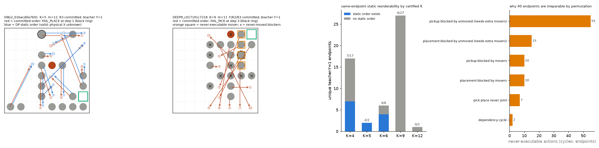

# P5A — Static same-endpoint order audit of P4 Y-positive endpoints

Branch `naren/kgt3-exec-composition`, created from `naren/kgt3-recursive` @ `c892af3d95`. This is an evaluator-only diagnostic:
- no teacher queries, no training, no new data;
- release_v2 TEST was not opened;
- no historical prediction, seal, metric or dataset was modified.

## Gate decision: **A-ORDER-RECOVERABLE**

- **13 of the 53** unique teacher-verified Y=1 P4 endpoints (6 of 17 roots) have a valid **static** ordering of exactly the same object→destination moves.
- Of these, **4 endpoints in 3 roots** were committed P4 plans whose committed order was statically invalid.

The result is **static only**. It says nothing yet about physical execution:
- No reordered endpoint has a verified physical X.
- Four static-valid orders had already been tested by the P4 teacher. All four came back `UNKNOWN_PLANNER` (no plan within budget), not certified negative.

The other **40** endpoints have **no** valid permutation under the abstraction. They include every K9 and K12 endpoint: 0 of 28.

## What was audited

**Sources.** Inputs are the sealed P4 R2, R3 and F plans:
- the committed plans, plus the full recorded candidate pools (8,360 scored candidates);
- seal hashes checked against both the run `SEAL.json` and the committed `reports/SEAL_P4_*.json`.

**Deduplication.** Endpoints are deduplicated by `(root, sorted (object, destination) assignment)`. This yielded 4,983 distinct endpoints. The Y evidence was kept separate and never promoted:

| Y evidence | Unique endpoints | Roots | Static order exists |
|---|---|---|---|
| **Teacher Y=1 (VERIFIED), primary** | **53** | 17 | **13** (6 roots) |
| – committed by ≥1 arm | 19 | 13 | 4 (3 roots) |
| – pool-only, teacher-evaluated post hoc | 34 | 16 | 9 (5 roots) |
| Static endpoint positive, teacher unverified or unknown (secondary, not used for the gate) | 2,127 | 25 | 473 (12 roots) |
| Excluded: teacher Y=0 certified or verified | 76 | – | – |
| Excluded: no Y-positive evidence | 2,727 | – | – |

For each endpoint the report also records:
- the frozen-model `hY` (`hY_frozen_max`), as a diagnostic only;
- consistency of teacher Y across the different orders of the same endpoint. There were 0 inconsistencies.
- grammar legality, checked with `data.check_sequence`. There were 0 illegal endpoints and 0 unresolved.

## Checker and its scope

**Abstraction.** The checker uses the construction-time grasp-screen kill tables `MINK_STATIC_V2` (`MINK_TABLE_original.json`), read through `dev_eval.Static`.

**Moves.** A move (o→d) is live in arrangement *c* iff both hold, with the other objects at their current cells:
- the pick of o at its current cell is live;
- the place at d is live.

**DP.** The subset DP has one state per set of completed moves, at most 2^12 = 4,096 states.
- An edge M→M∪{k} exists iff move k is live in the arrangement after M.
- An order exists iff the full set is reachable AND `Static.feasible(target, goal)` holds in the final arrangement.
- Every edge of every reachable state is tested. Dead-end states give frontier reason counts.
- The witness order is reconstructed deterministically: breadth-first, moves in ascending index.

**Failure attribution** (`profile`). For each move, all 2^(m-1) states of the other movers are enumerated.
- A move that is never live is a hard reason the endpoint is irreparable by permutation:
  - `PICK_NEVER`, `PLACE_NEVER`, or `JOINT_NEVER` (pick and place are each live in some state, but never together);
  - "structural" means the move is still dead with every other mover deleted;
  - `cause` = whether the move becomes live once every never-moved object except the target is deleted.
- If every move is live in some state but the full set is unreachable, the reason is `ORDER_CONFLICT` (a dependency cycle).

**Not a robot-motion proof.** The checker ignores carried robot state, swept volumes, the terminal connector to `q_ref`, and the teacher's search budget. "No static order" is a statement under this abstraction only; it is not a physical-impossibility certificate.

## Validation

- **Brute force on real tables.**
  - In the audit run, all 102 endpoints with m≤6 agree with brute-force permutation. So do 6,234 random real-table sub-assignments of size 2–6 (144 of them in the teacher group).
  - In the tests, 150 random legal real-table assignments (25 DEV roots × m=1..6) agree.
- **Private witness control** (evaluator only; booleans only, no sequence written).
  - All **25/25** certified DEV witnesses are static-valid in their own order, and the DP finds an order for each.
  - The witnesses are teacher x=1 tries from `CERTIFIED_MIN_K` construction records (`dev_build.py`); they were not re-run.
  - Witness/static parity therefore holds.
- **Static vs teacher soundness**, on the 58 already teacher-tested source orders in the audited set. The teacher **never passed a step that the static checker calls dead** (0 cases):
  - teacher failed at the same relocation as the static check: 23;
  - teacher failed earlier (a physical gap the static check does not see): 30;
  - order static-valid but teacher X failed: 5, all `UNKNOWN_PLANNER`.
- **Tests:** `tests/test_p5_order_audit.py`, **19/19 pass**. They cover:
  - DP vs brute force for m=1..6 (300 synthetic cases each, both outcomes present at every m);
  - order swap, unavoidable cycle, pickup-only blockage (by never-moved objects, by movers, by the target), placement-only blockage, joint-never, final target;
  - the all-legal control (exactly 2^m nodes and m·2^(m-1) tests), deterministic reconstruction, grammar legality;
  - the rule that hY is never promoted to Y, and that public modules never import the audit;
  - the real-table brute-force check and the private witness control.
- **Historical tests and K≤3 parity.**
  - No existing file was modified. `git diff c892af3d95 --stat` shows only additions.
  - `tests/test_p1_p2.py` passes 22/22.
  - `tests/test_p4_mock.py` output is **identical** to the committed `GATE_B_MOCK.json`, including the documented K12.R3 mock failure.
  - P0 K≤3 parity is preserved because data, models and the planners are byte-unchanged.

## Results for the 53 teacher-Y=1 endpoints

**By certified K (endpoints / roots):**

| K | Endpoints | Static order exists | Roots | Roots with an order |
|---|---|---|---|---|
| 4 | 17 | 7 | 5 | 3 |
| 5 | 2 | 2 | 2 | 2 |
| 6 | 6 | 4 | 2 | 1 |
| 9 | 27 | **0** | 7 | 0 |
| 12 | 1 | **0** | 1 | 0 |

**Recoverable endpoints** (static order exists, physical X unknown):

| Root | K | m | Source | Original order |
|---|---|---|---|---|
| ENG2_01bacd0a7b91 | 5 | 12 | R3 committed | FAIL_PLACE at step 1; teacher X `CERTIFIED_INFEASIBLE` at relocation 0 |
| ENG2_52b2736b5a89 | 6 | 12 | R2/R3 committed | FAIL_PLACE at step 9; teacher `UNKNOWN_PLANNER` at relocation 2 |
| ENG2_52b2736b5a89 | 6 | 12 | F committed | FAIL_PLACE at step 5 |
| ENG2_52b2736b5a89 | 6 | 9, 9 | pools | – |
| ENG2_e3c632c779c0 | 4 | 10 | R3 committed | FAIL_PLACE at step 2; teacher `CERTIFIED_INFEASIBLE` at relocation 1 |
| ENG2_e3c632c779c0 | 4 | 9, 11 | pools | – |
| ENG2_b629e01dc6e7 | 4 | 6, 9, 10 | pools | Pools already held static-valid orders; teacher `UNKNOWN_PLANNER` |
| ENG2_fdf500024486 | 4 | 12 | pool | – |
| ENG_8f3cfc3f84b9 | 5 | 12 | pool | – |

**Why the 40 irreparable endpoints fail.** Each endpoint can carry several codes. Counts are of moves that are never live in any state:

| Category | Count | Kind |
|---|---|---|
| **Pickup blocked by never-moved objects** | **55** | pickup blockage |
| Placement blocked by never-moved objects | 15 | placement blockage |
| Pickup blocked by other movers (at their source and at their destination) | 10 | destination-induced |
| Placement blocked by other movers | 10 | destination-induced |
| Pick and place never live together | 7 | dependency |
| Dependency cycle (endpoints) | 2 | dependency |
| Final target dead | 0 | – |

- None of the 70 "never-moved" blockages is caused by the target or the base. Each move becomes live once the non-target clutter is deleted, so the plan needed **additional enabling movers**.
- 29 of the 40 endpoints contain at least one pickup blocked by never-moved objects. A different permutation or different destinations alone cannot fix these: the object set must grow. 22 of the 40 are already at the 12-relocation cap.
- The other 11 have only destination-type causes (placement blockage, mover-induced blockage, or a cycle), which destination repair could address.
- Frontier dead-end reasons, summed over the irreparable endpoints: pick 587, place 491, both 198.

**Ranking diagnostic** (descriptive only; no labels fed back):
- 530 endpoints had ≥2 distinct orders in a P4 pool.
- Only 2 of them had any static-valid pool order, and the lowest-energy order was static-valid in only 1.
- So the frozen energy is essentially blind to order: P4 rarely generated the valid order in the first place.

**Historical outcomes that were misclassified.** P4 labelled the failure **"GENERATION (no statically complete candidate in pool)"** for arms whose own pool in fact held a teacher-Y=1 endpoint with a valid static permutation. For these the failure was **order composition, not endpoint generation**:

| Root | Arms |
|---|---|
| ENG2_01bacd0a7b91 | R3 |
| ENG2_52b2736b5a89 | R2, R3, F |
| ENG2_fdf500024486 | R3 |
| ENG_8f3cfc3f84b9 | R2, R3 |

ENG2_e3c632c779c0 (R3) and ENG2_b629e01dc6e7 were already labelled RANKING/STATIC.

- For all K9 and K12 roots, the "generation" label stands, and P5A sharpens it: those endpoints are statically **irreparable by permutation**, mostly because enabling movers are missing.



The figure uses real DEV geometry only. Panels (a) and (b) are committed endpoints, (c) shows counts by K, (d) shows the causes:
- (a) A recoverable endpoint: committed order in red, which fails at step 1; DP static order in blue.
- (b) A K9 endpoint committed by all three arms: never-executable movers are boxed in orange, their never-moved blockers marked with ×.

## Answers

1. **Unique Y-positive endpoints:** 53 teacher-verified (19 committed + 34 pool-only), in 17 roots. A further 2,127 are static-endpoint-only and unverified (not used for the gate).
2. **Statically reorderable vs irreparable:** 13 reorderable (6 roots, all K4–K6) and 40 irreparable by permutation (including every K9 and K12 endpoint).
3. **Failure sources:**
   - mainly pickup blockage by never-moved clutter (missing enabling movers): 55 moves;
   - then placement blockage by never-moved objects: 15;
   - destination-induced mover blockage: 20;
   - joint or dependency: 9;
   - final target: 0.
4. **P5B or P7?** The evidence supports **both, on disjoint populations**:
   - P5B, bounded physical order contrast on the 13 reorderable K4–K6 endpoints, to see whether static validity turns into physical X;
   - P7-style repair for K9 and K12.
   P7 as written (destination repair) addresses only the 11 destination-type endpoints. The 29 pickup-blocked-by-unmoved endpoints need **object-set expansion** (enabling movers), which is a recursive-insertion question, not a parking question.
5. **What remains unknown about articulated execution:**
   - whether any static-valid order admits a carried-state robot trajectory (static checking ignores arm configuration, swept volumes and the terminal connector to `q_ref`);
   - the teacher fails *earlier* than the static check in 30/58 tested orders;
   - the 5 static-valid orders tested so far were teacher `UNKNOWN_PLANNER`, which is a budget outcome, not a certificate.
6. **Next stage justified:** **P5B**, bounded, after explicit authorization, on the 13 A-ORDER-RECOVERABLE endpoints (6 roots, ≤2 per root), with the P5B budget caps from plan2. P7 should follow for K9/K12, with its scope extended to enabling-mover insertion.

**Nothing beyond P5A was started.**

## Reproduce

```
G1=.../scaling2d_k12; R=/home/naren/kgt3_runs
python p5_order_audit.py $R/p4 $R/p4eval/verify.jsonl $R/dev/dev_public/dev_public.jsonl $R/dev/dev_private $G1/G1 $G1/teacher_long.py reports/p5 --workers 4
python -m pytest tests/test_p5_order_audit.py -q
```

The run takes 29 s wall time with 4 CPU workers and makes 0 teacher queries; there is no GPU work. Hashes are in `P5A_PROVENANCE.json`:
- predictions, verify, DEV public/private, MINK table (`eb0419757a29…`), QCLEAR, teacher_long (`af0e9fd4ac94…`), p4_config, code.

## Files

- **Added:** `p5_order_audit.py` (evaluator only; reuses `dev_eval.Static`, `data.check_sequence`, `p4_viz.grid`), `tests/test_p5_order_audit.py`, `reports/p5/*`.
- **Modified:** none.
- **Import boundary:** public `data`, `models`, `planner*`, `run_p4` ↛ `p5_order_audit`, `dev_eval`, kill tables, `dev_private` (this is a tested invariant). The audit reads private witnesses only in `witness_control` and writes only booleans.
- **Not committed:** `dev_private/` (witnesses), the `verify.jsonl` raw teacher rows, and the kill tables.
- **Size:** `p5_order_audit.py` is 426 lines, above the ~300-line guideline. Roughly 70 of those lines are the figure and 40 the summary bookkeeping; the checker core (DP, brute force, profile, classify) is about 110 lines.
