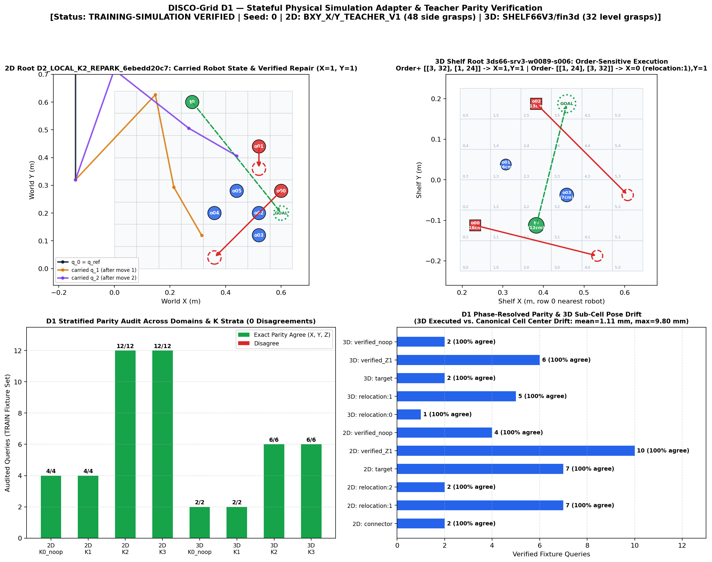

# D1 — Stateful Physical Simulation Adapter and Parity Verification Report

**Milestone:** D1 (`DISCO_plan.md` Sections 4.1–4.4 & 14)  
**Baseline Designation:** **DISCO-Grid (adapted)**  
**Date:** 16 November 2026  
**Status:** **PASSED**

---

## 1. Hypothesis and Stage Gate

- **Objective:** Build a unified 2D/3D stateful physical simulation adapter (`RepairEnv` in `baselines/disco_grid/env.py`) supporting `reset`, `observe`, `legal_actions`, `transition`, `terminal_query`, and `clone_or_serialize`/`restore`, so that MCTS can execute single physical relocations with carried robot/physics state (`q_t`, gripper state, object poses, per-sequence planner budgets) and evaluate `STOP` via the terminal `q_ref` connector plus canonical endpoint `Y`.
- **Stage Gate (`DISCO_plan.md` §4.4 & §14):** Zero unexplained contradictory physical decisions (`X`, `Y`, `Z`, and failure phase) on a deterministic stratified `TRAIN` fixture set across `2D` and `3D`, `K0`, `K1`, `K2`, `K3`, order-sensitive permutation pairs, and `OMISSION_YNEG` records; verified state isolation across MCTS branches; no intermediate `q_ref` reset or teleportation masquerading as physical execution.

---

## 2. Implementation Summary and Diagnosed/Repaired State Leak

### 2.1 `RepairEnv` Architecture (`baselines/disco_grid/env.py`)
1. **2D Backend (`_Backend2D`):**
   - Wraps `p16_motion.DetPhysics` and `bxy_teacher` (`BXY_X_TEACHER_V1` / `BXY_Y_TEACHER_V1`, teacher hash `sha256:4930754123e6905619b5e34ae450c8e78599643460c03e6cd0ce11393ea0a4fe`).
   - Dynamically synchronizes per-root `geometry_impl` (`fastgeom.install()` for `fastgeom1` roots vs. `fastgeom.uninstall()` for `original` roots) so mixed root cohorts run in a single process with exact parity.
   - `transition(state, action)` runs `phys.edges(cells_dict, q_now, o_id, dest_cell)` and `p16_common.best_edge(outs)` from the carried `(cells_dict, q_now, used, stats)` state without resetting `q` to `q_ref` or invoking the terminal connector.
   - `terminal_query(state)` invokes the free-gripper connector `phys._transit` from `q_now` to `q_ref` in the `("start", False)` world, certifies the full prefix + connector trajectory with `bxy_teacher.replay_x`, and evaluates `bxy_teacher.y_query` from `q_ref` in the canonical endpoint scene (cached by exact `ykey`).
2. **3D Backend (`_Backend3D`):**
   - Wraps `fin3d`, `bwlphys` (`CONNECTOR_TO_QREADY_V1`), `bd_shelf`, and `shelf_scene.XArm7TableEnv` (`SHELF66V3`, MuJoCo `3.16.0`, `RRT_ITERS = 5000`).
   - `transition(state, action)` restores the exact parent MuJoCo state (`time`, `qpos`, `qvel`, `act`, `qacc_warmstart`, `qacc`, `ctrl`, `q_cmd`, `held`, `_focus_i`, `table_z`, `_ikc`, and `objects[i]["pos"]` + column geoms), calls `bd_3dt.query(e, o_id, dest_rc)` and `e.run_plan(p)`, and checks destination cell, upright $|z_{\text{err}}| \le 0.01$ m, and zero unintended cell changes.
   - `terminal_query(state)` records the sub-cell pose drift between executed MuJoCo object positions and nominal cell centres (`endpoint_pose_drift_m`), executes `bwlphys.connector(e, S, expected)` to `q_ready = q_ref`, and evaluates `fin3d.run_y(rec, canon_rc)` on the canonical endpoint scene settled at `q_ready`.
3. **Diagnostic Finding & Repair during D1 Parity Testing:**
   - On initial 3D parity testing, root `3ds66-srv3-w0089-s006` (`seq = [(1, 24), (3, 32)]`) disagreed when run immediately after its reverse order `[(3, 32), (1, 24)]` on the same cached `ShelfEnv` instance, even though it agreed when run in a fresh process.
   - **Root cause:** `XArm7TableEnv._ikc` (`shelf_scene.py:557, 915, 937`) caches per-pose IK solutions on the `ShelfEnv` instance, and `XArm7TableEnv.ik` (`shelf_scene.py:868`) copies `self.data.qpos` into `self.ik_data.qpos` during DLS iterations. Reusing a `ShelfEnv` instance without clearing `_ikc` on `reset` (and snapshotting/restoring `_ikc` across branches) leaked cached IK branch ordering across trajectories.
   - **Fix:** Added explicit `e._ikc.clear()` on `reset()` and full `_ikc` snapshot/restoration in `_snap_env`/`_restore_env`. Re-testing `3ds66-srv3-w0089-s006` immediately restored 100% parity across all orders (`[(3, 32), (1, 24)] -> X=1, Y=1`; `[(1, 24), (3, 32)] -> X=0 [relocation:1], Y=1`).

---

## 3. Stratified Parity Audit Results (`reports/d1_parity_audit.json`)

Audited on `gvlab` (`Xenon Gold 5317`, 8 CPU workers for 3D) over deterministic stratified `TRAIN` fixtures (`48` total complete-sequence queries across `24` roots):

| Domain | Roots Audited | `n_checked` | `n_decided` | `n_agree` | `n_disagree` | `n_unresolved` | Order-Sensitive Endpoint `Y` Invariance |
|:--|:--:|--:|--:|--:|--:|--:|:--|
| **2D** | 16 | 32 | 32 | **32 (100%)** | **0** | 0 | **8 / 8 pairs invariant (100%)** |
| **3D** | 8 | 16 | 16 | **16 (100%)** | **0** | 0 | **4 / 4 pairs invariant (100%)** |
| **Total** | **24** | **48** | **48** | **48 (100%)** | **0** | **0** | **12 / 12 pairs invariant (100%)** |

### Breakdown by Stratum and Failure Phase

| Domain | Stratum Breakdown (`agree / checked`) | Phase Breakdown (`agree / checked`) | 3D Executed vs. Canonical Cell Drift |
|:--|:--|:--|:--|
| **2D** | `K0_noop`: 4/4, `K1`: 4/4, `K2`: 12/12, `K3`: 12/12 | `verified_noop`: 4/4, `verified_Z1`: 10/10, `relocation:1`: 7/7, `relocation:2`: 2/2, `connector`: 2/2, `target` (`X=1,Y=0`): 7/7 | `0.00 mm` (kinematic lattice center placement) |
| **3D** | `K0_noop`: 2/2, `K1`: 2/2, `K2`: 6/6, `K3`: 6/6 | `verified_noop`: 2/2, `verified_Z1`: 6/6, `relocation:0`: 1/1, `relocation:1`: 5/5, `target` (`X=1,Y=0`): 2/2 | Mean: **`1.11 mm`** (`0.001109 m`) Max: **`9.80 mm`** (`0.009803 m`) |

---

## 4. Visual Diagnostics

- **Top-Left:** 2D root `2d-plus2d-srv-w0250-s002` showing carried planar 3R arm joint configurations ($q_0 = q_{\text{ref}} \to q_1 \to q_2$) across a verified K2 repair (`X=1, Y=1`).
- **Top-Right:** 3D shelf root `3ds66-srv-w0045-s023` showing order-sensitive execution where `[(1, 12), (2, 11)]` succeeds (`X=1, Y=1`) while `[(2, 11), (1, 12)]` fails at `relocation:1` (`X=0, Y=1`).
- **Bottom-Left & Bottom-Right:** Stratified and phase-resolved parity counts (`48/48` agreement, `0` disagreements) and 3D sub-cell executed pose drift statistics.

---

## 5. Gate Decision

All 3 test suites in `baselines/disco_grid/tests/test_d1_parity.py` (`test_d1_grammar_and_state_isolation_2d`, `test_d1_grammar_and_state_isolation_3d`, `test_d1_stratified_parity_2d_and_3d`) passed on `gvlab` (`809.12 s`).

**Gate Decision:** **PASS D1** — Proceed immediately to **D2 (DISCO Policy P0 Pretraining on Q2 and Physical Proposal Validation)**.
