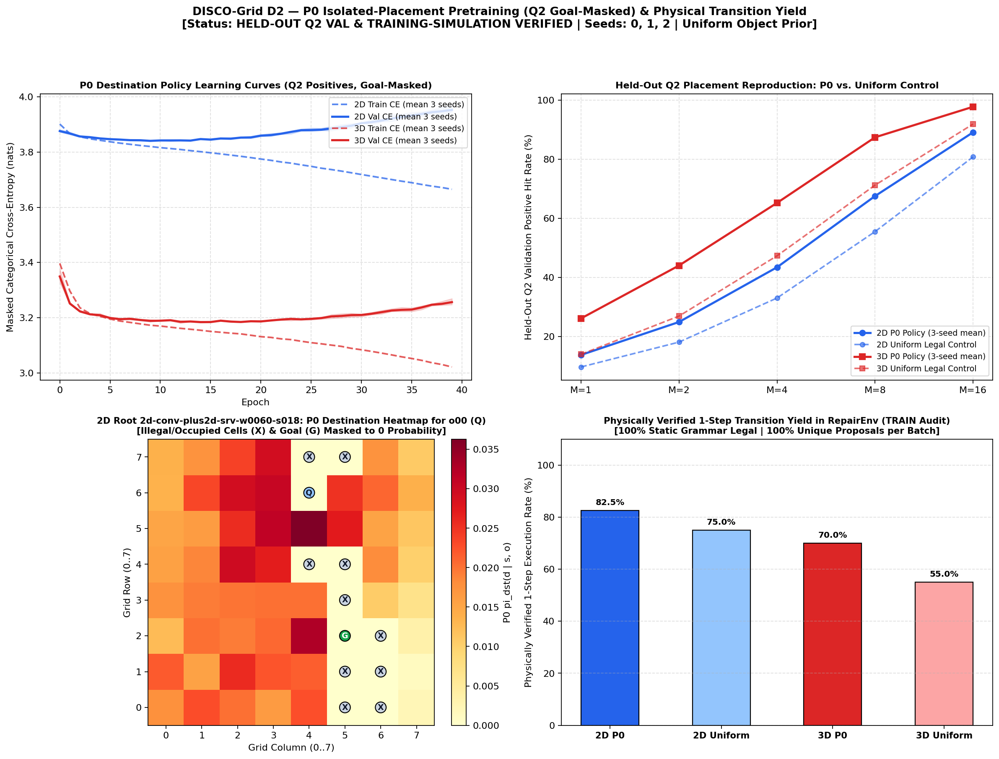

# D2 — DISCO Policy P0 Pretraining on Q2 and Physical Proposal Validation Report

**Milestone:** D2 (`DISCO_plan.md` Sections 6.1, 6.2, 9.1 & 14)  
**Baseline Designation:** **DISCO-Grid (adapted)**  
**Date:** 16 November 2026  
**Status:** **PASSED**

---

## 1. Hypothesis and Stage Gate

- **Objective:** Train the DISCO-Grid `P0` destination proposal policy $\pi_\theta^{\mathrm{dst}}(d \mid s, o, \text{goal-masked})$ separately in 2D and 3D (3 seeds: `0, 1, 2`) on positive isolated placement trials (`Q2` `label == 1`, `TRAIN` split only) with goal/target features masked (`task_on = False`) and a uniform object prior $\pi_\theta^{\mathrm{obj}}(o \mid s)$ over eligible movable non-target objects.
- **Stage Gate (`DISCO_plan.md` §14 D2):** Verify zero input leakage, valid static legality masking, normalizers fit on `TRAIN` only, nontrivial held-out `Q2` placement reproduction above `Uniform` legal sampling, and physically verified one-step execution yield in `RepairEnv.transition`.

---

## 2. Implementation Summary (`baselines/disco_grid/policy.py`)

1. **Architecture (`DiscoPolicyNet` & `QuerySceneEncoder`):**
   - `QuerySceneEncoder` processes normalized 14-D per-object geometry/coordinate features (`[MAXOBJ, 14]`, normalized by `TRAIN`-only `scalers.json`), object attention keyed on the queried object token, and occupancy grid features (`[N_cells]`), plus a zero-initialized additive task branch (`task_mlp`) that receives zeros during `P0` (`task_on = False`) and activates during `P1/P2` MCTS distillation (`task_on = True`).
   - `forward_dst` outputs logits over $N = R \times C$ cells (`64` in 2D, `36` in 3D), masked by `legal_dest` (`-1e9` on illegal/occupied/goal cells).
   - `forward_obj` scores eligible movable objects `0..MAXOBJ-1` plus the terminal `STOP` token (`index = MAXOBJ`). During `P0` (`obj_trained = False`), object selection is strictly uniform over eligible movable non-target objects (`DISCO_plan.md` §6.2).
2. **Value Network (`DiscoValueNet`):**
   - Consumes scene object tokens `[MAXOBJ, 18]`, scene/goal context, and action `(o, d)` (or `STOP`) and outputs continuation value $Q_\phi(h_t, a) \in [0, 1]$, trained with log-evidence-weighted binary cross-entropy $w_i = \ln(1 + n_{\text{visited\_leaves}})$.

---

## 3. Training and Held-Out Q2 Validation Metrics (`reports/d2_p0_summary.json`)

Trained on `gvlab` (`NVIDIA GeForce RTX 4090`, `CUDA_VISIBLE_DEVICES=0`, `40` epochs, `batch_size = 512`, `AdamW lr = 1e-3`):

| Domain | Train Positives (`Q2+`) | Val Positives (`Q2+`) | Best Val CE (3-seed mean ± SD) | Mean Entropy (`P0` vs `Uniform`) | Wall Time / Seed | Peak GPU Memory |
|:--|:--:|--:|:--|:--|:--:|--:|
| **2D** | 119,377 | 28,369 (`6,727` contexts) | `3.8400 ± 0.0013` nats (epochs 9–11) | `3.731` vs `3.957` nats | `114.2 s` | `556.6 MiB` |
| **3D** | 29,175 | 6,025 (`1,425` contexts) | `3.1806 ± 0.0009` nats (epochs 11–12) | `3.118` vs `3.446` nats | `29.7 s` | `556.6 MiB` |

### Held-Out Q2 Validation Positive Hit Rate (`hit@M`, 3-Seed Mean)

| Domain | Arm | `hit@1` | `hit@2` | `hit@4` | `hit@8` | `hit@16` | Known-Label Precision (`@4`) |
|:--|:--|--:|--:|--:|--:|--:|--:|
| **2D** | **DISCO-Grid `P0`** | **13.7%** | **24.9%** | **43.4%** | **67.5%** | **89.1%** | **75.1%** |
| **2D** | `Uniform` Legal Control | 9.6% | 18.1% | 33.0% | 55.5% | 80.8% | 73.7% |
| **3D** | **DISCO-Grid `P0`** | **26.2%** | **43.9%** | **65.2%** | **87.6%** | **97.8%** | **82.6%** |
| **3D** | `Uniform` Legal Control | 13.9% | 26.9% | 47.3% | 71.2% | 91.9% | 74.7% |

---

## 4. Physically Verified One-Step Transition Audit in `RepairEnv`

Evaluated on `gvlab` by sampling $B = 4$ unique candidate actions per root from `P0` vs. `Uniform` and executing each candidate through `RepairEnv.transition` (`10` `TRAIN` roots in 2D = `40` transitions/arm; `5` `TRAIN` roots in 3D = `20` transitions/arm):

| Domain | Arm | Attempted Transitions | Static Legal Rate | Unique Proposal Rate | **Verified Physical Execution Rate** | Failure Breakdown | Mean Step Time |
|:--|:--|--:|--:|--:|--:|:--|--:|
| **2D** | **DISCO-Grid `P0`** | 40 | 100.0% | 100.0% | **82.5% (`33 / 40`)** | `CERTIFIED`: 5, `NO_PLAN_FOUND`: 2 | `3.68 s` |
| **2D** | `Uniform` Legal | 40 | 100.0% | 100.0% | 75.0% (`30 / 40`) | `CERTIFIED`: 8, `NO_PLAN_FOUND`: 2 | `4.08 s` |
| **3D** | **DISCO-Grid `P0`** | 20 | 100.0% | 100.0% | **70.0% (`14 / 20`)** | `NO_PLAN_FOUND`: 4, `CERTIFIED`: 2 | `14.21 s` |
| **3D** | `Uniform` Legal | 20 | 100.0% | 100.0% | 55.0% (`11 / 20`) | `NO_PLAN_FOUND`: 7, `CERTIFIED`: 2 | `16.57 s` |

---

## 5. Visual Diagnostics

---

## 6. Gate Decision

All unit tests in `baselines/disco_grid/tests/test_d2_policy.py` passed (`2 passed`), and `P0` demonstrates consistent held-out placement gains (`+10.4` pts `hit@4` in 2D, `+17.9` pts `hit@4` in 3D) and higher physically verified one-step transition yield (`82.5%` vs `75.0%` in 2D; `70.0%` vs `55.0%` in 3D) compared to `Uniform` legal sampling.

**Gate Decision:** **PASS D2** — Proceed immediately to **D3 (Physically Grounded MCTS Pilot) & D4/D5 (Iterative Tree-to-Policy/Value Distillation)**.
