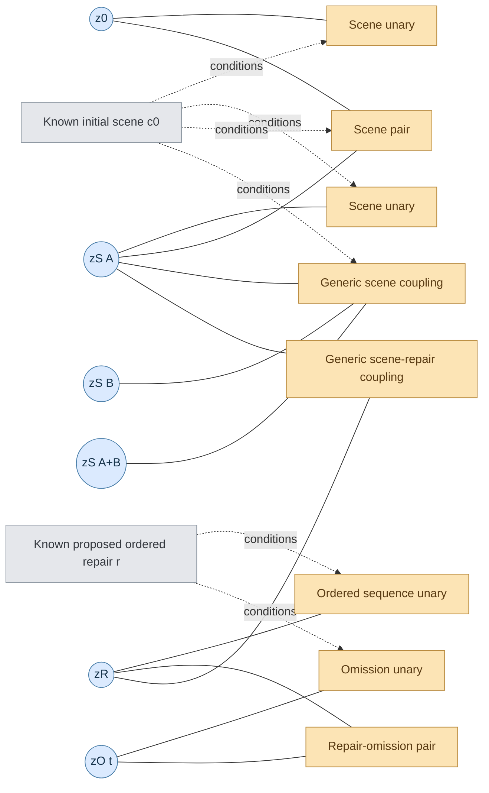

> **STATUS — PROPOSED SCIENTIFIC REVISION, NOT IMPLEMENTED.** This document supersedes **Methodology v1.7** for *future*, separately authorized A/B/C research. Its paired operational document is **Implementation Guide v2.0**. It is anchored in completed P4–P8 reports and the reported GitHub revision `f9a6de0` (`Narendhiranv04/latent-causal-tamp`). **P8 is not retroactively rewritten**: its code, teacher policy, checkpoints, data, masks, evaluations and results retain their original meaning. The simplified likelihood and any model refactor below are **proposals requiring implementation, numerical verification, and experiments**; they are not claims of accomplished performance. Preserve all archived evidence.

> **Main scientific choice.** Retain the originally agreed three-arm comparison—**A: LOCAL-SEQUENCE; B: JOINT-CAUSAL-EBM; C: HYBRID-JOINT**—and the five interpretable factor *families*. Favor a **primary exact, masked joint Boltzmann likelihood** for B/C rather than a long list of redundant auxiliary objectives, with only mathematically necessary local validity and travel-cost supervision. No guarantee that all factors will prove independently useful, that coupling will help, or that learned methods will beat geometry plus motion planning.

# 1. The objective and what has—and has not—been shown

Given a single initial observation of a fixed-base 3R planar robot and objects, choose an **ordered**, move-once sequence of supported obstacle relocations, including destinations, that permits a specified target manipulation followed by **SAFE_RETREAT**. Prefer fewest distinct moved objects, then economical robot travel and object displacement, among plausibly executable plans. The independent full-motion planner—not the energy model—generates and verifies continuous joint/gripper/object trajectories.

For a candidate repair

\[
r=((i_1,k_1),\ldots,(i_m,k_m)),\quad 0\le m\le b\le4,\quad i_t\ne i_u\ (t\ne u),
\]

the order, destination IDs and immutable start state are part of the query. The original task uses \(r=\varnothing\). Object end positions are derived from the sequence; nonmoved objects stay, even during an omission. The same final object arrangement can be reached by different move orders with different physical feasibility. Every relocation comprises approach, grasp, attached transport, supported placement, release and safe retreat, with achieved robot/object state carried into the next action. Only one specified target task is active; all others remain obstacles.

## 1.1 P8 evidence baseline (historical, not a new claim)

Completed P8 reported **323/323 tests passing** and 72 independent one-shot episodes on 12 new, *same-constructor-family* roots. Success with goal and safe retreat: geometry + full motion (**G+M**) **9/12**; B-full **8/12**; B-structured **7/12**; uniform **7/12**; A **6/12**; supervised factorized SF **4/12**. No learned arm executed in P8d won any scene that G+M lost; **C-full and B-quadratic were only evaluated offline**, not in P8d execution. G+M was shortest among known verified repairs on 7/7 evaluable successes; no globally optimal correction was proven. Its geometric screens share a family with the scene constructors. P8c's 36-root data contained 175 VERIFIED, 142 CERTIFIED, 34 BUDGET_INFEASIBLE, 13 UNKNOWN and 86 NOT_RUN query outcomes; the last two classes are not negatives. P8c had no decided same-endpoint order contrast; fresh \(\kappa\) evaluation used only 2/3/2 roots for -1/0/+1, and +1 relied on operational place-side labels. P8b found poor 4,000-step mixing on a 356-state pool, while exhaustive scoring of that pool cost under three CPU seconds.

**Interpretation:** component implementations and intervention-conditioned predictions exist, but joint coupling, learned order transfer, execution advantage and global minimum corrections are **not established**. No additional neural architecture is justified just by P8's good feasibility AUROC. Source: `responses-phases/0024...0027...md`, `responses-phases/P8_DECISION.md`, commit `f9a6de0`.

## 1.2 Research hypotheses

- **H-A:** Local endpoint energies plus a GRU over action-conditioned *prefix* features generalize to held-out physical repair feasibility and order contrasts.
- **H-B:** An explicit joint outcome distribution with named intervention, omission and cross-outcome factors predicts *previously unseen* interaction patterns and improves the selection of feasible low-displacement repairs beyond an equally supervised independent-outcome model and G+M.
- **H-C:** Replacing B's predecessor/prefix order function with an order-sensitive GRU improves genuine higher-order order prediction with the same joint outcome graph.
- **H-efficiency:** A learned factor score improves one-shot success, restricted-catalogue minimality or verifier CPU at matched total compute compared with a strong G+M baseline.

All hypotheses may be rejected. A factor-graph edge is a **statistical interaction, not a learned causal arrow**. We do not claim identifiable latent causal variables, discovery of an unknown causal DAG, hardware capability or global TAMP optimality.

# 2. Physical and information contracts (retained)

- **Robot/world:** exact repository-validated 2D 3R articulated arm with finite-width links and housings, base, palm/fingers, attached carried object, joint limits, gripper profiles, collision/contact/clearance checks and the tested **48-candidate grasp family**. Default historical resting domain: 8×8 grid, 0.08 m pitch, identical 0.024 m radius discs and one 0.005 m clearance margin. These are *dataset defaults*, not assumptions of continuous robot motion.
- **Learner-visible before action:** original RGB-D and supplied masks, primitive object poses/shapes/supports, original robot \(q_0\) and FK, target/goal, candidate high-level sequence and legal destination geometry. Historical frozen mask-pooled DINOv2 appearance features may be used; evaluate a supplied-geometry-only branch. Ideal proposed prefix positions are computable from the initial scene and repair, but are **not witnessed future robot states**.
- **Excluded from learner input:** ground-truth outcome bits, future gripper/joint/object trajectories, teacher planner branch/seed/timeout/hidden verdict, privileged target swept volumes, root/family IDs and post-intervention rendered teacher observations. Historical P8 source uses DINOv2 features **and** supplied symbolic geometry; it is not purely symbolic and it has not demonstrated an independent appearance benefit.
- **Counterfactual scene edit:** apply specified object pose changes instantaneously only for a **target-only diagnostic**; robot \(q_0\), gripper, attachment, task, all nonedited objects and original appearance anchor remain unchanged. It does **not** witness physical relocation.
- **Teacher/execution:** independently search grasp/path realizations *within* the fixed high-level order, preserve achieved states, check target and safe retreat. A positive requires complete witness. Sound negative certificates apply only within their proven scope; an exhausted finite physical search is not global infeasibility.
- **Status:** VERIFIED, CERTIFIED with scope, BUDGET_INFEASIBLE relative to a pinned policy, UNKNOWN and NOT_RUN are five distinct values. The operational teacher introduced in P4 may label budget negatives for that explicit policy, **not** impossibility. UNKNOWN/NOT_RUN are missing/censored—not binary zeros. Record placement/motion/target and simulation/hardware scopes separately.
- **One-shot boundary:** a ranked candidate is relocation-planned before commitment. Once relocation execution is committed and the target attempted, no feedback-based second candidate; no target-oracle labels used to choose the rank.

# 3. The factor graph: what are the actual variable nodes?

## 3.1 Conditioned quantities versus stochastic variables

For every initial scene/context \(c_0\), proposed repair \(r\), and **predeclared** root-level diagnostic catalogue \(Q_S\), use typed binary *outcome* variables:

\[
z=(z_0,\{z^S_I\}_{I\in Q_S},z_R,\{z^O_t\}_{t\in Q_O(r)}).
\]

| Circle / variable | One means | Evaluated by |
|:--|:--|:--|
| \(z_0\) | Original target task succeeds from fixed initial robot state | Target-only teacher from \(S_0\) |
| \(z^S_I\) | Target task succeeds after eligible **hypothetical fixed-robot pose edit** \(I\) | Target-only teacher on \(S_0^I\) |
| \(z_R\) | Entire **ordered physical repair followed by the target and safe retreat** succeeds | Full relocation + target teacher |
| \(z^O_t\) | Entire **new ordered repair with action \(t\) omitted**, followed by target, succeeds | Independent full teacher on \(r\setminus t\) |

Each \(z\) is a **0/1 random variable**, not a floating-point probability and not a Boolean cause mask. The model assigns probabilities to *joint combinations* and obtains per-variable probabilities by **marginalization**. Known initial scene features and proposed action/destination/order are **conditioning inputs**, not inferred stochastic outcome nodes. With a finite repair catalogue, \(r\) may additionally become a categorical variable in a *separately defined repair-selection distribution*; it is **fixed context in the conditional outcome graph**.

**Conventional factor-graph notation applies:** circles are variable nodes, squares are factor instances \(\psi_f=\exp[-\phi_f/T]\), edges exist only when the factor depends on that variable. A **factor family** is a shared neural scoring function instantiated repeatedly across objects/interventions/omissions, not a single square connected to every bit. Independent repetitions use shared weights but distinct geometry inputs.

## 3.2 Plain-text / Mermaid factor-graph schema

This is a **simplified bipartite graph**, not a depiction of every actual factor edge: pair and optional higher-order coupling instantiate across applicable bits. The **static factor family lives on deterministic proposed endpoint configurations**, separately from the conditional binary \(z\) graph; it must not be claimed to affect \(P(z\mid r,c_0)\) merely by adding an \(r\)-only energy offset.

# 4. Five factor families: their distinct jobs and overlaps

Let \(x(r)\) be the complete final object configuration implied by \(r\), and let \(x_t(r)\) be its **ideal object-only prefix** state (unmoved objects present at their original positions). Every factor can depend on learned scene/robot/context features; only specified factors depend on particular binary variables.

## F1. Static endpoint and placement energy \(E_{\rm static}\)

\[
E_{\rm static}(r,c_0)=\sum_i U_\theta(x_i(r),c_0)+\sum_{i<j} V_\theta(x_i(r),x_j(r),c_0).
\]

- Unary potential: object-level workspace, support, allowable resting destination, target-state compatibility for the explicitly supervised local label.
- Pairwise potential: collisions/overlaps and compatibility of **simultaneous resting endpoints**.
- These are trainable logits converted to nonnegative penalties such as \(\operatorname{softplus}(-\ell)\). Pair potentials must be symmetric in swapped object-token order.
- Static validity does **not** imply target accessibility, graspability, movable swept path, correct order or global task feasibility. The original P8 local-static BCE is a sound and **required learning signal** if \(E_{\rm static}\) remains independent of \(z\).
- Static factors can use **known** analytic screens at inference, too. A sound certificate always overrides learned confidence at its exact scope; the learner must not claim to discover the certificate itself.

## F2. Ordered physical repair energy \(\phi_{\rm seq}\)

- Scores the event \(z_R\) conditioned on the **full proposed order**, its ideal prefix states, robot start \(q_0\), and object geometry.
- B: learned selected-action and predecessor/prefix interaction features (no GRU). C: replace B's sequence representation with a single GRU over ordered action/prefix tokens (never double count B order plus GRU without an explicit ablation). A: GRU-based standalone repair scorer.
- E.g., B blocks A's grasp until B is relocated: `A→B` may fail while `B→A` succeeds despite identical terminal placements. Labels come from **independent complete physical repair + target outcomes**, not a trivial permutation tag or a pose-only shortcut.
- The score predicts success probability; it does **not** output a continuous IK solution, grasp trajectory, future joint state or contact dynamics.

## F3. Fixed-robot scene-intervention energy \(\phi_{\rm scene}\)

- Each scene-edit outcome \(z^S_I\) has its own unary factor from the **edited hypothetical object poses** and the unchanged original robot state; \(z_0\) has a corresponding original-task unary.
- Explicit structured \(z_0\)–\(z^S_I\) factors model their compatibility; generic scene-block factors can additionally connect \(z^S_A,z^S_B,z^S_{A+B}\).
- Question: **Does the target become feasible in the edited scene if the obstacles could magically be at those positions?** Not: **Are those placements collision-free?** Three nonoverlapping poses can have target outcomes (0,0,1).
- This does not establish that the robot can *physically move* the obstacles into those poses: that is F2/\(z_R\)'s supervised physical question.

## F4. Ordered repair-omission energy \(\phi_{\rm omit}\)

- Independently rescore the **reconstructed ordered sequence** \(r\setminus t\) with all omitted objects remaining in place throughout all prefixes; produce a unary outcome score for \(z^O_t\).
- Explicit \(z_R\)–\(z^O_t\) structured pair potentials learn correlations between success of the complete repair and success of each omission.
- Measures **whether this action is necessary *for this particular repair***. It does not establish a universally necessary blocker across all possible repairs unless separately certified.
- **Not the move-count cost.** A 3-step proposal has \(m=3\) regardless of whether a removed step would still permit success. Move count is an exact decision cost outside feasibility modeling; omission is a **learned counterfactual outcome**.
- Omission potential is not automatically beneficial when no omission labels exist. Presence of the factor, its usefulness and identifiable effect require data and ablations.

## F5. Joint outcome-coupling energy \(\phi_{\rm couple}\)

- Model additional **within-scene**, scene-to-repair, repair-to-omission, and eligible higher-order statistical interactions *not represented by the explicitly structured scene and omission pairs*.
- For example, outcomes \((z^S_A,z^S_B,z^S_{A+B})=(0,0,1)\) represent a complementary pair of interventions. A joint potential can prefer this *combination* where appropriate, based on the scene context, rather than treating outcome probabilities as independent.
- **Causality caution:** dependent binary potential outcomes are not equivalent to a learned structural causal DAG. Complementarity can also be captured by sufficiently expressive independent edit-conditioned predictors; \(\kappa\) accuracy alone does not establish that coupling is needed.
- **Overlap caveat:** scene/omission unaries, structured pairs and generic coupling can explain overlapping signal. Explicit ablations must isolate `full`, `quadratic`, `structured`, and `none`, including capacity-matched controls. P8's coupling benefit for physical execution is **not supported**.

## 4.1 What is outside the five feasibility factor families?

| Quantity or module | How obtained | Why separate? |
|:--|:--|:--|
| Number of distinct moved objects \(m(r)\) | Exact count | Objective, not uncertainty; omission learning is not counting |
| Endpoint displacement \(C_d(r)=\sum\|p_{i,k}-p_{i,0}\|/L_W\) | Exact from known geometry | Cost of corrective action, not proof of feasibility |
| Normalized robot joint travel \(J(w)\) | First complete witnessed relocation path, with \(\hat J_\theta(r)\) learned separately | Real travel requires paths; the model predicts travel but never supplies a trajectory |
| Full robot IK/path/collision/attachment/target + SAFE_RETREAT | Frozen independent planning and verification backend | Only source of physical witnesses and sound scope-limited certificates |
| Finite catalogue and safety/geometry screens | Deterministic rules, predeclared | Candidate generation, hard admissibility, scope-limited verified constraints |
| Decision threshold/abstention/motion budget | Frozen by development validation and independent protocol | Decision policy, not the learned physical truth |

These do not become extra learned factor-graph circles automatically. If the model is extended to randomize repair \(r\), that is a **new categorical random variable over a declared finite catalogue**, not a continuous action generator.

# 5. Precisely specified Boltzmann model

## 5.1 Scene and repair outcome blocks: root consistency

Let \(z_S=(z_0,\{z^S_I\})\) be the *same* scene-level outcomes for all candidate repairs from one root, and \(z_Q=(z_R,\{z^O_t\})\) be repair-dependent outcomes. Preserve the P7/P8 **root-consistent exact normalized factorization**:

\[
\boxed{P_\theta(z\mid r,c_0)=P^S_\theta(z_S\mid c_0,Q_S)\;P^Q_\theta(z_Q\mid z_S,r,c_0,Q_O(r)).}
\]

Define raw learned block energies \(F_S(z_S;c_0)\) and \(F_Q(z_Q;z_S,r,c_0)\), with required masks and scopes:

\[
P^S_\theta(z_S\mid c_0)=\frac{\exp[-F_S(z_S;c_0)/T]}{\sum_{z'_S}\exp[-F_S(z'_S;c_0)/T]},
\]

\[
P^Q_\theta(z_Q\mid z_S,r,c_0)=\frac{\exp[-F_Q(z_Q;z_S,r,c_0)/T]}{\sum_{z'_Q}\exp[-F_Q(z'_Q;z_S,r,c_0)/T]}.
\]

Here \(F_S\) includes scene unaries, explicit \(z_0\)–\(z^S_I\) pairs and allowed within-scene generic pairs/higher-order residuals; \(F_Q\) includes sequence/repaired-outcome unaries, reconstructed-omission outcome unaries, structured \(z_R\)–\(z^O_t\) pairs, cross-block couplings and permitted higher-order residuals. In this parameterization **\(P^S\) must be exactly identical for every candidate repair of a root**, even when the repair/omission slots differ. A root-level scene factor must never be rebuilt with a candidate-specific learned context.

Equivalently, the **normalized outcome energy** is

\[
E^{\rm outcome}_\theta(r,z\mid c_0)=F_S(z_S)+T\log Z_S+F_Q(z_Q;z_S,r)+T\log Z_Q(z_S,r),
\]

and \(P_\theta(z\mid r,c_0)=\exp[-E^{\rm outcome}_\theta/T]\). Both normalizers are required. Addition of a constant to all z configurations must not change any predicted marginal. Absent/ineligible outcome slots are **removed** from the state space, not secretly represented by 2-valued dummy variables or observed zeros. Exact enumeration supports up to the historical bounded \(K=9\) binary active slots (512 configurations); check the actual layout and memory guards for each proposed query.

**Important factor-scope consequence.** Scene-to-repair couplings in \(F_Q\) **cannot change the unconditional \(P^S\)** because each \(P^Q(\cdot\mid z_S,r)\) sums to one. Within-scene coupling in \(F_S\) can change the scene marginals and \(\kappa\). Do not attribute scene-marginal gains to cross-block factors whose mathematics forbids that effect.

## 5.2 What exactly does Boltzmann predict?

The graph assigns a probability to **every admissible joint assignment of binary outcome variables**. A prediction such as

\[
p_R(r)=P_\theta(z_R=1\mid r,c_0)=\sum_{z:\,z_R=1}P_\theta(z\mid r,c_0)
\]

is a **marginal of the joint distribution**, not an independently assigned continuous z value. Likewise, \(p_0\), \(p_I^S\), and \(p_t^O\) are marginals. Expected contrast of fixed-robot potential outcomes:

\[
\widehat\Delta_I^S=p_I^S-p_0,\qquad
\widehat\Delta_t^O=p_R-p_t^O,\qquad
\hat\kappa_{A,B}=p_{A+B}^S-p_A^S-p_B^S+p_0.
\]

The exact **observed** \(\kappa\) needs all four independently decided outcomes at the same fixed original robot state and root. \(\kappa=+1\), \(-1\), \(0\) can represent complementarity, redundancy or additive/irrelevant relationships. A marginal difference is a model prediction, not a certified cause. Conditioning on revealed true z bits is an **offline oracle-revealed diagnostic only**, never a deployment input.

## 5.3 Repair scoring is not the same as marginalizing \(P(z\mid r)\)

This is a critical correction to oversimplified statements about a 'fully joint \(P(r,z)\)' model. **Conditioning on a repair \(r\)** means \(\sum_z P(z\mid r,c_0)=1\) for *every* repair, including bad ones. Simply marginalizing that conditional gives no preference among repairs. Likewise, an \(r\)-only \(E_{\rm static}(r)\) cancels from the conditional \(P(z\mid r,c_0)\).

For a predeclared finite catalogue \(\mathcal C(c_0)\), define a **separate success-conditioned selection distribution**:

\[
\boxed{\Pi_\theta(r\mid z_R=1,c_0,\mathcal C)\propto
\rho(r\mid c_0,\mathcal C)\,\exp[-E_{\rm static}(r,c_0)/T_s]\,p_R(r).}
\]

\(\rho\) is a **known, declared proposal/reference measure**, normally uniform across canonical candidates unless a frozen nonuniform policy requires correction. The implied **success-conditioned ranking energy**, up to constants, is

\[
E_{\rm rank}(r)=E_{\rm static}(r)-T_s\log p_R(r)-T_s\log\rho(r),
\]

which, with \(\rho\) uniform and \(p_R=\sigma(\ell_R)\), becomes

\[
\boxed{E_{\rm rank}(r)=E_{\rm static}(r)+T_s\operatorname{softplus}(-\ell_R(r)).}
\]

This matches the conceptual **P7/P8 collapsed ranking energy**, but now states **why** conditioning on success is necessary. It is an energy over **admissible candidates conditional on hypothetical success**, *not* proof of a globally normalized physical plan distribution or classical Boltzmann Machine training. The scoring energy may receive gradient from static supervision and optionally a **separately defined and justified** candidate-selection likelihood; do not assert that maximizing \(P(z\mid r)\) alone learns it.

Prefer **deterministic bounded-catalogue scoring and sorting** while exact enumeration is affordable (P8's 356-candidate example). A Boltzmann sampler is optional and cannot be claimed useful without exact stationary comparisons, measured mixing and matched CPU/model calls. P8's 4,000-step chain did not meet the frozen mixing gate.

## 5.4 What is optimized during decision-making?

Predict \(p_R(r)\), screen sound-invalid repairs, score remaining candidates, then apply a **validation-frozen** policy. Retained historical **lexicographic** objective among admitted repairs:

\[
\min_{r\in\mathcal C_{\rm admitted}}\left(m(r),\ \hat J(r),\ C_d(r),\ E_{\rm rank}(r),\ \operatorname{signature}(r)\right).
\]

Admission requires a known static eligibility rule and a calibrated minimum success probability, with **ABSTAIN** when nothing qualifies. This is a *decision heuristic*, not certified global lexicographic optimization, since probabilities and candidate sets are imperfect. An additional **risk-aware selector** may be evaluated as an *isolated ablation* (not silently substituted) because P8 demonstrated that length-first admission can preempt a longer, substantially more likely repair. The model must never override a **sound applicable certificate** with probabilistic confidence.

# 6. Training: one primary joint Boltzmann objective, mathematically valid auxiliary terms

## 6.1 What is actually learned?

The trainable quantities are **shared scene/object feature projections**, small neural unary/pairwise placement potentials, B's order-prefix features or C's GRU, outcome-unary factors for scene and repair events, explicit structured scene/omission pair functions, optional generic scene/repair coupling functions and a **separate** cost regressor \(\hat J\). The known robot kinematics, IK, collision model, finite-grasp sampler, oracle, support rules, teacher evidence, displacement formula, and object-move count are **not learned**. The factors are **functions shared over scenes**: we do not fit a different table of energies for each root.

## 6.2 Primary masked joint outcome negative log-likelihood

Let \(D\) contain independent root queries \(c\), candidate repair \(r\), and observed subset \(O\) of binary outcomes with teacher labels \(y_O\in\{0,1\}^{|O|}\). Define the likelihood of the *observed subset*, marginalizing unobserved variables:

\[
P_\theta(z_O=y_O\mid r,c)=
\sum_{z_{\neg O}} P_\theta(z_O=y_O,z_{\neg O}\mid r,c).
\]

The **building block** is the marginal probability of each observed subset, but the **training unit must be the root**, because many candidate repairs share the same original and hypothetical scene outcomes. The primary objective is therefore

\[
\boxed{\mathcal L_{\rm joint}^{\rm obs}(\theta)=
-\frac1{|\mathcal R_{\rm obs}|}\sum_{c\in\mathcal R_{\rm obs}}
\log P_\theta(D_c\mid c),}
\]

where the exact shared-scene evidence likelihood \(P_\theta(D_c\mid c)\) is defined in **Section 6.2, immediately below**, including its explicit modeling assumptions and query-equality caveat. Do not replace this by a naïve average over repairs: that would count the same root-scoped scene result several times.

- **Crucial:** do not plug unknowns into z or compute loss only over convenient fully observed pools; exact marginalization trains on **partly observed** records too. For a single decided bit, this reduces to the correct marginal Bernoulli log-loss; for several decided outcomes, it genuinely trains their joint dependency. One exact objective replaces separate duplicated BCE(scene), BCE(repair), BCE(omission), intervention-difference MSE and ad hoc per-pool joint-label terms **as the default B/C outcome supervision**.
- **Root deduplication:** \(z_0\) and all scene outcomes are **root-scoped** and must not be charged once per repair candidate. A practical rootwise factorization accounts for scene evidence **once per root**, and repair conditional evidence jointly through the shared latent scene vector. A composite approximation must be named as such, not passed off as an exact likelihood.
- **Evidence status:** VERIFIED and scope-sound CERTIFIED map to 1/0; operational BUDGET_INFEASIBLE may map to 0 **only** under the explicitly pinned OPNEG-v1 policy, reported and separately stress-tested; UNKNOWN and NOT_RUN yield no observed bit. Mask ineligible scene edits. A root with no valid outcome evidence makes no contribution.
- **Identifiability:** one shared likelihood does **not guarantee** that individual factor families are uniquely recoverable or independently meaningful. Factors can compensate for one another. Interpretability claims require controlled ablations, conditioning interventions, invariance and counterfactual evidence.

### Root-level likelihood with shared scene outcomes (required exact form)

Let \(O_S\) be observed scene bits and \(O_{Q,r}\) observed repair/omission bits for each candidate \(r\). Given the chain factored model, a correctly root-shared observed-data likelihood is

\[
\boxed{P_\theta(D_c\mid c)=\sum_{z_S}\!P^S_\theta(z_S\mid c)
\mathbf1[z_{S,O_S}=y_{S,O_S}]
\prod_{r\in\mathcal C_c}\left(\sum_{z_{Q,r}:z_{Q,r,O}=y_{Q,r,O}}P^Q_\theta(z_{Q,r}\mid z_S,r,c)\right).}
\]

This is exact **under the explicit modeling assumption** that distinct repair outcome vectors are conditionally independent given the common scene outcomes and root geometry. It is a constrained probabilistic model of outcomes, not a physically proved independence claim. Empty observations contribute 1. Scene outcomes are entered **once**. If the *same teacher query* is reused as both a complete repair and an omission, do not silently treat the duplicate label as independent evidence: either use a single shared variable with an explicit equality constraint in an extended model or use a predeclared de-duplicated composite-likelihood path and report the approximation. **The initial no-repair task \(z_0\) and zero-move repair \(z_R(\varnothing)\) are also the same physical event:** link them exactly or count the observation once. The current P8 code may require an actual layout refactor to obtain this full exact-root likelihood, so first implement/test it in bounded microcases.

## 6.3 Why one conditional likelihood cannot train every quantity

**Mathematical necessity:** \(E_{\rm static}(r)\) does not depend on \(z\). For any \(r\):

\[
\frac{e^{-[E_{\rm static}(r)+F(r,z)]/T}}{\sum_{z'}e^{-[E_{\rm static}(r)+F(r,z')]/T}}
=\frac{e^{-F(r,z)/T}}{\sum_{z'}e^{-F(r,z')/T}}.
\]

Therefore \(\nabla_{\theta_{\rm static}}\mathcal L_{\rm joint}^{\rm obs}=0\) if these parameters enter only the \(r\)-only static offset; **a single conditional z likelihood cannot train the static potentials**. Likewise, the travel-cost head has no training signal unless cost measurements are included in an explicit probabilistic travel model or a separate regression term.

**Minimal, defensible objective for B/C:**

\[
\boxed{\mathcal L_{B/C}=\mathcal L_{\rm joint}^{\rm obs}
+\lambda_{\rm static}\mathcal L_{\rm static}
+\lambda_J\mathcal L_{\rm travel}\quad[+\lambda_{\rm select}\mathcal L_{\rm selection}\ \text{only if ablated/justified}].}
\]

Here \(\mathcal L_{\rm static}\) is BCE on *independently decided analytic unary/pair endpoint labels* and \(\mathcal L_{\rm travel}\) is Huber or a declared likelihood for first-witness normalized joint-travel \(J\), **only where a complete relocation witness exists**. If used, \(\mathcal L_{\rm selection}\) must come from an explicitly defined finite-catalogue target distribution with a sound sampling/reference measure, not automatically treat one arbitrarily teacher-chosen feasible plan as the unique optimal plan. **Three terms total** are a principled default: **one primary joint-outcome loss and two necessary local auxiliaries**, not five unrelated factor losses.

If the research insists on literally **one scalar NLL**, a genuinely joint generative/discriminative model must define **observed static validity and observed relocation travel** as part of its probabilistic data model and normalize correctly across corresponding variables/repair candidates. That is a **different architecture and observation model**, not achieved by simply renaming the three losses as one. Do not chase one-loss branding at the expense of mathematical correctness.

## 6.4 Architecture A and fair optimization comparison

A has no explicit joint z graph. Preserve A's independent task logit/GRU, local placement factors, fixed-robot scene edits re-scored through the same task network, omission sequences re-scored, and separate J head. Use a **minimum fair supervised A objective** of static BCE, task/other-outcome marginal log-loss on same decided records, and J regression. In B/C, the joint loss reduces to marginal log-loss if only one observed outcome exists. A is not falsely advertised as optimizing a missing z-joint partition. Keep a well-tuned supervised factorized SF control with the *same* input fields and available outcome-label masks. All model comparisons use matched root batches, capacity and compute where feasible.

## 6.5 Optional auxiliary tests—not automatic training ingredients

Do not add separate \(\kappa\) MSE, omission-effect MSE, task BCE, scene BCE or arbitrary joint-pool CE by default **on top of** exact joint likelihood: these frequently double-count the same evidence, exacerbate clipping, and compromise interpretation. They may be tested as **single-purpose ablations** with an explicit hypothesis, root-level weighting and validation-only selection. Also test whether local static factors should use *fixed analytic screens* rather than a redundant neural approximation. Ablate higher-order residual independently from quadratic coupling. Gradient norms/clipping and term magnitudes must be reported.

# 7. Exact labels, causal effects and observed-data validity

Definitions of observed causal contrasts remain rooted in independent physical/scoped intervention queries:

\[
\Delta_I^{S,*}=Y_I^*-Y_0^*,\qquad
\Delta_t^{O,*}=Y_r^*-Y_{r\setminus t}^*,\qquad
\kappa_{A,B}^*=Y_{A+B}^*-Y_A^*-Y_B^*+Y_0^*.
\]

Use a fixed query/robot/appearance anchor across a root. Distinguish **certified** negative labels and **policy-relative operational** negatives in every result. Positive \(\kappa\) signs built from unproven place-side operational negatives are **not proof-grounded interactions**. A correct arithmetic \(\kappa\) prediction may be achieved by independent marginal heads and does not alone justify generic coupling. For independent action-order contrasts require a **physically verified** successful order versus a sound order-scoped negative; if only budget failure, report **policy-relative** contrast. Same endpoint **and same initial robot state** are mandatory. Fresh P8 had no decided order contrasts; do not claim its trained sequence factor generalized to order-sensitive manipulation.

# 8. Learning feasibility versus optimizing corrective effort

The energy model does **not** learn arbitrary robot paths, a free-form continuous destination generator, or guaranteed reachability. It predicts feasibility **of proposed discrete high-level sequences and named counterfactual outcomes**, having been supervised using full independent motion+target checks. The robot planner may vary grasps and trajectories within that sequence, under a fixed budget, and ultimately decides the outcome.

Omission predictions help explain *local redundancy*, not globally minimize the number of moved objects. The correct preference remains exact \(m(r)\), analytic \(C_d\), and separately trained \(\hat J\), conditioned on reasonable success confidence. Report calibration, false-positive empty repair commitment, shorter-infeasible preemption, over-conservative abstention and solver-planning tail costs. If G+M already uses most of the known analytic constraints, test whether the joint factors predict **residual physical outcome or planning cost** beyond G+M screens; do not imply they have demonstrated that capability.

# 9. Scientific ablations: each factor must earn its role

**Two ablation types must be distinguished:** (i) **retrain-without-factor** evaluates redundancy/capacity/generalization; (ii) **zero/remove-at-inference** is only a dependency/sensitivity lesion and cannot substitute for fair retraining. Match labels, batches, available supervision, independent roots, wall/CPU, parameter count when possible; report actual gradient clipping and convergence. Use three or more optimizer seeds and root-cluster uncertainty, not 3-seed error bars as if roots were independent.

| Hypothesis / controlled ablation | Essential test cases | Predicted diagnostic metrics | Interpretation if no degradation |
|:--|:--|:--|:--|
| Remove static unary / static pair separately | Support invalid and object-overlap endpoints, held-out geometry | Local-static BCE/NLL, static-admission errors, execution failures | Static neural potentials redundant with analytic screens or other features |
| Remove B prefix/order interactions; replace C GRU by permutation-invariant encoder | **Decided same-endpoint opposite-order** witnesses/negatives, ideally >=2–4 moves | Order-pair AUROC/ranking and complete one-shot success | No empirical need for learned order representation on test distribution |
| Remove scene-intervention unaries or structured \(z_0\)–scene pairs separately | Eligible fixed-robot A/B/A+B, including nuisance, harmful and independently confirmed positive/negative effects | Scene-bit NLL, \(\Delta\), \(\kappa\), calibration | Scene supervision or structured relation redundant/not learnable |
| Remove omission unary or structured \(z_R\)–\(z_O\) pair separately | Verified full repair and independently decided omitted-repair outcomes; different move lengths | Omission NLL and necessity sign, unnecessary committed moves | Omission effect not buying explanation/selection value |
| Generic `full` vs `structured` | Same factor definitions except generic cross-outcome edges, all signs | Conditional NLL, scene NLL, prediction, execution | Additional coupling redundant or hurts; do not merge with no-coupling |
| `quadratic` vs `full` | Same pair potentials; optional higher-order term toggled | Hidden-scene completion, calibration, root NLL | Higher-order residual unnecessary/overfits |
| `structured` vs `none` | Structured scene/omission pair effects only | Marginal effects and omission likelihoods | Structured pairs themselves unneeded |
| B vs C; C vs C-no-order | Same z supervision, B predecessor vs C GRU | Order generalization, compute, execution | GRU advantage unsupported |
| Supervised SF/A vs B/C; G+M vs learned and hybrid | Fresh distinct generator with multiple physically viable repairs | Paired one-shot success, compute, false feasible zero move, minimal moves | Factorized EBM unnecessary for deployed selector |

**Crucial experiment design:** induce informative variation naturally—originally feasible controls, valid-but-target-infeasible layouts, same-endpoint order differences, interchangeable alternatives, terminal-placement versus swept-motion conflicts, robot-start changes—without secretly injecting outcomes or privileged geometry into the learner. Report construction failures and unknowns. Higher training accuracy or learned factor magnitudes are not evidence that a factor mattered. Avoid shared generator/analytic-screen advantage by testing at least one genuinely construction-disjoint family, then discuss whether a different structural mechanism or only random seeds changed.

## 9.1 Necessary falsification gates

- **If no decided order contrasts:** learned order hypothesis UNTESTED, regardless of GRU performance on random permutations.
- **If no sound +1 interactions:** describe complementarity prediction as **policy-relative**, not proof of causal effect.
- **If sparse auxiliary labels undermine coupling:** conditional-value generalization NOT_SUPPORTED.
- **If factor deletion improves matched held-out outcomes:** drop or demote the redundant factor; do not force five-factor justification.
- **If learned methods do not beat G+M under matched one-shot compute:** report no executed planning advantage, even if AUROC improves.
- **If sampler mixing fails its predefined runtime criterion:** use deterministic exact bounded scoring, report the null.
- **If outcomes are partly missing:** marginalized evidence is permitted only when semantically consistent; missingness pattern and potential MNAR bias must be analyzed, not assumed randomly missing.
- **If test roots used to choose thresholds/features/ranking:** those tests become development and must not be called sealed afterward.

# 10. Experimental protocol and staging after P8

This is a **proposal** for an inexpensive, independently gated research check, **not authorization** for a new teacher collection or training job. P8 is completed and frozen. Do not auto-launch G5/G6/3D; the historical G0–G4/G5/G6 stage IDs remain archived.

**Stage M1 — likelihood/mathematical validation (no new teacher):** tiny analytically enumerated roots and saved P8 data; implement root-scoped shared-scene evidence, duplicate-query equality/label dedup, masked unknown likelihood, exact block partition and gradients, static-cancellation proof, reference-measure invariance. Compare new loss numerically against hand-computed exact likelihood. If semantic or leakage tests fail, STOP.

**Stage M2 — controlled retraining (no new teacher):** train B-structured, B-quadratic, B-full, C-full, A and SF under matched retained data, with the minimal three-term objective and a legacy P8 loss baseline. Use matched seeds, capacity controls, no new sealed-test claims (all P8 outcomes disclosed), root-stratified development. If lower training complexity still cannot yield reliable intervention/repair calibration, record negative result and stop before expensive collection.

**Stage M3 — factor sufficiency experiment (only after explicit approval):** new *independent* 2D roots with decided physical order contrasts and diverse independently checked \(\kappa\) signs, including originally feasible targets, different grasp/destination alternatives and obstruction mechanisms not aligned to the G+M static constructor screens. Freeze roots/splits/teacher budget before any query. Maintain OPNEG-v1 if operational negatives are used; no quiet teacher-policy relaxation. Do not choose training knobs on the sealed test.

**Stage M4 — independent paired execution (approved separately):** score same finite repair catalogue and compare G+M, A/SF, B/C and optional G+M+joint re-ranker, with all model inference and motion-planning compute charged. One target attempt after commitment; report paired root differences and restricted minimality. Do not expand to 3D until an explicit held-out 2D decision warrants it.

# 11. Output and reproducibility

For each gate save a numbered report (source revision, frozen config/robot profile/teacher policy, root/split hashes, candidate catalogue/hash and masks, exact decided status counts, results by source and \(\kappa\) sign, loss/gradient audit, model compute, checkpoint manifests, per-root paired execution/CPU and visualizations). Actual robot GIFs must come **only from stored executed trajectories**, not fabricated endpoint interpolation. Counterfactual scene-edit visualizations must be clearly labelled **hypothetical**. A factor-graph diagram must use **circles for stochastic z variables**, rectangles for instantiated factors, dashed context inputs; show static object-endpoint factors separately and distinguish conditional z distribution from candidate selection.

Mandatory view: a root with original scene, hypothetical A/B/A+B scene edits, observed and predicted bits, alternate move orders and omissions, model energy decomposition **with energy offsets normalized appropriately**, selected candidate and actual robot trace or explicit NO TRACE. Explicitly display inability to independently decide outcomes, especially budget, unknown and not-run. Never extrapolate restricted-catalogue minimum move count to a global optimum. Publish a decision memo that allows simplifying or rejecting B/C.

# 12. Version differences and authority hierarchy

**New relative to v1.7:** (1) correct conditional factor graph with z-circles versus r-as-context; (2) explanatory meaning of all five factors and static/scene, omission/count distinctions; (3) root-consistent P7/P8 normalized scene/repair block formulation; (4) rigorous differentiation of \(P(z\mid r)\), success-conditioned \(\Pi(r\mid z_R=1)\), and actual robot execution; (5) proposed primary masked joint *observed-data* likelihood, including partially observed labels and duplicated-query caveat; (6) proof that conditional likelihood alone cannot learn r-only static energies and thus explicit minimal static/J auxiliary supervision; (7) dedicated factor-wise and capacity-matched ablations; (8) P8 results and failure-mode-aware scientific decision; (9) no mandatory Boltzmann MCMC while exact finite enumeration is cheap. The research goal, all three architectures, physical robot, one-shot safety and scoped causal semantics **remain unchanged**.

**Authority on conflicts:** verified robot code and sound proof scopes govern physics; immutable archived report/checkpoint provenance governs historical results; this methodology governs **proposed next modeling semantics**; Implementation Guide v2.0 governs **how to implement and test them**. Nothing here authorizes new collection, modifies `f9a6de0`, changes already collected outcomes, or retroactively promotes operational evidence to a proof.
