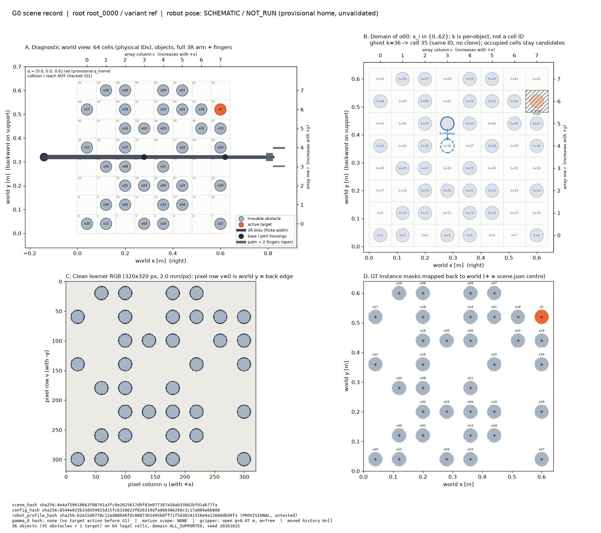

# 0001 — G0 completion report (scene, records, visual foundations)

| Field | Value |
|---|---|
| Report number | 0001 |
| Stage | G0 (Implementation Guide v1.6 §5) |
| Original response date | 15 October 2026 |
| Archived | 15 October 2026, during workflow setup (see `0002_workflow_setup.md`) |
| Authoritative documents | `latent_causal_tamp_specification_v1_4.pdf` (Methodology v1.4), `latent_causal_tamp_implementation_guide_v1_6.pdf` (Guide v1.6) |
| Gate verdict | G0 acceptance checks PASS; robot pose SCHEMATIC / NOT_RUN |

**Provenance of this file.** Sections 1–3 reproduce the G0 response exactly as it was delivered in chat, in content and conclusions. Only the link paths changed: they now start with `../` so they resolve from inside `responses-phases/`. Section 4 was added at archival time. It records which checks were personally rerun before archiving, and one numeric correction. The original text is left unedited so the historical record stays intact.

---

## 1. Project context (for an independent reviewer)

The project studies **intervention-supervised joint relocation for a prescribed target motion**. The inputs are:
- a scene;
- a robot state;
- a finite set of legal resting cells;
- a previously validated, now frozen, complete target action.

The goal is to predict which objects obstruct that specific motion. The method then proposes a small, executable, move-once set of relocations that restores it. Motion, ordering and replay are verified independently of the learner.

Development follows the guide's stage registry G0–G10, one gate at a time. G0 is the data-model and visual foundation: there is no robot kinematics, no collision checking and no learning yet.

### Pre-implementation document review (delivered with the G0 response)

Both PDFs were read in full. Points that matter for later stages:

- **Inconsistency, affects G7 and not G0:** the guide's file tree says `cupboard.toml (created G6)`, and the 3D profile uses `UNPINNED_BLOCKING_G6` and "At G6 pin actual MJCF". The stage registry puts the cupboard and xArm7 at **G7**, and G6 is the ablation gate, so the "G6" labels appear stale. This will be raised again at G7.
- **Fixtures with no definition in these documents:** T01, T02, T06, T11 and C00–C07 (except C04) are "retained as previously named", but they are defined only in earlier versions, which are out of scope. They will be raised when a stage needs them.
- **Two naming variants for the same idea:** `margin_policy = UNINFLATED_ORACLE_DELTA_ONCE` (config) and `clearance_source = UNINFLATED_GEOMETRY_PLUS_DELTA_ONCE` (evidence JSON). Both strings are kept exactly as the guide writes them.

### G0 kickoff plan (delivered before implementation)

1. **Question:** can a scene be represented reproducibly (stable IDs, 64 physical cells, the per-object candidate domain with "stay = 0", and the robot state) and drawn with correct coordinate conventions?
2. **Methodology covered:** §2 (the state S, frames, the cell formula x = (c+½)h, y = (r+½)h, and row increasing with world +y) and §4 (per-object categorical domain with index 0 = current pose, deduplication, and ghost poses that never clone an object).
3. **Files:** the G0 list (`scene.py`, `viz.py`, `run.py`, `config.toml`, `fixtures.json`, `tests/test_scene.py`, `README.md`), plus `requirements.lock` for the versions actually tested.
4. **Fixture:** one seeded scene with 35 obstacles and 1 target (`G0_ILLUSTRATIVE`, `root_0000`, seed 20261015).
5. **Acceptance:** same seed gives the same hash; permuting the object list changes neither the physics nor the pixels; unknown TOML keys fail; JSON/NPZ round trips are exact; the row↔world and raster transforms check out; the arm drawing is labelled NOT_RUN.

### Key implementation decisions (from the G0 code)

- **Scene state** (`scene.Scene`, a frozen dataclass):
  - Contents: root/variant IDs, lattice (rows, cols, pitch), objects, robot state (q [rad], gripper clear gap g [m], attachment m ∈ {free, attached}), legal cells, domain policy, robot profile hash, and `action_hash` (null before G1/G2).
  - Objects are canonically sorted by stable ID in `__post_init__`, so the order of the input list can't affect the record.
  - Validation rejects duplicate IDs, a pose that disagrees with its cell, unsorted legal cells, and inconsistent attachment.
- **Objects** (`scene.Obj`): stable ID (`o00`–`o34` obstacles, `t0` target), kind, radius, `xy_m` (the authoritative pose), resting `cell` (None if off the lattice) and support.
- **Generation** (`make_scene`): one `numpy.random.default_rng(seed).permutation(64)`. The first `num_targets` cells go to targets and the next `num_obstacles` cells to obstacles, so every object rests at a distinct cell centre.
- **Candidate map** (`candidate_map`, Methodology §4):
  - Index k = 0 is the actual current pose. Index k > 0 is physical cell `cells[k-1]`; indices are per-object, not global cell IDs.
  - The domain is all legal cells, minus the object's own current pose (identical-pose deduplication), minus target-occupied cells (targets are never relocated).
  - Cells occupied by other obstacles **stay in the domain**, because pair factors decide coexistence.
  - Result: K = 62 non-stay candidates per obstacle.
- **Ghost hypothesis** (`substitute_pose`): the same object ID at a legal cell; the source pose is vacated and nothing is cloned.
- **Hashes:** `stable_hash` is SHA-256 of canonical JSON (sorted keys, exact float repr).
  - `scene_hash` is a **physical-state** hash: every field except the root/variant labels.
  - `config_hash` covers the fully validated config.
  - `robot_profile_hash` covers `[arm2d]` and `[gripper2d]`, and is PROVISIONAL until G1.
- **Config validation** (`validate_config`): exact key/type schema per section. Unknown or missing sections or keys fail, as do wrong types and physically inconsistent values. Examples of the physics checks:
  - pitch > 2r + δ;
  - 1 ≤ targets ≤ 3;
  - objects fit in distinct cells;
  - q_home within joint limits;
  - open gap > 2r;
  - 0 < closed gap < open gap;
  - domain policy must be ALL_SUPPORTED, because RESTRICTED needs a published spot list, introduced at G3.
- **Raster convention** (`viz.py`): the observation covers [0, 0.64]² m at 320×320 px (2.0 mm/px). Pixel column u grows with +x. Pixel row v grows **downward** (with −y), so v = 0 is the back edge y = 0.64 m and the image is row-reversed relative to the lattice.
- **Clean learner RGB:** all cylinders are drawn identically, the target included, because the query identifies the target, not its appearance. The robot is not rendered at G0 because its pose is not validated.
- **Robot drawing** (`viz.robot_shapes`):
  - About 6 lines of drawing-only FK: θ_j = q_1 + … + q_j, with joints at b + Σ L_j (cos θ_j, sin θ_j).
  - Links are finite-width rectangles with round caps; there are two joint housings.
  - The palm spans x ∈ [−palm_length, 0] in the tool frame (TCP at the palm tip). The fingers span x ∈ [0, finger_length], with inner faces at y = ±g/2.
  - This FK moves to `geometry.py` at G1.

---

## 2. Original G0 completion report (as delivered)

# G0 — Scene, records, visual foundations: complete

G0 passes all 14 acceptance tests. The scene command writes all eight run artifacts, and the overview figure has been rendered and checked by eye.

### A. Stage objective and outcome
**Question:** can a scene be represented reproducibly, with stable IDs, 64 physical cells, each object's candidate domain (index 0 = stay where it is) and the robot state, and drawn with the correct coordinate conventions?

| Guide G0 pass criterion | Result |
|---|---|
| Two builds from one seed give the same scene hash | yes (a different seed gives a different hash) |
| Shuffling the object list changes neither physics nor plot | yes: hash, occupancy, raster images and overview pixels are all identical |
| Unknown TOML keys fail immediately | yes; missing keys, wrong types and inconsistent physics also fail |
| JSON/NPZ round trip and deterministic hash | yes; editing a saved pose by 1 µm is caught as a hash mismatch |
| Row→world and raster-y transforms; equal aspect | yes; mask areas are within 0.97% of πr² |
| No duplicate cells; ghosts never clone the object | yes |
| Full 3R arm and two fingers drawn inside the axes, marked NOT_RUN | yes |

### B. Files created
Logical lines exclude blanks, comments and docstrings.

| File | Purpose | Physical / logical lines |
|---|---|---|
| `scene.py` | config validation, lattice, scene state, candidate maps, ghost substitution, snapshots, hashes | 365 / 255 |
| `viz.py` | clean learner observation, robot body shapes, four-panel overview | ~280 / ~205 *(see correction in §4)* |
| `run.py` | sole dispatcher; only `scene` is active | 141 / 114 |
| `tests/test_scene.py` | the 14 G0 tests | 193 |
| `config.toml` | `[suite]`, `[arm2d]`, `[gripper2d]` from the guide, plus `[render]` | 52 |
| `fixtures.json`, `README.md` | the G0 case; one-page start | 13, 50 |
| `requirements.lock` | versions actually tested | 6 |

Code-organisation audit:
- **`requirements.lock`:** it isn't in the guide's G0 file list. It was added because the guide's file tree includes it and it records the tested versions.
- **Drawing-only FK in `viz.py`:** about 6 lines of forward kinematics live in `viz.robot_shapes`. At G1 they move into `geometry.py` and this copy is deleted.
- **`scene.py` size:** it is the largest module. If config validation grows, its natural split is a separate `config.py`.
- **Config sections:** `[geometry]`, `[planner2d]` and `[inference]` are deliberately left out until their stages. The validator would otherwise have to accept parameters nothing uses yet.

### C. Configuration and reproducibility
- **Config hash:** `sha256:8544e825b33d354915d15fcb310623f826319dfa066386268c1c17a089a6b808`
- **Scene hash:** `sha256:4e4af59618663f88741a3fc0e2625617d9f83e077387a58ab33b82bf01ab77fa`. It covers the physical state only; root and variant labels are excluded.
- **Robot profile hash:** `sha256:b2e15d0778c12ad88048fdc08073b5495b8ff71f5d30242318e9a12660db99f3`, marked PROVISIONAL.
- **Root seed:** 20261015
- **Versions:** Python 3.13.11, numpy 2.4.0, matplotlib 3.11.2, pillow 12.0.0, pytest 9.1.1 (miniconda base env)

### D. Tests and verification
- **Test suite:** `python -m pytest tests -q` → **14 passed**.
- **Scene command:** `python run.py scene --config config.toml --case G0_ILLUSTRATIVE --out runs/g0_scene` → exit 0, `gate_checks_passed: true`.
- **Mutation check:** the raster row convention was flipped and the raster test failed. After restoring the code, all 14 pass again.
- **Verification scope:** NONE. No collision, IK or motion checking exists yet.

The 14 tests:

| Test | What it asserts |
|---|---|
| `test_unknown_missing_and_mistyped_config_keys_fail` | unknown key, later-stage section, missing key, wrong type, wrong vector length all raise `ConfigError` |
| `test_physically_inconsistent_config_fails` | pitch 0.05 < 2r+δ, RESTRICTED, 64+1 objects, open gap < 2r all raise |
| `test_config_hash_is_stable_and_sensitive` | same config → same hash; δ change → different hash |
| `test_row_to_world_convention` | (0,0)→(0.04,0.04), (7,0)→(0.04,0.60), (0,7)→(0.60,0.04); 64 unique centres |
| `test_generated_scene_is_distinct_and_nonpenetrating` | 36 objects in 36 cells; all surface gaps ≥ δ |
| `test_same_seed_same_hash_different_seed_differs` | determinism |
| `test_object_permutation_changes_neither_physics_nor_plot` | hash, occupancy, observation arrays and overview pixels identical under shuffling |
| `test_raster_transform_and_row_reversal` | cell (7,0) appears top-left; world↔pixel round trip; every mask centroid within ½ px of its world centre |
| `test_mask_area_and_equal_aspect` | mask areas within 3% of πr²; world panels have aspect 1 |
| `test_robot_drawing_inside_fixed_axes` | arm/fingers inside fixed limits; 2 fingers, 1 palm, 2 housings |
| `test_candidate_map_stay_zero_and_no_clone` | k=0 = stay; size 63; own and target cells excluded; ghost keeps IDs, vacates source; target has no domain |
| `test_json_snapshot_roundtrip_and_tamper_detection` | exact round trip; 1 µm edit detected |
| `test_npz_snapshot_roundtrip` | dtype- and value-exact NPZ round trip |
| `test_cli_scene_run_writes_artifacts` | CLI writes all artifacts; hash matches; NOT_RUN status fields |

### E. Visualizations
- [`../runs/g0_scene/overview.png`](../runs/g0_scene/overview.png): the four-panel figure
- [`../runs/g0_scene/observation.png`](../runs/g0_scene/observation.png): the clean learner RGB image
- **No GIF:** nothing moves at G0.

What each panel shows:
- **A (diagnostic world view):** the 8×8 support with physical cell IDs, which run `r·8 + c` from the front-left (cell 0) to the back-right (cell 63). Also shown: 35 grey obstacles, the orange target `t0` at cell 55, and the full arm with its base at (−0.14, 0.32), finite-width links, two joint housings, palm and two open fingers. The top and right axes give array column and row, so you can see that row grows with +y.
- **B (candidate domain of `o00`):**
  - Every cell carries `o00`'s own index k. Its current cell (43) is k=0 "stay", and indices are per-object, not cell IDs: cell 35 is k=36.
  - The target's cell is hatched and excluded.
  - Cells holding other obstacles stay in the domain, because two objects wanting the same cell is a pair-factor question.
  - The dashed ghost shows `o00` at k=36 → cell 35: the same object with its pose substituted, still 36 objects.
- **C (clean learner RGB):** the image the learner will see, with no labels. Pixel row 0 is the back edge, so the image is flipped vertically compared with the lattice. All cylinders look identical, the target included, because the query identifies the target, not its appearance.
- **D (instance masks):** the masks mapped back into world coordinates. Each "+" is the centre stored in `scene.json`, and it sits at the centre of its mask, which confirms the image↔world transform.

**What the figures do not prove:** that the arm pose is reachable or collision-free. Panel A shows the *provisional* home pose, labelled SCHEMATIC / NOT_RUN.

### F. Scientific interpretation
**What is established:**
- The state S and the per-object domains from Methodology §4 (stay = 0, deduplication, per-object indices, ghosts that never clone) are implemented exactly and are reproducible.
- The scene is non-penetrating: the smallest surface gap between objects is 0.032 m against δ = 0.005 m. This is the lattice pitch fact that the reference-grid theorem relies on later.

**What is not established:** any robot kinematics, swept envelope, blocker or label. No action exists yet, so `target_hash` is null and the query status is not applicable.

**One interpretation to confirm:** the spec says each candidate must respect "target/object occupancy semantics". This is read as excluding target-occupied cells from obstacle domains, while keeping cells occupied by other obstacles. That gives K = 62 candidates per obstacle.

### G. Next-stage readiness
All G0 gates pass. G1 adds `geometry.py`, `motion.py` and a 2D planner dependency for 3R FK/IK, full-body collision, the grasp/carry/release phases and the first validated nominal skill. It then freezes a tested robot profile hash.

Points G1 will have to settle. These come from hand arithmetic, not verification:
- **Straight home pose:** `q_home = [0,0,0]` runs along y = 0.32, between rows 3 and 4. The elbow housing would be only 0.004 m (less than δ) from an obstacle at cell 27 or 35. Both cells are empty in this scene, but that is luck.
- **Palm width:** the palm is 0.034 m wide, but the open fingers span 0.084 m. The fingers visibly float apart from the palm in panel A. How the fingers mount needs a decision.
- **Closed gap:** 0.046 m is smaller than the disc diameter of 0.048 m, so it has to be read as "fingers stop at contact".

**Document inconsistencies noted, not acted on:**
- The guide says the cupboard comes at G6 (`cupboard.toml` "created G6", `UNPINNED_BLOCKING_G6`), but its stage registry puts it at G7. To be raised at G7.
- Fixtures T01, T02, T06, T11 and C00–C07 (except C04) are referenced but not defined in either document. To be raised when a stage needs them.

**STOP — Awaiting explicit approval before proceeding to the next stage.**

---

## 3. Run artifacts referenced by this report

All of these live in `runs/g0_scene/` and were **not** regenerated during archival. Their SHA-256 hashes still match `manifest.json`.

| Artifact | Content |
|---|---|
| [`config.json`](../runs/g0_scene/config.json) | fully resolved config + `config_hash` |
| [`scene.json`](../runs/g0_scene/scene.json) | scene record with embedded `scene_hash` (verified on load) |
| [`result.json`](../runs/g0_scene/result.json) | gate checks and status fields (`robot_pose_status: SCHEMATIC_NOT_RUN`, `target_hash: null`) |
| [`metrics.csv`](../runs/g0_scene/metrics.csv) | object/cell counts, 62 candidates per obstacle, min surface gap 0.032 m, mask-area error 0.0097 |
| [`arrays.npz`](../runs/g0_scene/arrays.npz) | numeric mirror: poses, cells, q, candidate table, RGB, instance mask |
| [`manifest.json`](../runs/g0_scene/manifest.json) | command, seeds, versions, per-file SHA-256 |
| [`overview.png`](../runs/g0_scene/overview.png), [`observation.png`](../runs/g0_scene/observation.png) | figures above |

---

## 4. Archival re-verification (performed 15 October 2026, before committing)

Each check was personally rerun at archival time, without modifying any source, config or run artifact:

| Check | Command / method | Result |
|---|---|---|
| G0 test suite | `python -m pytest tests -q -p no:cacheprovider` | **14 passed**, exit 0 |
| Artifacts present and readable | PIL open/load of both PNGs; `np.load(..., allow_pickle=False)` | `overview.png` 1920×1704 RGBA; `observation.png` 320×320 RGB; NPZ 13 arrays, RGB (320,320,3), mask (320,320) |
| Artifacts unchanged since the run | recompute SHA-256 of every file listed in `manifest.json` | 0 mismatches |
| Scene snapshot integrity | `scene.load_scene_json` (re-hashes the contents) | hash = `sha256:4e4af596…01ab77fa`, matches `result.json` |
| Config hash | `scene.config_hash(scene.load_config("config.toml"))` | `sha256:8544e825…a6b808`, unchanged |
| Robot profile hash | `scene.robot_profile_hash(...)` | `sha256:b2e15d07…d99f3`, unchanged (PROVISIONAL) |

**Source and configuration SHA-256 at archival time:**

| File | SHA-256 |
|---|---|
| `scene.py` | `c2e20716d9fffc5ba5dfec8f4b5688b4caa2832e8b07a4abf725d9c99b9f2e02` |
| `viz.py` | `7946f160397006b9b953d283c5df9e4625be1efbb7e9b6ab1786adb993d30af4` |
| `run.py` | `f989521a12a83611bdb45b55113af009982a75977c10931a088dfaff07c6b97f` |
| `tests/test_scene.py` | `8f2cf8fcc693010f9b6f6a8b2ce11ba8c29575336c348c07bde73d64184867c4` |
| `config.toml` | `0d7a2310f8908cf06583cfec8b707e5c9355d7b747d15cf0d7c6dd5484a65316` |
| `fixtures.json` | `847efc8e52eb5e59ae2d6b4b412eeea9b7f68f193dcdc62173f08a00c647fcfc` |
| `requirements.lock` | `009c2ed27bff87c1d39f919b3e6da39bd3f8bb4e209b7f5d6258b6d7bffce0de` |

(`README.md` was later edited in the workflow-setup commit; see report 0002.)

**Correction to the original report (numbers only, no change to conclusions):** table B gave `viz.py` as "~280 / ~205" physical/logical lines. Measured exactly at archival time it is **271 physical / 197 logical**. The other counts were exact: `scene.py` 365/255, `run.py` 141/114, `tests/test_scene.py` 193 physical / 145 logical.

**Independent external review.** The user's review in `instruction-phase-md/G0_review_and_next_Claude_message.md` gave a provisional PASS for G0 and listed further G1 acceptance checks. Those are recorded in report 0002.
