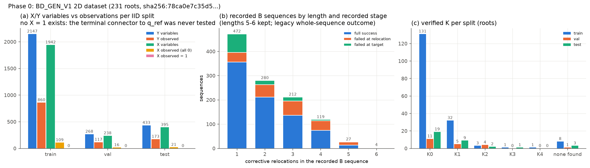

# 0106 — Approach B X/Y, Phase 0: starting state

**Authority:** `Approach_B_Final_Methodology_2026-10-31.pdf` (the 13-page final methodology). Branch `approach-b-xy-v1`, based on `dataset-bd-v1` `9d6a12d`.

**Verdict: PASS.** The dataset, splits and code are located and frozen. There is one supervision gap, documented below.

## A. Repository and code

| Item | State |
|---|---|
| Branch | `approach-b-xy-v1` (new; `main`, `approach-d-v1` and `dataset-bd-v1` untouched) |
| Generator | `bd_core.py`, `bd_2d.py`, `bd_run.py`: unchanged; read only |
| Production LB | `p17_b.py` (`ARMS["LB"]` = `abc7_models.ModelBC7("B", "none", order="pred")`), `unique_factor.py`, `unique_factor_keyed.py`, `p10c_train_eval._record`, `learn_data.root_record` (frozen DINOv2-small object features from the deterministic renderer) |
| DINOv2 cache | present locally (`facebook/dinov2-small` @ `ed25f3a3`) |

## B. Dataset (input provenance)

- **Source:** the `mock2d_5000` 2D collection, copied read-only from the lab server to `/home/naren/Desktop/rss_ebm_dataset_snapshot/20261031_mock2d_5000_full`. The original on the server was not modified.
- **Contents:** 231 accepted roots (280 ledger entries; 49 were construction rejections) and 2,371 stored witnesses. The run stopped when the server hung on 10-29, so this is the complete collected set.
- **Hash:** `sha256:78ca0e7c35d5a2b937554c03ce38b06db2486e5d74af5f2831e37e335ccb1a38`, over the sorted root files.
- **Versions:** generator `BD_GEN_V1`, labels `BD_BINARY_BUDGET_V1`, teacher `BD2D_TEACHER_V1:DetPhysics(P16_FAST,no-library)`.
- **Split:** the generator's own IID family-grouped rule (`bd_core.manifest`), recomputed over all 231 roots.
  - Result: **176 train / 21 val / 34 test**, with 0 families straddling splits.
  - The on-server `SPLITS.json` is stale: it lists only the first 47 roots, written at the wave-size restart. All 47 agree with the recomputed assignment.

## C. How the existing labels map onto the methodology (§2, §5.2)

| Record | Semantics in `bd_2d.teach` | Final-methodology use |
|---|---|---|
| `labels.original` | target from `q0`, unedited scene | **Y** of the empty edit (Y₀) |
| `labels.D` (`SCENE_TARGET_ONLY`) | target from `q0` in a parked-object edited scene; same teacher, same per-query budget | **Y** of that edited scene (exact match, q_ref = q0) |
| `labels.B` y | relocations, then the target **from the achieved state** (`p16_common.verify_sequence`) | **not X, not Y**: the legacy LB target and the external whole-execution check (§2.2.1) |
| `labels.B`, relocation step j failed | the deterministic greedy teacher fails at step j under the fixed per-query budget | **X = 0** for the shortest prefix r₁:ⱼ₊₁ only. The prefix query makes the identical failing attempt and never reaches the connector. Recorded once, never repeated for longer prefixes |
| — | no prefix was ever tested with a terminal connector to q_ref | **no X = 1 exists**. The empty repair has X = 1 by definition (a constant, not a variable) |
| `travel` on successful B | relocations + target from the achieved state | legacy-witness travel. Not the methodology's matched J (no connector; target not from q_ref) |

The sidecar is written to `runs/approach_b/bxy/SIDECAR.json` (version `BXY_SIDECAR_V1`, built by `bxy_data.py`):
- canonical X keys are ordered prefixes;
- canonical Y keys are final moved-object poses, so two orders with equal endpoints share one Y;
- omission queries are added as variables;
- no observation conflicts were found.

## D. Supervision coverage (counts only; no label analysis)

| | train | val | test |
|---|---|---|---|
| roots | 176 | 21 | 34 |
| non-empty candidates (recorded B) | 843 | 103 | 168 |
| of which 5 / 6 relocations | 18 / 4 | 2 / 0 | 7 / 0 |
| Y variables / observed | 2147 / 860 | 268 / 117 | 433 / 173 |
| X variables / observed (all 0) / observed = 1 | 1942 / 109 / **0** | 238 / 16 / **0** | 395 / 21 / **0** |
| X and Y both observed on one prefix | 34 | 6 | 7 |
| candidate endpoint Y observed | 386 | 49 | 75 |
| legacy-witness travel available | 616 | 66 | 113 |
| verified K0 / K1 / K2 / K3 / K4 / none | 131/32/3/1/1/8 | 11/5/4/0/0/1 | 19/9/2/1/0/3 |

## E. Consequences for later phases

1. **Y is well supervised.** It has 860 training observations, including 386 at candidate endpoints.
2. **X is not identifiable as a binary outcome.** It has only zeros and no positive anywhere. P(X = 1) and the X–Y coupling w_q cannot be learned from this dataset. The XY model will be implemented and trained, but its X and w outputs are reported as untrained, not as learned interactions (methodology §8.2, check 6).
3. **K3 and K4 are nearly absent:** 3 roots in total. K-stratified results beyond K2 are not supportable.
4. **Phase 1 (legacy LB)** uses the recorded B, original and D labels exactly as recorded.

## F. Files

`bxy_data.py`, `bxy_viz.py`, `runs/approach_b/bxy/P0_MANIFEST.json`, `runs/approach_b/bxy/SIDECAR.json`, `visualizations/approach_b/bxy/P0_coverage.png`.
