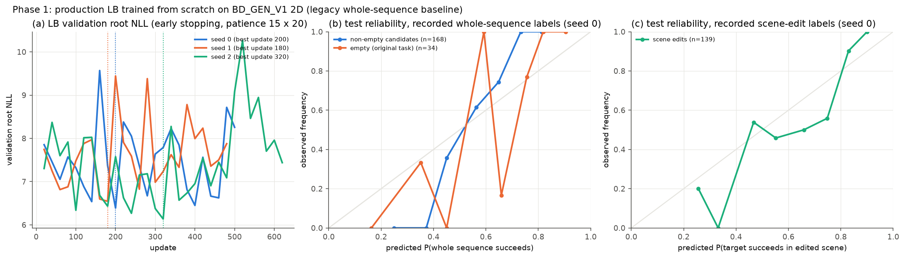

# 0107 — Approach B X/Y, Phase 1: legacy production LB on the new 2D dataset

**Verdict: PASS.** This is also the run prescribed by instruction 0106. Its outputs are in `runs/approach_b/bd2d_lb_v1/`.

## A. What ran

- **Model:** production `LB` = `abc7_models.ModelBC7("B", "none", order="pred")`, 467,365 parameters, trained from scratch.
- **Objective:** keyed unique-factor NLL (`unique_factor_keyed`), with λ_static = λ_travel = 0.
- **Optimizer:** `p17_b.fit` unchanged: AdamW, learning rate 1e-3, weight decay 1e-4, root batch 12, clip 10, validation every 20 updates, patience 15, at most 3,000 updates.
- **Seeds:** 0 (the 0106 run), plus 1 and 2 for the Phase 7 comparison.
- **Data:** only the BD_GEN_V1 2D roots. Records are built by `bxy_lb.py` through the unchanged `p10c_train_eval._record` and `learn_data.root_record`, which include the frozen DINOv2-small object features from the deterministic renderer.
  - Records hash: `sha256:357e2d43494f021a…`
  - Dataset hash: `sha256:78ca0e7c…`
- **Splits:** IID 176 train / 21 val / 34 test (generator rule). The test split was used only after checkpoint selection.

## B. Adapter decisions

1. **Labels as recorded:**
   - `original.y` → `seq:{root}:empty`;
   - each `D` edit → `scene:{root}:{sig}`;
   - each B sequence → `seq:{root}:{sig}`, with its recorded y.
   - Recorded travel is attached to successful sequences only; LB ignores it (λ_travel = 0).
2. **Layout:** `P17_LAYOUT_V1` rules with the move cap raised from 4 to 6 (`BXY_LB_LAYOUT_V1`, applied through a context patch that restores `p17_b` afterwards).
   - `MAX_ACTIVE = 9` still holds. A 6-move candidate keeps z₀, zR, its 6 omission slots and 1 scene edit.
   - **No sequence was dropped or truncated:** all 1,114 B sequences are kept, including 27 five-move and 4 six-move sequences.
   - Omission slots are observed only when the omitted sequence is itself a recorded B sequence; otherwise they are marginalized.
3. **Target-only scenes:** some K0 roots contain no obstacle, so P6's random static-check sampler cannot run. Those roots get an empty static-check list. LB's static weight is 0, so this changes nothing in training.
4. **Sampler:** P17's `RootSampler` groups roots by an A/B/A+B edit pattern that BD roots do not have. Every root therefore falls in one group, and sampling is uniform.

## C. Results (test, 34 roots; no test data used for selection)

| Seed | Best / run updates | Val root NLL | **Test root NLL** | All candidates (n = 202) Brier / log loss / AUROC / acc | Empty (original, n = 34) AUROC | Non-empty (n = 168) AUROC | Scene edits (n = 139) Brier / AUROC | CPU s (wall s) |
|---|---|---|---|---|---|---|---|---|
| 0 | 200 / 500 | 6.390 | **5.802** | 0.196 / 0.578 / 0.727 / 0.728 | 0.881 | 0.721 | 0.199 / 0.769 | 3,834 (745) |
| 1 | 180 / 480 | 6.545 | **5.478** | 0.183 / 0.529 / 0.762 / 0.728 | 0.909 | 0.735 | 0.200 / 0.794 | 3,711 (723) |
| 2 | 320 / 620 | 6.136 | **5.991** | 0.206 / 0.594 / 0.687 / 0.673 | 0.818 | 0.665 | 0.206 / 0.718 | 4,442 (851) |

**Checkpoints:** `runs/approach_b/bd2d_lb_v1/ckpt/BXY-LB-s{0,1,2}.pt`. Seed 0: `sha256:48469ee9e8bc4cd5…`.

**Other per-seed outputs:**
- `EVAL_s*.json`: metrics and run manifest (data hash, records hash, layout, sampler note, parameter count, clip fraction ≈ 0.3).
- `TRAIN_LOG_s*.json`.
- `PREDICTIONS_s*.json`: every validation and test candidate in original catalogue order, with its sequence, destinations, role, p and recorded y; plus every scene-edit query.

## D. Reading

- **Accuracy:** LB learns the recorded whole-sequence and scene-edit outcomes well above chance. Test AUROC is 0.69–0.76 on candidates and 0.82–0.91 on the original task.
- **Noisy validation:** validation NLL fluctuates strongly between evaluations because there are only 21 validation roots. Early stopping fires after 480–620 updates.
- **Coarse reliability:** the reliability curves use 10 bins over 34–168 points, so their shape is noisy.
- **Scope:** these are the legacy direct outcomes, with the target run from the achieved state. They are not X/Y results.
