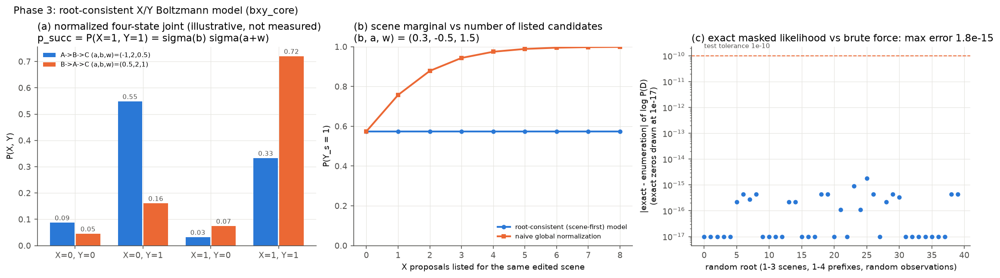

# 0109 — Approach B X/Y, Phases 3 and 4: exact model and neural implementation

**Verdicts:**
- **Phase 3 (mathematics): PASS.**
- **Phase 4 (neural implementation): PASS.** The implementation works; whether it learns anything depends on data (see Phase 5).

## A. Phase 3: exact model (`bxy_core.py`, methodology §3.2, §4, §5.3)

- **Pair energy:** E_q(x, y) = −a_q x − b_s(q) y − w_q x y, with x, y ∈ {0, 1} and τ = 1 (frozen).
- **Scene-first root-consistent factorization:** P(y_S, x_Q) = ∏_s P^Y(y_s) ∏_q P^X(x_q | y_s(q)), where:
  - P^Y = σ(b/τ);
  - P^X(1 | y) = σ((a + w y)/τ).
- **Root-normalized energy:** `energy_root` includes both normalizers, so the partition function is 1.
- **Root-level observed-data NLL:** for each unique scene s, take the log-sum-exp over the allowed y_s of [log P^Y + Σ observed children log P^X].
  - Unobserved X contribute exactly 0.
  - An unobserved Y with no observed child contributes exactly 0.
  - One NLL per root, averaged over roots. There are no separately weighted X and Y binary cross-entropy losses.
- **Prior marginals:**
  - P(Y = 1) = σ(b);
  - P(X = 1) is marginalized over Y, never conditioned on a revealed Y;
  - p_succ = σ(b) σ(a + w).

**Tests** (`tests/test_bxy.py`, 15 pass):

| Check (methodology §8.2) | Test |
|---|---|
| Four-state microcase, all 9 observation patterns = brute force; partition = 1; p_succ formula; cross log-odds = w/τ | `test_four_state_microcase_every_observation_pattern` |
| Random roots (3 scenes, 4 prefixes, random parents and observations) = enumeration through E_root | `test_root_microcases_match_enumeration` (6 × 8 cases) |
| Shared Y marginals unchanged when X proposals are appended; unobserved X sum to 1 | `test_scene_marginals_invariant_to_appended_x_proposals` |
| P(X = 1) and p_succ = enumeration; autograd = finite differences (`gradcheck`) | `test_x_marginal_marginalizes_y_and_gradients_are_exact` |
| w = 0 gives independence (uncoupled arm) | `test_uncoupled_is_product_and_zero_w_gives_independence` |
| Shared-Y identity, reversed order → two X keys, omission recomputed from S0, zero-move key | `test_query_identities_shared_y_reversed_order_and_omission_recompute` |
| Sidecar: only matching labels, recorded y unchanged, order and destinations preserved, zero-move without X | `test_sidecar_reuses_only_semantically_matching_labels` |
| IID family split disjoint and equal to the generator's rule | `test_iid_splits_disjoint_by_family_and_match_generator_rule` |
| LB records: labels, order and destinations preserved; all 4 six-move sequences kept | `test_lb_records_preserve_labels_order_and_six_move_sequences` |
| Neural forward on a real six-move root; the observed-only view equals the full view (exact marginalization) | `test_neural_forward_on_real_roots_including_six_moves` |

Panel (b) shows why scene-first normalization is required. Under a naive global normalization of ∏ exp(−E_q), P(Y_s = 1) drifts from 0.57 to 1.00 as candidate proposals are listed. In the root-consistent model it stays constant.

## B. Phase 4: neural coefficients

`ModelXY` subclasses production LB's `abc7_models.ModelBC7("B", "none", order="pred")` and reuses its modules unchanged:

| Coefficient | Module | Factor |
|---|---|---|
| b_s | LB `scene` head on the edit-aware `scene_vec(S^s)` + context (robot q0, goal) | F3 hypothetical-scene unary |
| a_q | LB `order_s` on the predecessor-aware prefix summary g_q (`pairo` / `mix`; no GRU) | F2 ordered-prefix unary |
| w_q | **new** `xy = mlp(3W → 1)` on (g_q, v_s(q), context); absent in XY-uncoupled | F5, the single X–Y pair |
| Ĵ(r) | LB `cost` head, softplus(cost(g_r)) | travel readout |
| F1 | analytic only. The inherited static heads `unary` and `pairh` receive no loss | — |
| F4 | omission queries reuse the same scorers; no pair network | — |

**Parameter counts:**

| Arm | Parameters |
|---|---|
| LB | 467,365 |
| XY-uncoupled | 467,365 (identical modules) |
| XY-quadratic / XY-quadratic-noJ | 516,774 (+49,409, +10.6%) |

**Training settings** (identical to production LB):
- AdamW, learning rate 1e-3, weight decay 1e-4;
- root batch 12, the same seeded batch sequence as LB;
- gradient clip 10;
- validation every 20 updates, patience 15, at most 3,000 updates.

**Loss:** ℒ_B = ℒ_joint + λ_J ℒ_J, with ℒ_J = Huber(log1p Ĵ, log1p J). λ_J is chosen on validation from {0.1, 0.3, 1.0}; the noJ arm uses λ_J = 0.

## C. Files

`bxy_core.py`, `bxy_run.py` (training, selection, evaluation), `tests/test_bxy.py`, `visualizations/approach_b/bxy/P3_math.png`.
