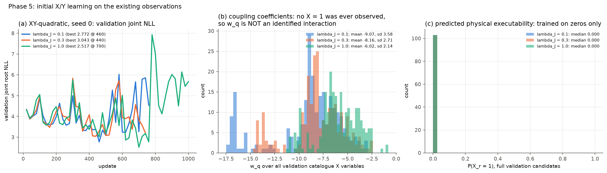

# 0110 — Approach B X/Y, Phase 5: initial X/Y learning

**Verdict: PARTIAL.** The architecture trains end to end on every valid observation, and Y is learned. X and the X–Y coupling are **not** learned, because the data contains no X = 1 (coverage gap, 0108 §C).

## A. Runs (validation only; test untouched)

- **Arm:** XY-quadratic, seed 0, λ_J ∈ {0.1, 0.3, 1.0}.
- **Training:** LB's optimizer, batch sequence, clip and early stopping.
- **Training observations:** 860 Y, 109 X (all 0), 34 prefixes with both X and Y observed (all X = 0), and 616 legacy-travel witnesses.

| λ_J | Best val joint root NLL | Best / run updates | Wall s |
|---|---|---|---|
| 0.1 | 2.772 | 460 / 760 | 274 |
| 0.3 | 3.043 | 440 / 740 | 268 |
| **1.0** | **2.517** | 700 / 1000 | 306 |

## B. What the coefficients show

- **X:** P(X_r = 1) is about 0.000 (median) for every full validation candidate, under every λ_J. With only zeros observed, the likelihood drives a_q → −∞. X is not a learned executability estimate.
- **Coupling:** w_q is large and negative (mean −6 to −9, s.d. 2–4). The only signal on w comes from X = 0 prefixes whose Y is observed (34 in training). It just reinforces "X = 0", and can never be checked against an X = 1. **w_q is not an identified X–Y interaction and is not reported as one** (methodology §8.2, check 6).
- **Y:** b_s is supervised by 860 observations. Its test quality is reported in Phase 7.

## C. Consequence for selection

p_succ(r) = σ(b) σ(a + w) ≈ 0 for every non-empty repair. Only the zero-move candidate keeps p_succ = P(Y₀ = 1). Any X/Y selection rule therefore reduces to the no-op unless new X data is collected (plan P-min, 0108 §D).
