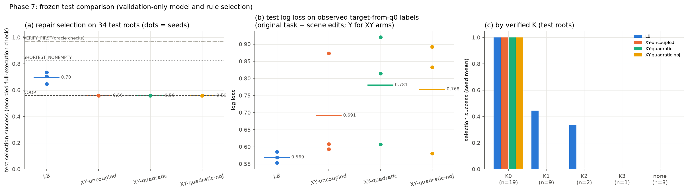

# 0112 — Approach B X/Y, Phase 7: frozen test comparison

**Verdict: PARTIAL.** The comparison ran exactly as specified: 4 arms × 3 seeds, matched splits and catalogue, validation-only model, λ_J and rule selection (`FROZEN.json`), then one test read. However, the X/Y arms cannot be evaluated as X/Y models on this data. They are untrained in X (0110) and therefore always select the no-op.

## A. Protocol

- **Data:** 34 IID test roots, 168 non-empty candidates plus 34 zero-move candidates (frozen catalogue: the recorded B sequences in recorded order).
- **Success of a choice:** the recorded full-execution check of the chosen candidate.
- **Checkpoints and rules:** frozen before the test read (`runs/approach_b/bxy/FROZEN.json`, 2026-10-31T04:58).
- **Outputs:** `runs/approach_b/bxy/EVAL_P7.json` (all metrics, per-root rows, bootstrap) and `PREDICTIONS_P7_test.json`.

## B. Repair selection (test)

| Arm | Success s0 / s1 / s2 (mean) | Optimal within catalogue | Mean moves | False-repair rate on originally feasible roots |
|---|---|---|---|---|
| LB | 0.647 / 0.706 / 0.735 (**0.696**) | 0.56 / 0.26 / 0.41 | 0.53 / 1.00 / 0.78 | 0.16 / 0.79 / 0.53 |
| XY-uncoupled | 0.559 ×3 | 0.559 | 0 | 0 |
| XY-quadratic | 0.559 ×3 | 0.559 | 0 | 0 |
| XY-quadratic-noJ | 0.559 ×3 | 0.559 | 0 | 0 |
| NOOP | 0.559 | 0.559 | 0 | 0 |
| SHORTEST_NONEMPTY | **0.824** | 0.382 | 0.97 | 0.84 |
| VERIFY_FIRST (oracle; 1.94 verifications per root) | 0.971 | — | — | — |

**Paired bootstrap over roots (2,000 resamples), XY-quadratic minus another arm:**

| Comparison | s0 | s1 | s2 |
|---|---|---|---|
| − LB | −0.088 [−0.21, 0.00] | −0.147 [−0.26, −0.03] | −0.176 [−0.32, −0.06] |
| − XY-uncoupled | 0.000 [0, 0] | 0.000 [0, 0] | 0.000 [0, 0] |
| − XY-quadratic-noJ | 0.000 [0, 0] | 0.000 [0, 0] | 0.000 [0, 0] |

**By verified K** (seed mean; test n per stratum: K0 19, K1 9, K2 2, K3 1, none 3):
- **LB:** K0 1.00, K1 0.44, K2 0.33, K3 0, none 0.
- **Every X/Y arm:** K0 1.00 and 0 elsewhere, because it only ever selects the no-op.

## C. Probabilistic quality (test)

| Arm | Target-from-q0 labels (original + edits, n = 173): log loss s0 / s1 / s2 | AUROC (mean) | p_succ vs full-execution check, AUROC | Observed X (n = 21, all 0): mean P(X = 1) |
|---|---|---|---|---|
| LB (scene / original unaries) | 0.569 / 0.553 / 0.586 | 0.78 | 0.72 / 0.73 / 0.67 (its own target) | — |
| XY-uncoupled (Y) | 0.593 / 0.608 / 0.873 | 0.74 | 0.60 / 0.46 / 0.61 | ≤ 0.002 |
| XY-quadratic (Y) | 0.920 / 0.607 / 0.814 | 0.74 | 0.61 / 0.46 / 0.61 | ≤ 1e-4 |
| XY-quadratic-noJ (Y) | 0.832 / 0.580 / 0.892 | 0.70 | 0.50 / 0.50 / 0.50 | ≤ 1e-10 |

**Learned coupling on test X variables (n = 395):**
- XY-quadratic: w mean −5.1, s.d. 1.5.
- XY-quadratic-noJ: w mean −32, s.d. 18.

In both arms w only pushes X toward 0. It is **not an identified interaction**.

**Same-endpoint reordered pairs in the test catalogue:** 11, of which 4 have discordant recorded checks. LB ranks 3 of 4 correctly. The X/Y arms rank 0 to 3 of 4, varying by seed, because X is driven by noise around −∞. Four pairs are too few for any conclusion.

## D. Reading against the acceptance checks (§8.2)

| Check | Status |
|---|---|
| 1 Semantics | **met** (tests; sidecar keys; Y shared across orders) |
| 2 Physics | **not met:** no positive X witness with a connector exists |
| 3 Binary contract | **met:** recorded zeros kept; nothing unattempted turned into 0 |
| 4 Math | **met:** brute force, invariance, gradients |
| 5 Identity | **met:** dedup, zero-move, all six-move sequences encoded |
| 6 Coupling | **not met:** XY-quadratic does not beat XY-uncoupled on any metric (differences exactly 0 in selection; worse or equal Y log loss) |
| 7 Travel | **not measurable:** selection never changes; the travel labels are legacy (not matched J) |
| 8 End-to-end | **not met for X/Y:** with no X = 1 data, X/Y selection equals NOOP |

**Additional findings on this test set:**
- **Shortest-candidate rule beats LB:** the analytic SHORTEST_NONEMPTY rule (0.824) beats LB (0.696 mean). The rule also exploits the catalogue's construction, since the minimal sequence is listed first among the shortest.
- **LB's scene unaries predict Y better than every X/Y arm.** LB's scene unaries are trained jointly with the whole-sequence outcomes, and give a lower log loss on target-from-q0 labels (0.569 mean against 0.69–0.78).
