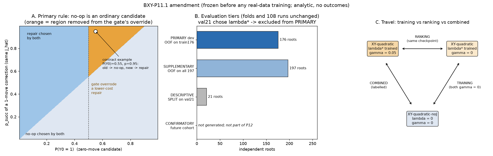

# 0118 — BXY-P11.1: amendment to the frozen P11 training design (selection rule, cross-fit claims, travel decomposition)

Date: 2026-10-31. Gate: BXY-P11.1 (the first part of the BXY-P11.1 + BXY-P12 execution contract). Previous gate: 0117, commit
`5c781001da1b7f58cabe5fc02cc40d752aa30fab` (pushed; local HEAD = origin at start).

**Result: amendment frozen, before any real-data training.**
- Successor design `TRAINING_DESIGN_P11_1.json` sha256 `3d6524deca3cef76f026736a53565d3a86a5d86b9b797daa468b6743b95ca7fa`.
- Lock `TRAINING_LOCK_P11_1.json` (authorized: false).
- The parent P11 design `24ffa822…782cf`, the P11 lock, the P-min evidence and every P11 source file are untouched; the adapter
  [bxy_p11_1.py](../bxy_p11_1.py) imports them and re-hashes them.

**Nothing trained here.** 0 optimizer steps on real data, 0 teacher queries, 0 test roots, no generation.

---

## 1. Verified starting state

| Item | sha256 | Status |
|---|---|---|
| `BXY_SIDECAR_V2_PMIN.json` | `0191f49b…76cd7e` | match |
| `PMIN_DESIGN.json` | `8f164845…ff658` | match |
| `PMIN_LOCK.json` | `4d42027e…dfffaa` | match |
| P11 `TRAINING_DESIGN.json` | `24ffa822…782cf` | match, not modified |
| P11 `TRAINING_LOCK.json` | `72941438…cd9` | match, not modified |

Counts re-verified by `bxy_p11.evidence()`: 2,222 X, 1,866 Y, 2,222 pairs, 1,452 complete + 142 no-op travel witnesses, 176 train / 21 val,
no test root. `bxy_p11_prereg.assert_frozen(check_git=True)` passes.

## 2. The three corrections

### A. Primary selection rule (the no-op gate is removed)

`bxy_p11.choose()` with the frozen `RULE` returned the zero-move candidate whenever P(Y0=1) ≥ 0.5, before any cost was compared. That
contradicts the cost-minimization methodology: a correction with p = 0.95 lost to a no-op with p = 0.55 although its cost is lower
(0.051 + 0.1 + γĴ vs 0.598 + γĴ₀).

**Primary rule `bxy_p11_1.PRIMARY`:**
1. F1 screens candidates analytically (the zero-move candidate is always admissible).
2. Every admissible candidate, the no-op included, gets C = −log p_succ + 0.1·m + 0·C_d + γ·Ĵ (no-op: p = P(Y0=1), m = 0, Ĵ = J(∅)).
3. η = 0: the rule never abstains.
4. argmin C; ties by (m, C_d, canonical signature).

γ = 0.05 for the travel-trained arms (XY-quadratic, XY-uncoupled, XY-uncoupled-SA), γ = 0 for XY-quadratic-noJ, DIRECT and LB.

The implementation is the frozen `bxy_p11.choose` with the gate switched off (same cost, same tie order); `bxy_p11_1.choose` refuses a
gated rule. The superseded gate survives only as the labelled secondary ablation `GATED_NOOP` (alongside `ABSTAINING` η = 0.5,
`LEXICOGRAPHIC_LENGTH_FIRST` α = 100 and the report-only sensitivity grid).

### B. Cross-fit claims

λ* is chosen on the 21 VAL roots, and those roots reappear as held-out roots in the 197-root cross-fit, so all-197 OOF is not independent
of λ* selection. Folds and the 108 runs are unchanged; the claims are re-tiered:

| Tier | Roots | Role |
|---|---:|---|
| PRIMARY_DEV | 176 | CROSSFIT out-of-fold on the original TRAIN roots — the development comparison and every decision rule |
| SUPPLEMENTARY_DEV | 197 | CROSSFIT out-of-fold on all roots — exploratory |
| DESCRIPTIVE_VAL | 21 | SPLIT checkpoints on val21 — descriptive; the only place LB is comparable |
| CONFIRMATORY | — | future independent outcome-blind cohort; not part of P12 |

Cross-fit gains are development evidence and are never reported as final generalization results.

### C. Travel learning vs travel-aware selection

The P11 travel ablation (quadratic with λ* and γ = 0.05 vs noJ with γ = 0) changes the loss and the selection weight at once. Three
evaluation-only contrasts, with no added training run:

| Contrast | A | B | Isolates |
|---|---|---|---|
| TRAVEL_TRAINING | XY-quadratic (λ*), γ = 0 | XY-quadratic-noJ, γ = 0 | auxiliary travel training |
| TRAVEL_RANKING | XY-quadratic (λ*), γ = 0.05 | same checkpoints, γ = 0 | travel-aware selection |
| TRAVEL_COMBINED | XY-quadratic (λ*), γ = 0.05 | XY-quadratic-noJ, γ = 0 | both (the P11 ablation), labelled combined |

Criteria (PRIMARY_DEV, paired root-cluster bootstrap):
- TRAINING: Δ success log loss CI upper < 0.02 and Δ success on infeasible roots CI lower > −0.05.
- RANKING: Δ witnessed J of successful choices CI upper < 0 and Δ success on infeasible roots CI lower > −0.05.
- COMBINED: the original P11 travel criterion.

Panel A is analytic (no data): the region where the old gate overrode a lower-cost one-move correction.

## 3. What did not change

Evidence, custody, the leakage-separated interface, objective, arms, training procedure (seeds, AdamW, batching, early stopping, λ grid),
the 108-run roster, folds, budget request, fresh-cohort protocol and the coupling / DIRECT decision rules (now evaluated on PRIMARY_DEV).
`bxy_p11_1.design()` raises if the recomputed roster or folds differ from the frozen P11 design.

## 4. Tests and regression

- [tests/test_bxy_p11_1.py](../tests/test_bxy_p11_1.py): **9 passed**:
  - P(Y0) = 0.55 vs a correction p = 0.95 → the correction (old gate → no-op);
  - the no-op still wins when cheaper;
  - η = 0 never abstains;
  - per-arm γ and the travel trade-off;
  - deterministic, permutation-invariant ties;
  - F1 first;
  - the primary rule refuses a gate;
  - tiers 176/197/21 with every root out-of-fold exactly once;
  - contrast structure;
  - successor design keeps roster / folds / training / arms / objective / budget;
  - freeze refuses a rewrite; the guard detects source drift.
- Full suite: **643 passed, 1 skipped, exit 0** (14 min 11 s; 634 previous + 9 new). Six archived replays `g1_robot`, `g1_hardening`,
  `g2_interventions`, `g3_repairs`, `g3_5_initial_scene`, `g4a_evidence_audit`: **exit 0 × 6, `replay_passed: true` × 6** (77 / 77 / 2 / 50 / 20 / 257
  trajectories). Logs: [regression/](../runs/approach_b/bxy_p11_1_v1/regression/).

## 5. Next

Commit and push P11.1. Then BXY-P12, under the user's explicit budget authorization (separate authorization manifest, runner,
fault-injection tests, 108 runs, evaluation): report 0119.

**STOP (P11.1).**
