# 0119 — BXY-P12: development training of the frozen 108-run roster (P11 design + P11.1 amendment)

Date: 2026-11-01. Gate: BXY-P12 (the second part of the BXY-P11.1 + BXY-P12 execution contract). Previous gate: 0118 (P11.1, commit
`ad13fcdee04a62527b6fdcff0bbcf70f377f16e0`). Runner, tests, evaluator and figure code were committed before any real-data training
(`d531f6663dbf32113c69b7aa1b7c241f3c906f22`).

## Verdict: **READY_FOR_FRESH_COHORT_DESIGN**

All 108 frozen runs finished inside the authorized ceilings, with no numerical failure, and the full registered evaluation was produced.
"Ready" means only that the development protocol is complete. It does **not** mean the hypotheses were supported. On the primary
development tier (PRIMARY_DEV, 176 out-of-fold TRAIN roots) the answer to the contract's question — *do the factorization, the quadratic
interaction and the travel objective give measurable advantages?* — is **no for all three**:

| Question | Registered decision (PRIMARY_DEV) | One-line reason |
|---|---|---|
| Quadratic coupling vs XY-uncoupled / XY-uncoupled-SA | **UNSUPPORTED** | No log-loss gain over the capacity-matched control (Δ = +0.011, worse in point estimate); 0 / 3 seeds improve. |
| Factorization (XY-quadratic) vs DIRECT | **not preferred** | Corrective success on infeasible roots is lower by 0.148 [−0.237, −0.059]. |
| Travel (P11 combined ablation) | **λ\* not retained** | Shorter witnessed travel, but success on infeasible roots drops by 0.119 [−0.178, −0.067]. |

Post hoc and descriptive only (§6.9): only DIRECT beats always choosing the no-op on overall success (+0.042 [+0.009, +0.076]). No XY arm
does.

These are **development** results (cross-fit, outcome-guided catalogue). They are not final generalization results, and nothing here is
confirmatory.

**Scope respected.**
- 0 teacher queries, 0 fresh data, 0 test roots, no GPU, no `PREFIX_COMPLETE`, no P-full, no 3D.
- No architecture, objective, label or hyperparameter change. No unregistered run.
- Historical evidence, the P11 design and lock, and the P11.1 design and lock are untouched (hashes in §1).

---

## 1. Custody

| Item | sha256 | Status |
|---|---|---|
| `BXY_SIDECAR_V2_PMIN.json` | `0191f49b…76cd7e` | match |
| `PMIN_DESIGN.json` / `PMIN_LOCK.json` | `8f164845…ff658` / `4d42027e…dfffaa` | match |
| P11 `TRAINING_DESIGN.json` | `24ffa822…782cf` | match, not modified |
| P11.1 `TRAINING_DESIGN_P11_1.json` | `3d6524de…a7fa` | match, not modified |
| P12 `AUTHORIZATION.json` | roster `a7d52d8d…`, folds `e257c5b1…`, runner `2e3c3e78…` | `bxy_p12_run.py verify` passes |

Every `RESULT.json` records the hashes of its run's root set, configuration, environment and files, including the sha256 of its `best.pt`.
The checkpoints (469 MB) stay local and are git-ignored; their hashes are committed.

## 2. Execution and resources (authorized ceilings vs measured)

| Quantity | Ceiling | Measured |
|---|---:|---:|
| Runs | 108 | **108 DONE** (33 SPLIT + 75 CROSSFIT) |
| Aggregate worker CPU | 110,000 CPU-s | **35,085 CPU-s** training + 8.7 CPU-s evaluation |
| Per-run CPU incl. resumes | 3,500 CPU-s | min 190 / median 324 / max **505** |
| Wall across resumes | 31,200 s | **11,752 s** (3.26 h) training + 9 s evaluation |
| Concurrent workers | 8 | ≤ 4 (memory gate was binding: ~780 MB RSS per worker, 3–4.5 GB available) |
| Torch threads per worker | 1 | 1 |

- **Faults:** 1 attempt per run. No crash, CPU-cap stop, timeout, memory-pressure kill, quarantine, orphan or resume. Ledger events:
  108 launches, 108 `done` reaps, 2 ramp steps, 1 λ selection.
- **Training:** all 108 runs stopped early (best checkpoint at update 40–580, median 270; 340–880 updates run, cap 3,000).
  0 non-finite updates. 43,034 of 60,600 updates (71 %) hit the frozen gradient-norm clip. That is the registered setting, not a failure,
  but it is recorded here as a property of the objective.
- **Parameters:** 549,799 per run for XY-quadratic, XY-quadratic-noJ, DIRECT and XY-uncoupled-SA (the capacity-matched control); 500,390 for
  XY-uncoupled.

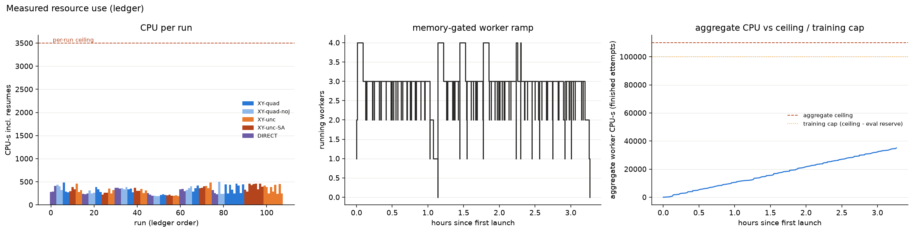
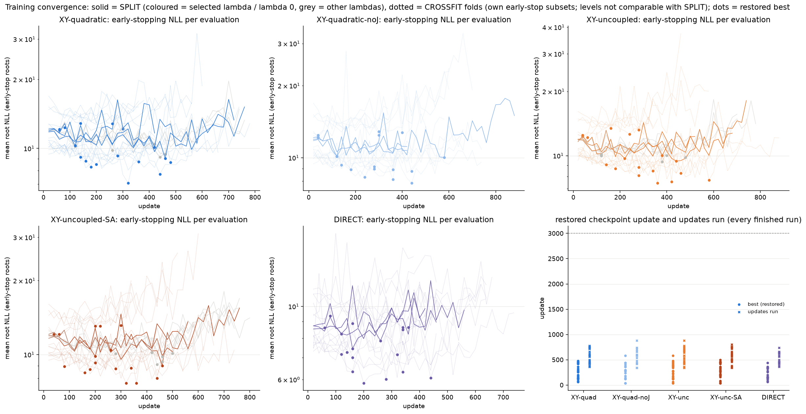

The gap near 1.1 h in the ramp panel is the registered barrier: CROSSFIT starts only after every SPLIT run is terminal and λ\* is written.

## 3. λ selection (val21, frozen rule: 3-seed mean of best early-stopping NLL, ties within 1e-3 → smaller λ)

| Arm | λ = 0.1 | 0.3 | 1.0 | **λ\*** |
|---|---:|---:|---:|---:|
| XY-quadratic | 9.978 | 9.830 | 9.811 | **1.0** |
| XY-uncoupled | 9.796 | 9.712 | 9.976 | **0.3** |
| XY-uncoupled-SA | 9.763 | 9.778 | 9.780 | **0.1** |

**Caveat:** the seed spread at a fixed λ (about 9.0–10.4) is several times larger than the differences between λ values. λ\* is therefore
weakly determined. It was applied exactly as frozen.

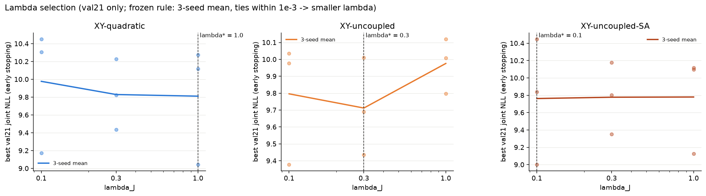

## 4. Feasibility prediction (§6.1)

PRIMARY_DEV, out-of-fold, seeds pooled.
- **Success:** p_succ vs x ∧ y, with the no-op scored against Y0.
- **Heads:** P(X) vs observed X, and P(Y) vs observed Y.

| Arm | success LL | ECE | X LL | Y LL | joint NLL / root |
|---|---:|---:|---:|---:|---:|
| DIRECT | 0.650 | 0.097 | — | — | — |
| XY-quadratic | 0.621 | 0.058 | 0.474 | 0.498 | 10.18 |
| XY-quadratic-noJ | 0.617 | 0.079 | 0.466 | 0.489 | 9.97 |
| XY-uncoupled | 0.649 | 0.084 | 0.513 | 0.497 | 10.48 |
| XY-uncoupled-SA | **0.610** | 0.069 | 0.493 | **0.478** | 10.07 |

- The success LL above is pooled over candidates. The root-averaged success LL used in the contrasts is 0.518–0.538.
- All arms predict feasibility above chance, and the XY arms are somewhat better calibrated than DIRECT.
- The differences between arms are small, and every paired CI includes 0 (§5).
- P(Y) systematically **under**-predicts at low probabilities: observed frequency is about 0.6 where the prediction is below 0.2.

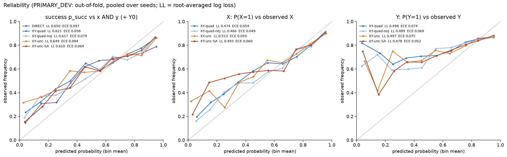

## 5. Registered contrasts

PRIMARY_DEV decides. Each contrast is a paired root-cluster bootstrap, B = 10,000, seed-averaged per root. Deltas are A − B.

| Contrast | Δ success log loss (< 0 = A better) | Δ success on infeasible roots (> 0 = A better) | Other | Decision |
|---|---|---|---|---|
| quad − XY-uncoupled | −0.007 [−0.029, +0.019] | −0.022 [−0.089, +0.044] | joint −0.30 [−0.75, +0.08]; 2 / 3 seeds | |
| quad − XY-uncoupled-SA | +0.011 [−0.011, +0.036] | +0.022 [−0.037, +0.089] | joint +0.11 [−0.29, +0.52]; 0 / 3 seeds | **coupling UNSUPPORTED** |
| quad − DIRECT | −0.009 [−0.041, +0.024] | **−0.148 [−0.237, −0.059]** | unnecessary repair −0.150 [−0.206, −0.094] | **factorization not preferred** |
| TRAVEL_TRAINING (quad γ=0 − noJ γ=0) | +0.008 [−0.006, +0.023] | −0.067 [−0.133, +0.000] | J −0.15 [−0.27, −0.05] rad | not supported |
| TRAVEL_RANKING (quad γ=.05 − γ=0) | (same model) | **−0.052 [−0.104, −0.007]** | J −0.19 [−0.27, −0.12] rad | not supported |
| TRAVEL_COMBINED (quad γ=.05 − noJ γ=0) | +0.008 [−0.006, +0.023] | **−0.119 [−0.178, −0.067]** | J −0.34 [−0.49, −0.21] rad | λ\* not retained |

**Coupling.** The frozen `bxy_p11.verdict` requires a log-loss gain over *both* controls. Against the capacity-matched control the point
estimate is worse.
- The fitted coupling term is not zero: on XY-quadratic out-of-fold candidates, w has median 0.45 and is positive on 84 % of
  candidates (5–95 %: −0.64 to 1.46).
- A nonzero w is a fitted parameter, **not** evidence that quadratic coupling is necessary, and here it buys no measurable predictive or
  selection gain.

**Factorization.** DIRECT and XY-quadratic predict equally well (Δ LL CI spans 0). Under the shared gate-free cost rule they behave
differently:
- DIRECT proposes corrections far more often. It repairs about twice as many infeasible roots (0.259 vs 0.111) and also does
  unnecessary repairs on twice as many feasible roots (0.300 vs 0.150).
- The registered criterion protects corrective success, so the factorized arm is not preferred.

**Travel.** Both components shorten the witnessed travel of successful choices:
- training on J: −0.15 rad;
- ranking by Ĵ: −0.19 rad.

Each component, and their combination, costs corrective success on infeasible roots. The ranking term alone has a CI that excludes 0.
The combined log-loss bound (+0.023) also just misses the frozen +0.02 non-inferiority margin.

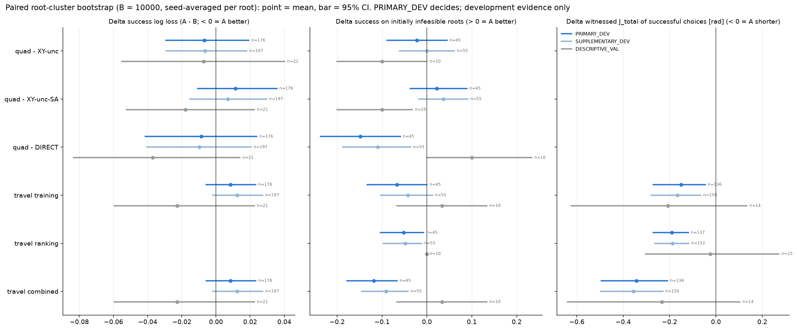

SUPPLEMENTARY_DEV (197 roots) gives the same signs and decisions. DESCRIPTIVE_VAL (21 roots, 10 infeasible) flips several signs, for
example quad − DIRECT on infeasible success is +0.10 there. With n = 10 this is noise-level and carries no inferential weight.

## 6. Corrective selection, references and ablations (§6.2, §6.9)

PRIMARY rule (gate-free cost, η = 0), mean over 3 seeds, PRIMARY_DEV: 176 roots, of which 45 are initially infeasible and 131 are
feasible as-is.

| Selector | overall success | success on infeasible | unnecessary repair on feasible | no-op decision correct |
|---|---:|---:|---:|---:|
| DIRECT | **0.786** | **0.259** | 0.300 | 0.669 |
| XY-quadratic | 0.742 | 0.111 | 0.150 | 0.723 |
| XY-quadratic-noJ | 0.754 | 0.230 | 0.361 | 0.623 |
| XY-uncoupled | 0.761 | 0.133 | 0.120 | 0.737 |
| XY-uncoupled-SA | 0.748 | 0.089 | 0.127 | 0.725 |
| NOOP reference | 0.744 | 0.000 | 0.000 | 0.744 |
| SHORTEST_ADMISSIBLE / DISPLACEMENT_RANK | 0.688 / 0.693 | 0.356 | 0.916 | 0.256 |
| VERIFY_FIRST (oracle, 1.63 verifications / root) | 0.966 | 0.867 | — | — |
| Oracle availability (a verified success exists) | — | 0.867 | — | — |

**Post hoc, descriptive.** This analysis is not registered. It is a paired root bootstrap of overall success, kept in
[POSTHOC_OVERALL_SUCCESS.json](../runs/approach_b/bxy_p12_v1/POSTHOC_OVERALL_SUCCESS.json):

| Comparison | Δ overall success |
|---|---|
| DIRECT − NOOP | **+0.042 [+0.009, +0.076]** |
| XY-quadratic − NOOP | −0.002 [−0.034, +0.028] |
| XY-quadratic-noJ − NOOP | +0.009 [−0.034, +0.051] |
| XY-uncoupled − NOOP | +0.017 [−0.008, +0.044] |
| XY-uncoupled-SA − NOOP | +0.004 [−0.021, +0.027] |
| XY-quadratic − DIRECT | −0.044 [−0.081, −0.008] |

**Main limitation.** A verified repair exists for 87 % of infeasible roots, but the best learned selector finds one for 26 %. The
learned p_succ is not sharp enough to separate the working correction from the failing ones. All arms rank the executable order of
budget-limited order pairs at or below chance (§7).

**Secondary rules** (labelled ablations, not decisions; XY-quadratic):

| Rule | overall success | success on infeasible | unnecessary repair |
|---|---:|---:|---:|
| GATED_NOOP | 0.737 | 0.044 | 0.071 |
| ABSTAINING (η = 0.5) | 0.725 | 0.104 | 0.145 |
| LEXICOGRAPHIC (length-first) | 0.744 | 0 | 0 |
| PRIMARY at γ = 0 | 0.746 | 0.163 | 0.257 |

- LEXICOGRAPHIC degenerates to the no-op on every root.
- Removing the gate (P11.1 correction A) raised infeasible-root success for every arm. For DIRECT it went from 0.081 to 0.259.

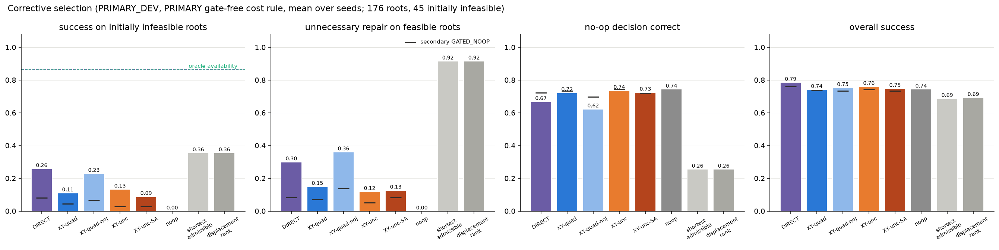
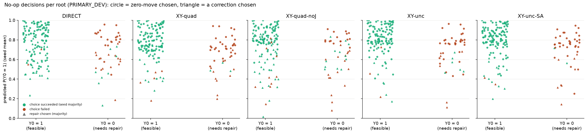

In the no-op panel, the recorded Y0 = 0 roots mostly sit at predicted P(Y0) ≈ 0.6–0.95. The models are over-confident that the
unmodified scene is feasible, which is the failure that keeps corrective success low.

## 7. Action ordering and omissions (§6.6, §6.7)

**Same-endpoint order pairs** (one Y node, two X nodes; PRIMARY_DEV). Root-mean concordance of p_succ: is the executable order ranked
higher?

| Arm | certified failing order (22 pairs / 12 roots) | budget-policy failing order (77 pairs / 45 roots) |
|---|---|---|
| DIRECT | 0.56 [0.33, 0.77] | 0.45 [0.35, 0.54] |
| XY-quadratic | 0.55 [0.35, 0.74] | 0.39 [0.29, 0.49] |
| XY-quadratic-noJ | 0.60 [0.40, 0.78] | 0.43 [0.32, 0.53] |
| XY-uncoupled | 0.60 [0.40, 0.79] | 0.48 [0.38, 0.58] |
| XY-uncoupled-SA | 0.58 [0.41, 0.74] | 0.48 [0.38, 0.58] |

- No arm is distinguishable from chance on certified pairs, where a sound ORDER_FIRST_ACTION certificate says the failing order is
  impossible.
- XY-quadratic is *below* chance on budget-policy pairs. A budget-limited zero is a teacher-policy outcome under a fixed motion-planner
  budget, **not** a proof of geometric impossibility, so these pairs measure agreement with that policy only.

**Single-action omissions** (full candidate vs each candidate with one action removed; sign agreement of the predicted change on decided
pairs with differing labels):
- X: 0.68 (DIRECT, via its single head) and 0.70–0.74 (XY arms), over 525 pairs.
- Y: 0.51–0.54 over 384 pairs. Not applicable to DIRECT, which has no Y head.
- Success: 0.52–0.55 over 726 pairs.

So the models track X changes (does the motion still execute?) but not Y or success changes.

**Two-move non-additivity.** For XY-quadratic there are 19 roots where the full two-move candidate fails but the version with its first
action omitted succeeds. Mean predicted p: full 0.61, omit-first 0.76, omit-second 0.65 — the right direction. In the mirror pattern
(full succeeds, omit-first succeeds, omit-second fails; 19 roots), the predictions are nearly flat (0.66 / 0.69 / 0.69). Full tables
per arm are in EVALUATION.json.

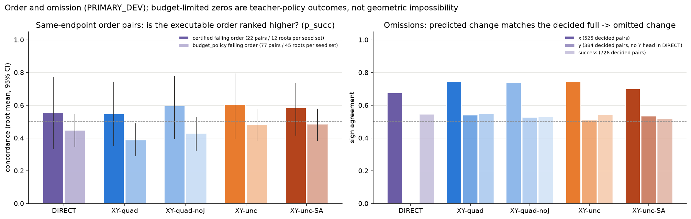
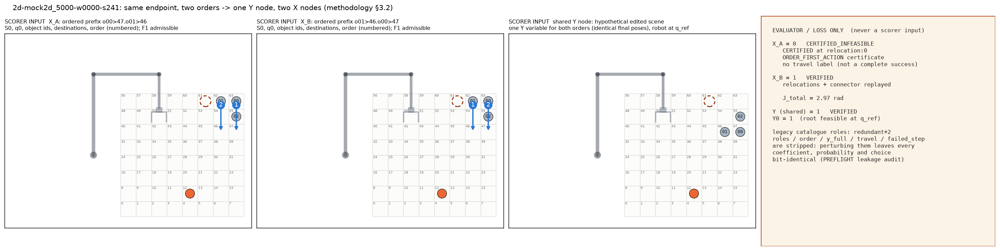

## 8. Difficulty strata (§6.8)

PRIMARY_DEV: K0 = 131 roots, K1 = 32, K ≥ 2 = 5, unknown = 8.

| Arm | LL K0 | LL K1 | success on infeasible K1 | K ≥ 2 | unknown |
|---|---:|---:|---:|---:|---:|
| DIRECT | 0.413 | 0.821 | **0.323** | 0.133 | 0.083 |
| XY-quadratic | 0.427 | 0.752 | 0.146 | 0 | 0.042 |
| XY-quadratic-noJ | 0.412 | 0.749 | 0.281 | 0 | 0.167 |
| XY-uncoupled | 0.420 | 0.793 | 0.177 | 0 | 0.042 |
| XY-uncoupled-SA | 0.410 | 0.766 | 0.104 | 0 | 0.083 |

- The XY arms predict K1 roots better than DIRECT (0.75–0.79 vs 0.82) but repair fewer of them.
- Strata with fewer than 10 roots are descriptive only.
- The set is K0-dominated: 74 % of roots are feasible as-is, which favours the no-op reference.

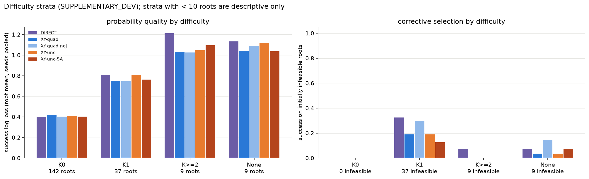

## 9. Travel decomposition (§6.5)

Complete witnessed robot travel of chosen, verified-successful candidates, replayed from recorded witnesses: relocations (including
approaches) + connector + target.

| Arm | mean J, all successful choices | mean J, successful corrections (m ≥ 1) |
|---|---:|---:|
| DIRECT | 2.19 rad | 3.66 rad |
| XY-quadratic | 1.86 | 4.03 |
| XY-quadratic-noJ | 2.31 | 3.92 |
| XY-uncoupled | 1.82 | 3.99 |
| XY-uncoupled-SA | 1.76 | 3.68 |

- Over all successful choices, the travel-trained arms are shorter mainly because they choose the no-op more often (target travel only).
- Over successful corrections, travel is about the same across arms: about 1.1–1.3 rad relocation, 0.8–0.9 rad connector and 1.6–1.8 rad
  target.

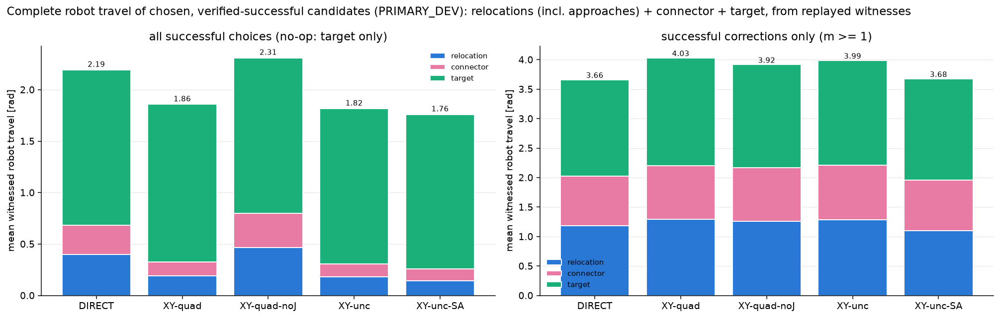

## 10. Robot scenes (recorded witnesses only)

**Figure 10** (`s132`, Y0 = 0) shows XY-quadratic's seed-majority correction (o01 → cell 37), with its replayed relocation,
connector and target witnesses. All three XY-quadratic seeds succeeded on this root. DIRECT's seed majority chose the no-op (success
1 of 3).

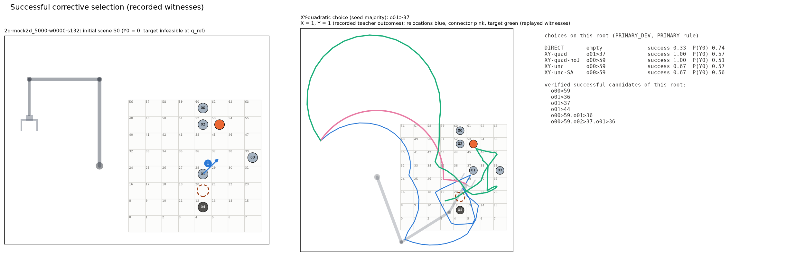

**Figure 11** (`s005`) shows a selection error. The root had exactly one verified-successful candidate (o00 → 52), which DIRECT found.
XY-quadratic chose o00 → 45, which executes (X = 1) but does not make the target feasible (Y = 0; recorded failure UNKNOWN_PLANNER).

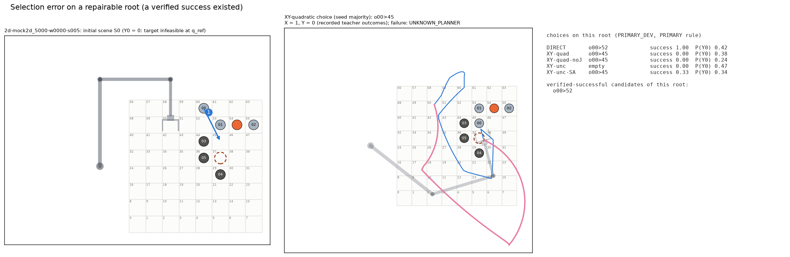

Both scenes are drawn from sidecar evidence and the recorded teacher outcomes. Neither is synthetic or illustrative.

## 11. LB reference (DESCRIPTIVE_VAL only; frozen historical reference)

| Seed | LB success LL | selection success | success on infeasible |
|---|---:|---:|---:|
| s0 | 0.541 | 0.571 | 0.10 |
| s1 | 0.518 | 0.571 | 0.10 |
| s2 | 0.524 | 0.667 | 0.30 |

- On the same 121 matched candidates, the P12 arms span 0.48–0.59 log loss depending on the seed.
- On val21, the NOOP reference succeeds on 0.524 and the P12 arms on 0.556–0.651.
- With 21 roots and 10 infeasible, this comparison is descriptive only.

## 12. Limitations

1. **Development evidence only.**
   - CROSSFIT folds reuse the P-min catalogue, which was built with knowledge of the outcomes.
   - λ\* was chosen on val21, which is why PRIMARY_DEV excludes those roots.
   - No result here is confirmatory.
2. **Small, K0-dominated sample.** There are 45 infeasible roots in PRIMARY_DEV, and 5 roots with K ≥ 2. The CIs on corrective metrics are
   wide (about ±0.08).
3. **λ\* is noise-dominated** (§3).
4. **Budget-limited negatives.** Most failing orders and many Y = 0 labels come from a budget-limited planner. They do not establish
   geometric impossibility.
5. **Gradient clipping** was active on 71 % of updates under the frozen settings. This is not a failure, but it may limit how sharp the
   learned p_succ becomes.
6. **Checkpoints are local** (469 MB, git-ignored). Each one's sha256 is in its committed `RESULT.json`, and the predictions are committed
   as JSON.
7. **One post-hoc analysis** (overall success vs no-op / DIRECT) is clearly labelled and kept separate from the registered decisions.

## 13. Tests and regression

- **Preflight, before training** ([regression_preflight/](../runs/approach_b/bxy_p12_v1/regression_preflight/)): full suite 660 passed,
  1 skipped, exit 0. The six archived replays exit 0 with `replay_passed: true`.
- **Fault-injection tests:** 17 runner tests ([tests/test_bxy_p12_run.py](../tests/test_bxy_p12_run.py)) cover:
  - SIGTERM, crash, corrupt output, CPU cap, aggregate cap, wall durability, timeout, memory pressure and ramp, killed parent, orphan,
    synthetic guard;
  - bitwise resume identity, the λ rule, authorization refusal, roster, fair order and real custody.
- **After training:** the evaluator ([bxy_p12_eval.py](../bxy_p12_eval.py)) is byte-identical to the pre-training commit `d531f666`. It was
  run once on the trained models; an earlier smoke test used untrained models and is not reported. The only post-training code edits
  are presentation fixes in [bxy_p12_viz.py](../bxy_p12_viz.py): a dtype bug, legend counts and labels, and line visibility. P12 + P11.1
  tests re-run afterwards: **26 passed, exit 0** ([regression_post/](../runs/approach_b/bxy_p12_v1/regression_post/)).

## 14. Artifacts

**[runs/approach_b/bxy_p12_v1/](../runs/approach_b/bxy_p12_v1/):**
- `AUTHORIZATION.json`, `PREFLIGHT_P12.json`;
- `LEDGER.json`, `RUN_STATUS.json`, `LAMBDA_SELECTION.json`;
- per run `runs/<id>/{RESULT,history,predictions,heartbeat}.json` plus attempt logs;
- `EVALUATION.json`, `EVAL_RESOURCES.json`, `POSTHOC_OVERALL_SUCCESS.json` (with its script), `launch_session1.log`, `eval.log`.

**[visualizations/approach_b/bxy_p12_v1/](../visualizations/approach_b/bxy_p12_v1/):** 15 figures, all generated from the files above.

**STOP (BXY-P12).** No cohort generation, teacher collection, further training, 3D or any other phase has been started.
