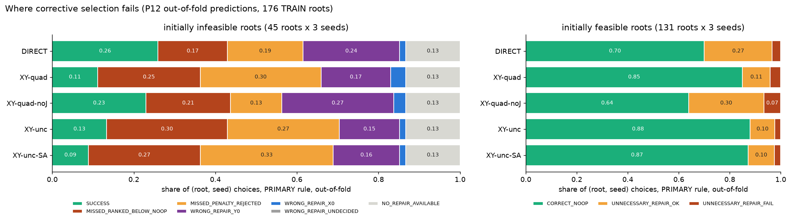
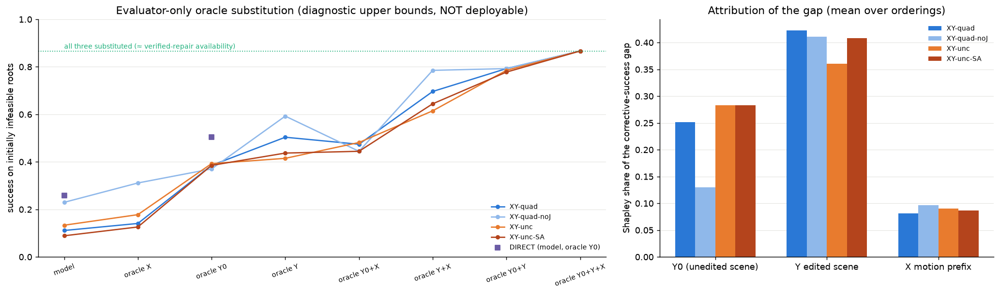
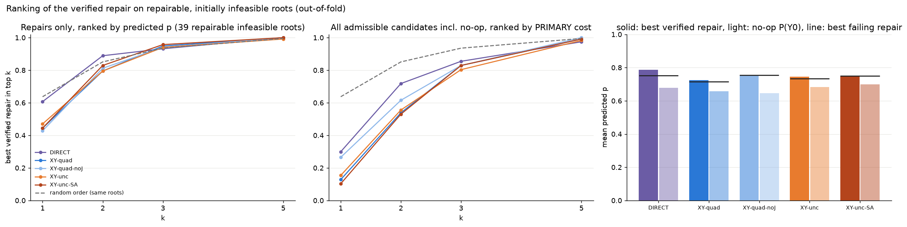
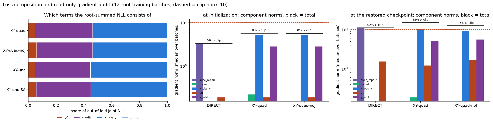
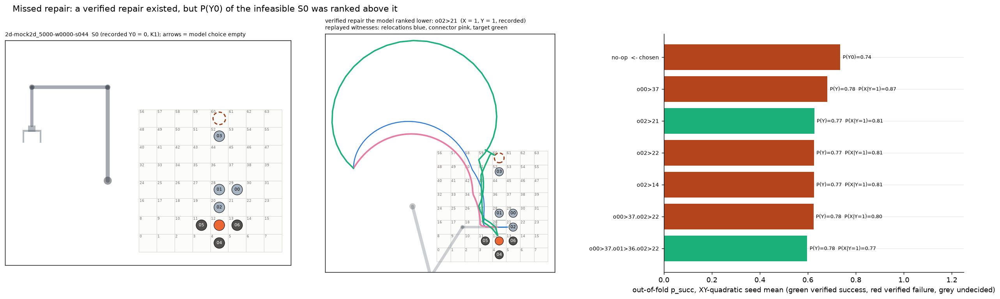
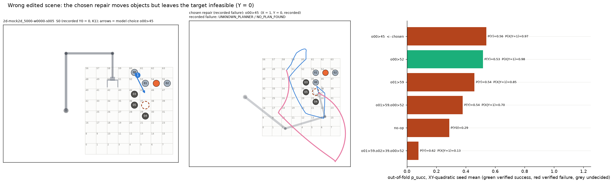

# 0120 — BXY-P13: why the P12 models do not select corrective actions

Date: 2026-11-01. Gate: BXY-P13 (first of the BXY-P13 / P14 / P15 contract). Previous gate: 0119, commit
`2342b4cc517f066249da17fa33789f5ff7949248` (local HEAD = origin at start).

**Scope:** read-only forensics.
- Done here: the saved P12 predictions, verified outcomes and local checkpoints, evaluated with `no_grad` or with gradients computed but
  never applied.
- Not done here: no optimizer step, teacher query, new data or test root.
- Oracle substitutions happen only in evaluator-side copies of the prediction rows. They are **diagnostic upper bounds, not deployable
  performance**.

## Result in one paragraph

The dominant failure is the **edited-scene Y head**. It does not distinguish the edits *within* a root. Every edited scene gets roughly the
same bonus over the unedited scene, P(Y_edit) − P(Y0) ≈ +0.12 to +0.16, whatever the recorded outcome. The edits that break a feasible
scene are therefore ranked *above* the feasible original in 94–100 % of cases. This holds on the models' own training roots as well, so it
is an under-fit of the within-root contrast, not only a generalization failure.

Second, P(Y0) generalizes poorly: AUROC is 0.83–0.89 on training roots but 0.65–0.71 out of fold. Third, the action/travel penalty rejects
verified repairs that the model already scores above the no-op.

X prediction, gradient clipping and loss normalization are minor or unsupported as explanations. These are measured associations in
development data. They do not establish causal mechanisms in the robot task.

---

## 1. Reproduction first

`bxy_p13.reproduce()` re-runs the committed P12 evaluator and compares the result with the committed `EVALUATION.json`. **All three tiers
are identical** across the 108 runs; only the accounting fields are excluded from the comparison. Every number below starts from that
reproduced state.

**Inputs read:**
- the October 31 methodology;
- reports 0117–0119;
- the frozen P-min sidecar (hashes match);
- the 108 P12 `RESULT` / `predictions` / `history` files, all hash-validated;
- the 75 CROSSFIT `best.pt` files, each matching the sha256 in its RESULT.json.

PRIMARY_DEV, as in P12: 176 TRAIN roots out of fold; 45 initially infeasible, of which 39 have a verified repair; 131 initially feasible.

## 2. Where the choices fail

[`01_failure_categories.png`](../visualizations/approach_b/bxy_p13_v1/01_failure_categories.png)

Shares of (root, seed) choices on the 45 infeasible roots under the PRIMARY rule:

| Arm | success | missed: no-op ranked above every verified repair | missed: verified repair had higher p, lost on penalty | wrong repair, Y = 0 | wrong repair, X = 0 | no verified repair exists |
|---|---:|---:|---:|---:|---:|---:|
| DIRECT | 0.26 | 0.17 | 0.19 | 0.24 | 0.01 | 0.13 |
| XY-quadratic | 0.11 | 0.25 | **0.30** | 0.17 | 0.04 | 0.13 |
| XY-quadratic-noJ | 0.23 | 0.21 | 0.13 | **0.27** | 0.03 | 0.13 |
| XY-uncoupled | 0.13 | **0.30** | 0.27 | 0.15 | 0.01 | 0.13 |
| XY-uncoupled-SA | 0.09 | 0.27 | **0.33** | 0.16 | 0.01 | 0.13 |

- **Wrong motion (X = 0) is rare**, at 1–4 %.
- **Wrong edited scenes (Y = 0) are common**, at 15–27 %.
- **The no-op wins in 36–60 % of choices**, about half of them through the penalty.

## 3. Oracle substitution and attribution (evaluator-only)

Under the model, p_succ(q) = P(Y_s = 1) · P(X_q = 1 | Y = 1). The substitutions replace:
- P(Y0) with the recorded Y0;
- P(Y_s) of edited scenes with the recorded Y;
- P(X | Y = 1) with the recorded X.

Each applies only where that quantity was observed. Scorer inputs are never touched, and a test checks this.

Success on infeasible roots, XY-quadratic: model **0.111**.

| Substitution | Success | Paired Δ vs model [95 % CI] |
|---|---:|---|
| oracle X | 0.141 | +0.030 [+0.000, +0.067] |
| oracle Y0 | 0.385 | +0.274 [+0.170, +0.385] |
| oracle Y_edit | 0.504 | +0.393 [+0.289, +0.496] |
| oracle Y0 + Y_edit | 0.793 | +0.681 [+0.563, +0.793] |
| all three | 0.867 | = verified-repair availability |

**Shapley shares of the gap** (Y_edit / Y0 / X):

| Arm | Y_edit | Y0 | X |
|---|---:|---:|---:|
| XY-quadratic | 0.42 | 0.25 | 0.08 |
| XY-quadratic-noJ | 0.41 | 0.13 | 0.10 |
| XY-uncoupled | 0.36 | 0.28 | 0.09 |
| XY-uncoupled-SA | 0.41 | 0.28 | 0.09 |

For DIRECT, substituting the recorded Y0 raises infeasible-root success from 0.259 to 0.504, and substituting the decided success raises it
to 0.748.

## 4. Is the verified repair ranked correctly but rejected by the penalty?

[`03_repair_ranking.png`](../visualizations/approach_b/bxy_p13_v1/03_repair_ranking.png). The analysis covers the 39 repairable
infeasible roots, which have on average 5.7 admissible repairs, 3.5 of them verified.

- **By p alone, among repairs only.** The best verified repair is ranked first for only 43–47 % (XY) and 61 % (DIRECT) of roots. A random
  order would rank it first for 64 %. Within-root success AUROC is 0.60–0.64: above chance pairwise, but the top choice is often a failing
  repair. The dominant failing top choice is a one-move repair with X = 1 and Y = 0, as many as the successful ones (48 vs 47).
- **By PRIMARY cost, no-op included.** Top-1 drops to 10–30 %. In 65–78 % of these roots the best verified repair has p above P(Y0); the
  α·m + γ·Ĵ penalty then decides against it.
- **Penalty-free selection** (α = β = γ = 0, the "no-pen" rule):
  - it raises infeasible-root success to 0.30–0.42;
  - but it repairs **55–65 % of feasible roots**, because every edit carries the constant Y bonus of §5.

So the penalty is a real but secondary bottleneck. Removing it alone is not acceptable without fixing the edit contrast.

## 5. Which prediction is wrong: no-op, X or edited-scene Y?

[`04_y_diagnostics.png`](../visualizations/approach_b/bxy_p13_v1/04_y_diagnostics.png)

**Edited-scene Y, matched within each root.** For every edited scene whose observed Y differs from the observed Y0, I checked whether
P(Y_edit) − P(Y0) has the right sign.

| Case | Sign agreement |
|---|---:|
| S0 infeasible, edit feasible | **0.96–0.98** |
| S0 feasible, edit infeasible | **0.00–0.06** |

- The mean shift P(Y_edit) − P(Y0) is about +0.13 regardless of the label pair. XY-quadratic, over all OOF rows:

  | (y0, y_edit) | Mean shift | Rows |
  |---|---:|---:|
  | (0, 1) | +0.120 | 621 |
  | (0, 0) | +0.149 | 519 |
  | (1, 1) | +0.130 | 3,126 |
  | (1, 0) | +0.162 | 204 |

- The model has learned "editing makes the target feasible", not *which* edit does. Within-root edited-Y AUROC is **0.42–0.48** (below
  chance).
- **Label structure behind this:** edited scenes are feasible in 94 % of cases on feasible roots (1,110 labels) and in 54 % on infeasible
  roots (380 labels). Only 27 + 33 roots contain both edited-Y classes.

**Y0.** Mean P(Y0) is 0.66–0.69 on infeasible roots vs 0.75–0.79 on feasible ones; AUROC is 0.65–0.71. 35 of the 45 Y0 = 0 labels are
NO_PLAN_FOUND under the fixed motion budget, and only 10 are certified infeasible. A budget-limited zero is a teacher-policy outcome, not
geometric impossibility, so part of the Y0 error is irreducible from the scene alone.

**X.** Within-root AUROC is 0.70–0.74, and the oracle-X gain is small (+0.03–0.08).

## 6. Generalization or representation?

[`05_insample_vs_oof.png`](../visualizations/approach_b/bxy_p13_v1/05_insample_vs_oof.png). Each of the 75 CROSSFIT checkpoints was
re-scored, without gradients, on its own training roots: 9,180 root predictions, cached locally with hashes in DIAGNOSTICS.json.

| XY-quadratic | training roots | out of fold | Reading |
|---|---:|---:|---|
| Y0 AUROC | 0.86 | 0.69 | **generalization gap** |
| within-root edited-Y AUROC | 0.58 | 0.48 | **under-fit even in-sample** |
| edit contrast, S0 feasible | 0.04 | 0.00 | not learned at all |
| within-root success AUROC | 0.69 | 0.60 | weak fit + gap |
| certified order pairs | 0.68 | 0.55 | weak fit + gap |
| Y omission sign agreement | 0.66 | 0.54 | **generalization gap** |
| corrective success (PRIMARY) | 0.18 | 0.11 | poor even on training roots |

The other XY arms show the same pattern.

**Geometry probe** ([`07_geometry_probe.png`](../visualizations/approach_b/bxy_p13_v1/07_geometry_probe.png)). Eight hand-made clearances
were computed only from the scorer's own tensors: object centres and radii, the target flag, the robot base and the goal. They were fed to
a logistic regression trained on the same P12 folds.

| Metric | Probe | XY-quadratic OOF |
|---|---:|---:|
| Y0 AUROC | **0.77** | 0.69 |
| pooled edited-Y AUROC | **0.69** | 0.59 |
| edit-contrast agreement | 0.62 | 0.61 |

The scene representation (pooled object tokens) uses available geometry less efficiently than eight clearances do. Neither solves the
within-root contrast.

**Reading:**
- Y0 is mainly a **generalization** problem; a better inductive bias such as geometry helps.
- The edit contrast is mainly a **supervision / representation** problem: the root-summed likelihood rewards separating roots, not the
  edits inside a root.
- Order and omission errors combine a weak in-sample fit with a generalization gap. Certified order pairs are only 22 pairs on 12 roots,
  too few for a dedicated intervention.

## 7. Loss composition and gradient clipping

[`06_loss_gradient_audit.png`](../visualizations/approach_b/bxy_p13_v1/06_loss_gradient_audit.png). The exact root NLL splits additively
into a Y0 term, edited-Y terms and X-given-observed-Y terms; a test verifies this to 1e-9. Out of fold, every X has an observed parent Y,
so the marginalized share is 0.

- **Loss shares:** Y0 is **5.6 %** of the NLL (1 term per root), edited Y 39–41 %, and X 54–55 %.
- **Query count:** root NLL correlates with the root's query count at r = 0.71–0.74, with query quartiles 8 / 19 / 31. Query-rich roots
  dominate each batch mean.
- **Clipping.** I recomputed gradients with no optimizer step on 4 random 12-root training batches for each of 15 models per arm.
  - At initialization: 0 % of batches exceed the clip norm of 10 (median total norm 5.7).
  - At the restored checkpoints: 62–65 % exceed it (median 11–15).
  - The X-given-Y component dominates (≈ 10 vs 5 for edited Y and 1.2 for Y0).
  - P12 histories show the same: 34 % of updates clipped in the first 100, 83 % after.
  - Gradient norm correlates only weakly with batch NLL (r = 0.17).
  - So clipping reflects large X-term gradients of sharpened logits late in training, not a start-up scale problem. Nothing indicates it
    prevents fitting: X is the best-fit head.

## 8. Scenes (recorded witnesses, saved out-of-fold predictions)

- **[08 — missed repair](../visualizations/approach_b/bxy_p13_v1/08_scene_missed_ranked_below_noop.png).** On `s044` (K1), the model keeps
  the infeasible S0 with P(Y0) = 0.74. The verified repair o02 → 21, shown with its replayed relocation, connector and target, gets
  P(Y) = 0.77 — exactly the same as the failing o02 → 22 and o02 → 14.
- **[09 — wrong edited scene](../visualizations/approach_b/bxy_p13_v1/09_scene_wrong_repair_y0.png).** On `s005`, the chosen o00 → 45
  executes (X = 1) but leaves the target unplannable under the budget (Y = 0, NO_PLAN_FOUND). The one verified repair, o00 → 52, scores
  P(Y) = 0.53 vs 0.56.
- **[10 — penalty rejection](../visualizations/approach_b/bxy_p13_v1/10_scene_missed_penalty_rejected.png).** On `s008`, the verified
  repair o00 → 12 (p = 0.66) and two other verified repairs all score above P(Y0) = 0.50, but the no-op wins on the α·m + γ·Ĵ cost.

## 9. Ranked bottlenecks and the frozen P14 hypotheses

1. **B1 — edited-scene Y contrast:** constant edit bonus, within-root AUROC below chance, under-fit in-sample. It has the largest Shapley
   share (0.36–0.42).
2. **B2 — Y0 generalization:** 0.86 → 0.69 AUROC from training roots to out of fold; Shapley share 0.13–0.28. Simple geometry beats the
   network on it.
3. **B3 — selection penalty:** 27–33 % of travel-arm choices are penalty rejections. Removing the penalty only helps once B1 is addressed.

The P14 hypotheses were frozen in [P14_HYPOTHESES.json](../runs/approach_b/bxy_p13_v1/P14_HYPOTHESES.json), sha256
`8c3b62395629bd1910793e0a016fc62ce856f0bfa89d20f516d0efe7fa24ee72`, before any P14 code or run existed.

**Interventions (three; nothing else):**

| Id | Kind | Definition |
|---|---|---|
| **CON** | training, auxiliary to — and explicitly not — the exact likelihood | Matched within-root Y contrast: for observed Y pairs with different labels (Y0 included), a weighted pairwise loss on the Y logit b; κ = 1 |
| **GEO** | geometry-aware control | The 8 scorer-available clearances feed an extra term into the Y unary b only |
| **PONLY** | selection only | −log p argmin over the F1-admissible candidates including the no-op, with no penalty |

**Arms (5 × 5 folds × 3 seeds = 75 runs):** DIRECT, XYQ (P12 XY-quadratic at λ_J = 1.0), XYQ+CON, XYQ+GEO and XYQ+CON+GEO. The folds are
new family-grouped folds over the 176 TRAIN roots only.

**Contrasts:**

| Id | Comparison |
|---|---|
| C1 | XYQ+CON vs XYQ |
| C2 | XYQ+GEO vs XYQ |
| C3 | XYQ+CON+GEO vs XYQ |
| C4 | PONLY vs PRIMARY on the same checkpoints |
| C5 | XYQ+CON+GEO with PONLY vs XYQ with PRIMARY |

**Decision rules:**
- **IMPROVES:** infeasible-root success has Δ CI95 lower bound > 0, and the unnecessary-repair Δ point estimate is ≤ +0.05.
- **TARGET_MET:** IMPROVES, and Δ ≥ +0.10.
- 95 % CIs are reported, together with whether each result survives a Bonferroni 99 % CI.

**Not targeted,** with reasons:
- X: small Shapley share.
- Clipping: a late-training symptom with no evidence that it prevents fitting.
- Root/query normalization: Y0 is not under-fit.
- Order/omission: 12 certified roots are too few for a dedicated loss.

## 10. Tests, regression, compute

- [tests/test_bxy_p13.py](../tests/test_bxy_p13.py): **6 passed**. They cover:
  - the exact NLL split equals −log_evidence;
  - oracle rows are evaluator-only (the scorer view and the prediction are unchanged; a full oracle recovers an available verified repair);
  - categories are exhaustive;
  - the ranking random-order expectation and AUROC;
  - Shapley efficiency;
  - the geometry features read only scorer tensors.
- Full suite: **666 passed, 1 skipped, exit 0** (15 min 24 s). Six archived replays (`g1_robot`, `g1_hardening`, `g2_interventions`,
  `g3_repairs`, `g3_5_initial_scene`, `g4a_evidence_audit`): **exit 0 × 6**. Logs: [regression/](../runs/approach_b/bxy_p13_v1/regression/).
- **Hash guards:** P-min evidence, the P11 / P11.1 designs and locks, and the P12 authorization (`bxy_p12_run.py verify`) all unchanged.
- **Compute:**
  - final diagnostics run: 211 CPU-s / 211 s wall;
  - the earlier run that produced the cached in-sample predictions: about 10 min of single-thread CPU, not separately metered.
- **Artifacts** ([runs/approach_b/bxy_p13_v1/](../runs/approach_b/bxy_p13_v1/)): `DIAGNOSTICS.json`, `PER_ROOT_OOF.json`,
  `GRAD_AUDIT_BATCHES.json`, `P14_HYPOTHESES.json`. The in-sample cache stays local (git-ignored, hashed).
- **Figures** ([visualizations/approach_b/bxy_p13_v1/](../visualizations/approach_b/bxy_p13_v1/)): 10, from measured data only.

Next: BXY-P14, with its own design, authorization and runner, under the 45,000 CPU-s authorization.
