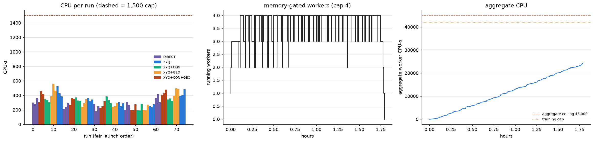
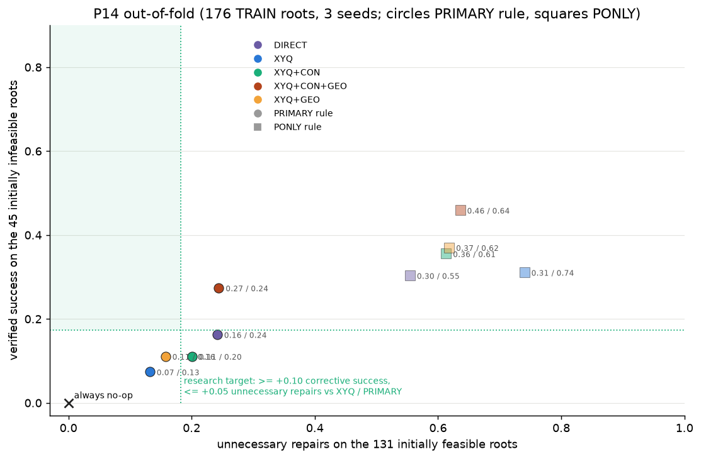
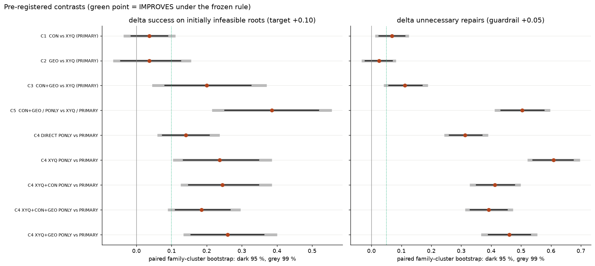
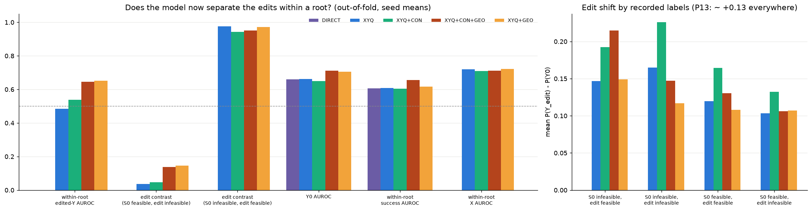
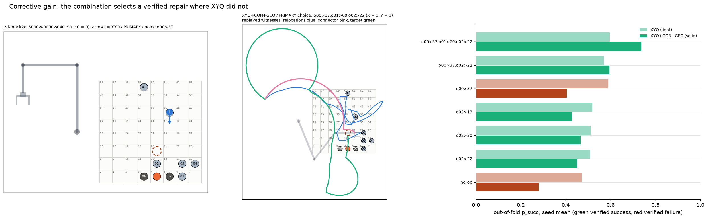

# 0121 — BXY-P14: bounded repair-learning experiments (CON, GEO, PONLY)

Date: 2026-11-01. Gate: BXY-P14 (second of the BXY-P13 / P14 / P15 contract). Previous gate: 0120 (P13, commit `e662f85a2aa1`).

Commits made before any P14 run:

| Commit | Content |
|---|---|
| `835ccc2e` | design, code, tests |
| `1b05d51b` | authorization manifest |
| `9ec331f0` | preflight |

## Result

**No intervention meets the frozen IMPROVES criterion**: infeasible-root success Δ CI95 lower bound > 0 *and* unnecessary-repair Δ ≤ +0.05.
The criterion is reported unchanged.

The one large effect is the **combination of the matched Y contrast and the geometry head (XYQ+CON+GEO)**. Under the unchanged PRIMARY rule it
lifts verified corrective success on the 45 initially infeasible roots from **0.074 to 0.274**, Δ **+0.200 [+0.081, +0.326]**, which
survives the Bonferroni 99 % interval. It also raises unnecessary repairs by **+0.112 [+0.059, +0.169]**, above the +0.05 guardrail, so it
fails the frozen decision rule.

Against **DIRECT**, the same combination gives **+0.111 [−0.007, +0.237]** corrective success at an **equal unnecessary-repair rate**
(+0.003 [−0.051, +0.057]). On overall success it is the only XY configuration whose CI excludes the no-op under PRIMARY: **+0.055
[+0.019, +0.093]**.

CON alone and GEO alone each give +0.037, with CIs spanning 0. The penalty-free rule (PONLY) raises corrective success for every arm, but
it repairs 55–74 % of feasible roots.

**Scope:**
- Development evidence only: 176 TRAIN roots, family-grouped 5-fold out-of-fold, 3 seeds.
- No val21 root, no test root, no teacher query, no new data, no GPU.

---

## 1. Execution and resources

| Quantity | Authorized | Measured |
|---|---:|---:|
| Runs | 75 | **75 DONE**, one attempt each: no crash, retry, CPU-cap stop, timeout or memory kill |
| Aggregate CPU (incl. evaluation) | 45,000 CPU-s | **24,389** training + 3.4 evaluation |
| Per run | 1,500 CPU-s | min 182 / median 301 / max **562** |
| Wall | 21,600 s | **6,452 s** + 4 s evaluation |
| Workers | 4, memory-gated | ≤ 4 |

Training statistics per arm (medians and totals over its 15 runs):

| Arm | Best update | Updates run | Updates clipped | Non-finite updates |
|---|---:|---:|---:|---:|
| DIRECT | 200 | 500 | 60 % | 0 |
| XYQ | 240 | 540 | 73 % | 0 |
| XYQ+CON | 220 | 520 | 80 % | 0 |
| XYQ+GEO | 180 | 480 | 81 % | 0 |
| XYQ+CON+GEO | 160 | 460 | 89 % | 0 |

- Every run stopped early.
- Every `best.pt` hash is in its RESULT.json; the checkpoints stay local (git-ignored).
- **Evaluation:** run once, with [bxy_p14_eval.py](../bxy_p14_eval.py) as committed before training. It covers 176 roots in 173 families
  (45 infeasible, 39 repairable). Uncertainty is a paired family-cluster bootstrap with B = 10,000.

## 2. Primary endpoints (out of fold, seed means)

| Arm / rule | Success, infeasible (45) | Success, repairable (39) | Unnecessary repair, feasible (131) | Overall success | Mean actions chosen | Mean C_d chosen | J of successful corrections (rad) |
|---|---:|---:|---:|---:|---:|---:|---:|
| NOOP | 0 | 0 | 0 | 0.744 | 0 | 0 | — |
| DIRECT / PRIMARY | 0.163 | 0.188 | 0.242 | 0.775 | 0.31 | 0.38 | 3.76 |
| XYQ / PRIMARY | 0.074 | 0.085 | 0.132 | 0.754 | 0.21 | 0.30 | 3.44 |
| XYQ+CON / PRIMARY | 0.111 | 0.128 | 0.201 | 0.761 | 0.27 | 0.42 | 3.47 |
| XYQ+GEO / PRIMARY | 0.111 | 0.128 | 0.158 | 0.756 | 0.23 | 0.34 | 3.52 |
| **XYQ+CON+GEO / PRIMARY** | **0.274** | **0.316** | 0.244 | **0.799** | 0.35 | 0.50 | 3.53 |
| DIRECT / PONLY | 0.304 | 0.350 | 0.555 | 0.797 | 0.82 | 0.97 | 3.81 |
| XYQ / PONLY | 0.311 | 0.359 | 0.740 | 0.777 | 0.99 | 1.36 | 3.49 |
| XYQ+CON / PONLY | 0.356 | 0.410 | 0.613 | 0.788 | 0.88 | 1.16 | 3.73 |
| XYQ+GEO / PONLY | 0.370 | 0.427 | 0.618 | 0.782 | 0.92 | 1.26 | 3.60 |
| XYQ+CON+GEO / PONLY | 0.459 | 0.530 | 0.636 | 0.822 | 0.99 | 1.34 | 3.79 |

The P14 XYQ baseline (0.074) is lower than in P12 (0.111). The folds and training sets differ: 176 roots here vs 197 in P12.

## 3. Pre-registered contrasts (paired family-cluster bootstrap; 95 % [99 %])

| Contrast | Δ success, infeasible | Δ unnecessary repair | Δ overall success | IMPROVES | TARGET_MET |
|---|---|---|---|:---:|:---:|
| C1 CON vs XYQ (PRIMARY) | +0.037 [−0.015, +0.089] | +0.069 [+0.026, +0.112] | +0.008 [−0.010, +0.026] | no | no |
| C2 GEO vs XYQ (PRIMARY) | +0.037 [−0.044, +0.126] | +0.025 [−0.020, +0.070] | +0.002 [−0.021, +0.027] | no | no |
| C3 CON+GEO vs XYQ (PRIMARY) | **+0.200 [+0.081, +0.326]** (99 %: [+0.044, +0.370]) | +0.112 [+0.059, +0.169] | +0.045 [+0.010, +0.082] | **no — guardrail** | no |
| C5 CON+GEO / PONLY vs XYQ / PRIMARY | +0.385 [+0.252, +0.519] | +0.504 [+0.433, +0.577] | +0.068 [+0.021, +0.117] | no — guardrail | no |

**C4, PONLY vs PRIMARY on the same checkpoints:**

| Arm | Δ success, infeasible | Δ unnecessary repair |
|---|---|---|
| DIRECT | +0.141 | +0.313 |
| XYQ | +0.237 | +0.608 |
| XYQ+CON | +0.244 | +0.412 |
| XYQ+GEO | +0.259 | +0.461 |
| XYQ+CON+GEO | +0.185 | +0.392 |

Every success CI excludes 0; every arm fails the guardrail.

**Disentangling training from selection** ([05](../visualizations/approach_b/bxy_p14_v1/05_training_x_selection.png)):

- **Training changes** (same rule): only CON+GEO moves corrective success materially under PRIMARY. Its unnecessary repairs (0.244) match
  DIRECT's (0.242).
- **Selection changes** (same checkpoints): PONLY trades about 0.14–0.26 corrective success for about 0.31–0.61 unnecessary repairs.
  Better-trained arms waste less: with PONLY, the CON+GEO checkpoints repair 64 % of feasible roots vs 74 % for XYQ. The penalty still
  cannot be removed without B1 being solved.

## 4. Mechanism: did the targeted bottlenecks move?

([03](../visualizations/approach_b/bxy_p14_v1/03_mechanism.png))

| Out of fold | XYQ | XYQ+CON | XYQ+GEO | XYQ+CON+GEO |
|---|---:|---:|---:|---:|
| within-root edited-Y AUROC | 0.484 | 0.538 | **0.651** | **0.646** |
| edit contrast, S0 feasible / edit infeasible | 0.04 | 0.05 | 0.15 | 0.14 |
| edit contrast, S0 infeasible / edit feasible | 0.98 | 0.94 | 0.97 | 0.95 |
| Y0 AUROC | 0.663 | 0.651 | 0.706 | **0.712** |
| mean P(Y0): S0 infeasible / S0 feasible | 0.69 / 0.78 | 0.63 / 0.73 | 0.68 / 0.78 | **0.60** / 0.74 |
| within-root success AUROC | 0.608 | 0.603 | 0.617 | **0.656** |
| top-1 repair by p is verified (repairable roots) | 0.39 | 0.55 | 0.55 | **0.62** |
| penalty rejections (share of infeasible choices) | 0.47 | 0.34 | 0.41 | **0.24** |
| success log loss / ECE (pooled) | 0.637 / 0.069 | 0.680 / 0.097 | 0.662 / 0.102 | 0.655 / 0.081 |
| Y log loss / ECE | 0.495 / 0.075 | 0.539 / 0.110 | 0.495 / 0.080 | 0.540 / 0.102 |

**Reading:**
- **GEO** is the component that lifts within-root edited-Y discrimination (0.48 → 0.65) and Y0 discrimination (0.66 → 0.71). The P13 probe
  suggested scorer-available clearances carry information the pooled representation used poorly.
- **CON** shifts the probabilities. It lowers P(Y0) on infeasible roots and makes the edit shift label-dependent: about +0.21 for
  "S0 infeasible → edit feasible" vs about +0.11 for "S0 feasible → edit infeasible", against nearly flat for XYQ. But it **worsens
  calibration**: Y log loss rises from 0.495 to 0.539 and ECE from 0.075 to 0.110. As expected, an auxiliary ranking term is not a
  likelihood.
- **Together** they move the decision: the verified repair is more often the top repair (0.62), and penalty rejections fall from 0.47 to
  0.24.
- **Still unsolved:** the S0-feasible / edit-infeasible contrast stays mostly wrong (0.14). The model rarely predicts that an edit *breaks*
  a feasible scene. This is the main remaining source of unnecessary repairs.

**Order and omissions** ([06](../visualizations/approach_b/bxy_p14_v1/06_probability_order_omission.png)):

| Arm | certified order pairs | budget-policy order pairs | Y omission sign agreement |
|---|---:|---:|---:|
| XYQ | 0.52 | 0.46 | 0.58 |
| CON | 0.66 | — | 0.61 |
| GEO | 0.66 | — | **0.72** |
| CON+GEO | 0.56 | — | 0.68 |

- Budget-policy order pairs stay at chance or below (0.46–0.49) for every arm. A budget-limited zero reflects the teacher policy, not
  geometric impossibility.
- The certified order pairs are only 22 pairs on 12 roots, so all order numbers are descriptive.

## 5. Error categories (PRIMARY)

([04](../visualizations/approach_b/bxy_p14_v1/04_error_categories.png)). On infeasible roots, XYQ → XYQ+CON+GEO:

| Category | XYQ | XYQ+CON+GEO |
|---|---:|---:|
| success | 0.07 | 0.27 |
| penalty rejected | 0.47 | 0.24 |
| no-op ranked above every verified repair | 0.12 | 0.18 |
| wrong repair, Y = 0 | 0.19 | 0.13 |
| wrong repair, X = 0 | 0.01 | 0.04 |
| no verified repair exists | 0.13 | 0.13 |

On feasible roots, unnecessary repairs that still succeed rise from 0.12 to 0.22, and unnecessary failing repairs stay at 0.02. So most
added repairs on feasible roots are harmless displacements that still succeed, though they cost actions and travel.

## 6. Scenes (recorded witnesses, saved out-of-fold predictions)

- **[08 — gain](../visualizations/approach_b/bxy_p14_v1/08_scene_gain.png).** On `s040` (Y0 = 0), XYQ chose the failing one-move
  o00 → 37. XYQ+CON+GEO chose the verified three-move o00 → 37 · o01 → 60 · o02 → 22, drawn with its replayed relocations, connector and
  target. Its P(Y0) dropped from 0.47 to 0.28, and the failing o00 → 37 dropped from 0.59 to 0.40.
- **[09 — regression](../visualizations/approach_b/bxy_p14_v1/09_scene_loss.png).** On `s239`, XYQ's verified o00 → 28 lost to o00 → 62.
  That edited scene is feasible (Y = 1), but the motion prefix failed (X = 0) under the fixed budget. The combination's probability shift
  is not uniformly beneficial.

## 7. Conclusions for P14 (development evidence)

1. Under the frozen criteria the P14 result is **negative**: no intervention improves corrective selection within the +0.05
   unnecessary-repair guardrail, and the +10-point target is not met. The criteria were not changed after seeing results.
2. There is a **real, sizeable, pre-specified effect of CON+GEO on corrective success** (+0.20, Bonferroni-robust). It comes with
   additional mostly-successful repairs on feasible roots. Relative to DIRECT it is a better operating point: +0.11 corrective success at
   equal unnecessary repairs. This is the candidate that merits independent confirmation, not an established improvement.
3. The training signal that mattered is geometric information on the Y unary plus explicit within-root Y supervision, and only in
   combination. Neither alone moved selection.
4. Selection-only changes (PONLY) cannot fix the problem while the S0-feasible / edit-infeasible contrast remains unlearned.

**Limitations:**
- 45 infeasible roots, so CIs are wide.
- Development folds of an outcome-guided historical catalogue.
- Five arms and multiple contrasts; Bonferroni is reported.
- CON degrades calibration.
- The P14 baseline differs from P12 because of the fold change.

## 8. Tests, regression, artifacts

- **Tests:**
  - [tests/test_bxy_p14.py](../tests/test_bxy_p14.py): 11 passed. They cover:
    - non-GEO initialization identical to bxy_p11;
    - baseline training bitwise identical to the P12 trainer;
    - the CON loss and its gradient sign;
    - GEO reads only the scorer view;
    - fold custody;
    - synthetic SIGTERM / crash / corrupt-output resume;
    - aggregate and per-run caps;
    - authorization refusal.
  - The full suite and six replays ran after training; logs are in [regression/](../runs/approach_b/bxy_p14_v1/regression/) and the
    results are in §9.
- **Artifacts** ([runs/approach_b/bxy_p14_v1/](../runs/approach_b/bxy_p14_v1/)):
  - `TRAINING_DESIGN_P14.json` (sha `f759c83f…`), `AUTHORIZATION.json`, `PREFLIGHT_P14.json`;
  - `LEDGER.json`, `RUN_STATUS.json`;
  - per run `runs/<id>/{RESULT,history,predictions,heartbeat}.json`;
  - `EVALUATION_P14.json`, `EVAL_RESOURCES.json`.
- **Figures:** 9, in [visualizations/approach_b/bxy_p14_v1/](../visualizations/approach_b/bxy_p14_v1/).

## 9. Regression and hash guards

- **Full suite** (after training): **683 passed, 1 skipped, exit 0** (15 min 43 s). This includes the already-written, not yet committed
  P15 test file (6 tests), which runs no planner.
- **Six archived replays:** exit 0 × 6.
- **Hash guards:** the P-min evidence, the P11 / P11.1 designs and locks, the P12 authorization and the P14 authorization all verify after
  training.

**STOP (P14).** Next: BXY-P15.
