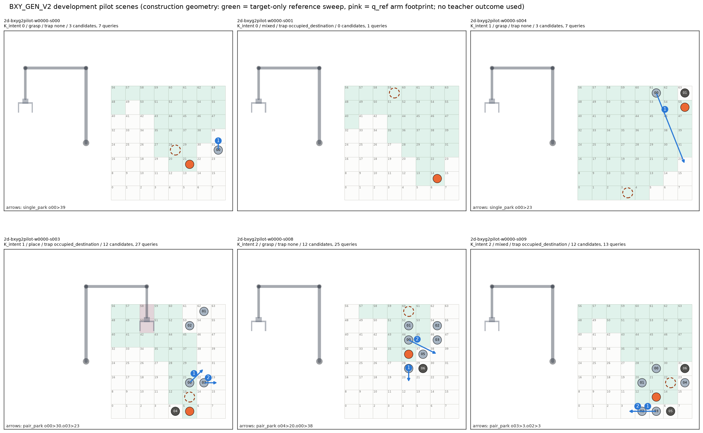
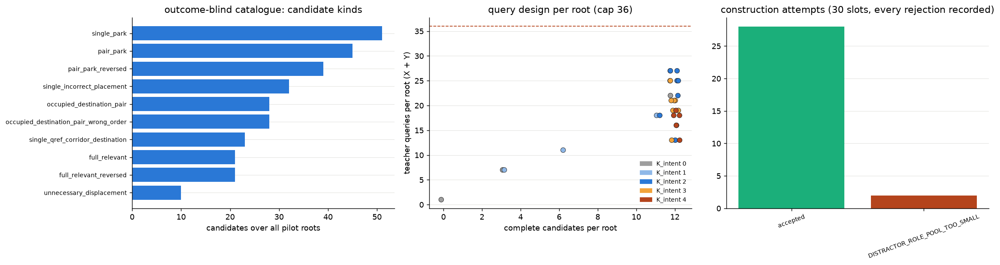
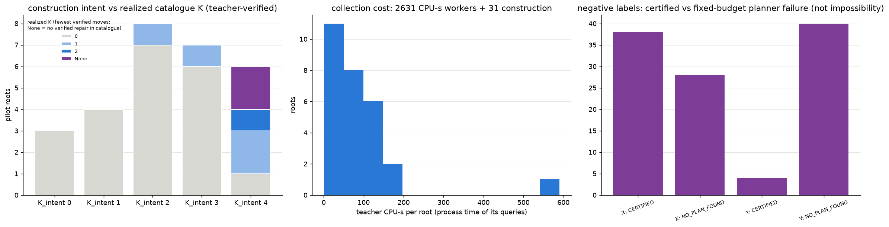
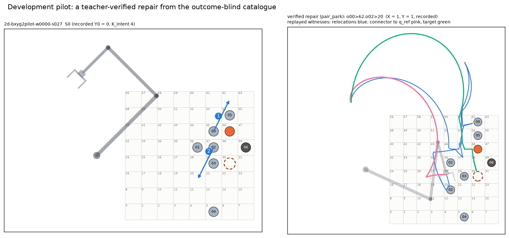

# 0122 — BXY-P15: outcome-blind harder-scene generator, development pilot, frozen confirmatory-cohort plan

Date: 2026-11-01. Gate: BXY-P15 (last of the BXY-P13 / P14 / P15 contract). Previous gate: 0121 (P14, commit `29bc09dd`).

Commits made before any teacher query:

| Commit | Content |
|---|---|
| `6dbb9e2c` | generator code |
| `f42828c0` | catalogue revision |
| `654f16be` | 28-root pilot, frozen pilot design and pilot authorization |

## Result

**Pipeline ready; confirmatory plan frozen; cohort not generated.**

The new deterministic generator **BXY_GEN_V2** works end to end:
- 30 slots attempted, 2 recorded geometric rejections, 28 roots.
- 514 frozen queries; **514 labelled, 0 censored, 0 replay failures, 0 identity mismatches**.
- Cost: 2,662 of the 8,000 authorized CPU-s (2,631 collection + 31 construction).

Its candidate catalogue never reads a teacher outcome. But its **difficulty realization is low**:
- 21 of 28 roots are feasible as-is.
- Only the K_intent 4 construction reliably yields initially infeasible roots (5 of 6).
- Only one root reached a verified K of 2.

The frozen 360-root plan therefore weights K_intent 4. From the pilot rates it expects about 163 initially infeasible roots, but only about
30 at K ≥ 2. That is 3.6× the infeasible roots and about 6× the K ≥ 2 roots of the historical 176-root development set, but K ≥ 2 coverage
stays modest (§6).

**Not done here:** no confirmatory root was generated, inspected or evaluated, and no model was run on any pilot root.

---

## 1. Generator (BXY_GEN_V2, [bxy_p15.py](../bxy_p15.py))

- **Root schema:** BD_GEN_V1 record fields, so the unchanged teacher (`bxy_teacher`, hash as in P-min) and F1 apply directly.
- **Construction**, deterministic from (namespace, wave, slot):
  - source, goal and start pose as in BD_GEN_V1;
  - **one reference planner call on the target-only scene** gives the nominal target sweep;
  - intended blockers come from the sweep's grasp / place / transfer pools, distractors from role pools, fixed structures off the sweep
    next to the anchors, and an optional **order trap** (a distractor on a blocker's natural parking cell).
- **Unlike BD_GEN_V1:** no populated scene is ever planned during construction — no witness chasing, no "fixed structures alone block"
  check, no K-based wave sampling. A root is rejected only for a geometric reason or an unverified target-only reference.
- **Namespaces:** `bxyg2pilot` (development) and `bxyg2confirm` (reserved; `generate("confirm")` raises). Root ids `2d-bxyg2…` and
  families `fam2-…` are disjoint from BD_GEN_V1 and from each other; tested.
- **Outcome-blind catalogue** (`candidates`), per sweep-relevant movable object:
  - nearest off-sweep parking cell;
  - an **incorrect placement** inside the sweep;
  - the free off-sweep cell nearest the q_ref arm footprint (**connector-to-q_ref corridor**);
  - an **occupied destination** (another object's cell: the free-first order and the **wrong order**, which F1 screens as
    DEST_OCCUPIED);
  - ordered **pairs in both orders** (order-sensitive relocations);
  - the full relevant set in two orders (**multi-obstacle**);
  - **unnecessary displacements** of non-relevant objects.
- **Catalogue order and caps:** the phenomena are drained round-robin under the caps of 12 candidates and 36 queries per root.
- **Query design** (`root_design`): the P-min PMIN_DEV_MATCHED classes — y0, complete X / Y, reversal X, single-action omission X / Y. F1
  runs on every query, and an inadmissible query is listed, never labelled. Unobserved prefixes remain marginalized.
- **Pre-freeze revision:** a first generation (31.1 CPU-s) let ordered pairs fill the cap, and no connector destination existed because
  the q_ref footprint lies outside the legal placement cells. I changed the catalogue order and destination rule from geometry only,
  before any teacher query, and regenerated. The scenes are deterministic and identical. The superseded CPU is recorded
  ([SUPERSEDED_GENERATION.json](../runs/approach_b/bxy_p15_v1/SUPERSEDED_GENERATION.json)) and counted against the 8,000 CPU-s.

## 2. Freezing, authorization and collection

- [PILOT_DESIGN.json](../runs/approach_b/bxy_p15_v1/PILOT_DESIGN.json) (sha `4b8cfaa7…`) records every root's record hash, catalogue and
  worklist. It was written once, before any query; `freeze()` refuses if results exist.
- [AUTHORIZATION_PILOT.json](../runs/approach_b/bxy_p15_v1/AUTHORIZATION_PILOT.json) records the limits (8,000 CPU-s including the
  construction calls, 800 per root, 4 workers, 7,200 s wall), the per-query budget (P-min QB, verified equal), and the design, runner and
  teacher hashes.
- **Collection:** the unchanged P-min supervisor (RLIMIT_CPU per root, memory gate, CENSORED on interruption) and the unchanged teacher
  functions (`x_query`, `y_query_counted`).
  - Spent 2,631 CPU-s over 1,023 s wall; 28 roots finished cleanly.
  - Mean 5.0 CPU-s per query (X 4.2, Y 5.8; max 68.7).
  - One root (`s026`) took 590 CPU-s.
- **Recorded:** [LEDGER.jsonl](../runs/approach_b/bxy_p15_v1/LEDGER.jsonl), per-query `results/` JSON, `witnesses/` (content-addressed
  trajectories), `logs/`.

## 3. Realized pilot outcomes (development only; [PILOT_SUMMARY.json](../runs/approach_b/bxy_p15_v1/PILOT_SUMMARY.json))

Realized K is the fewest moves among verified complete candidates *of the outcome-blind catalogue*. It is catalogue-relative and not
BD_GEN_V1's declared repair domain. "None" means no verified repair in the catalogue.

| K_intent | roots | realized K = 0 | 1 | 2 | None |
|---:|---:|---:|---:|---:|---:|
| 0 | 3 | 3 | — | — | — |
| 1 | 4 | 4 | — | — | — |
| 2 | 8 | 7 | 1 | — | — |
| 3 | 7 | 6 | 1 | — | — |
| 4 | 6 | 1 | 2 | 1 | 2 |

**Labels:**
- 202 of 268 X = 1 and 202 of 246 Y = 1.
- Negatives:
  - X: 38 CERTIFIED_INFEASIBLE, 23 UNKNOWN_PLANNER, 5 UNKNOWN_TRANSIT;
  - Y: 40 UNKNOWN_PLANNER, 4 CERTIFIED.
- Most Y zeros are fixed-budget planner failures, which reflect the teacher policy and are **not** geometric impossibility.

**Coverage of the requested phenomena among verified candidates:**
- single parking, incorrect placements, connector-corridor destinations, occupied-destination pairs (free-first order), ordered pairs in
  both orders, full relevant sets and unnecessary displacements all occur;
- the wrong-order occupied-destination variants are F1-screened, as designed.

`s027` (K_intent 4, Y0 = 0) is repaired by the verified two-move pair o00 → 62 · o02 → 20, drawn with its replayed relocations, terminal
connector to q_ref and target witnesses.

## 4. Why K_intent ≤ 3 rarely blocks

The reference sweep is one witness of a multi-mode side-grasp planner. Blockers on that sweep usually leave another grasp or approach mode
free. BD_GEN_V1 needed outcome-guided witness chasing to raise difficulty, and still produced 74 % K0 on the TRAIN split. Without chasing,
only the densest construction (four intended blockers plus fixed structures) closes enough alternatives.

## 5. Frozen confirmatory plan ([CONFIRM_PLAN.json](../runs/approach_b/bxy_p15_v1/CONFIRM_PLAN.json), sha `30fac794…`)

| Item | Frozen value |
|---|---|
| Namespace / generator | `bxyg2confirm`, BXY_GEN_V2 (this commit's code) |
| Roots | **360** |
| Composition (construction intent) | K_intent 0: 40, 1: 40, 2: 50, 3: 50, **4: 180**; other factors by the deterministic cycle of `specs()` |
| Rejections | a rejected slot retries the same spec at wave + 1, up to 5 times; every attempt is recorded; then the slot is dropped, not replaced |
| Queries | `root_design` (outcome-blind catalogue, P-min classes, F1), unchanged teacher hash and per-query budget |
| Stop rule | fixed root count; no interim look at labels or model outputs |
| Custody | generated only after every model, rule and metric of the confirmatory analysis is frozen; disjoint from BD_GEN_V1, the 34 exposed test roots and the pilot |
| Basis | pilot construction realization and cost only; no model was run on a pilot root, so composition is independent of model success |

**Expected from the pilot** (6–8 pilot roots per level, so indicative only):
- about **163 initially infeasible** roots, giving a worst-case 95 % half-width of **0.077** for a paired corrective-success difference;
- about **30 roots at K ≥ 2**;
- about **60 roots without a verified repair**;
- teacher cost about **94 CPU-s per root**, roughly 34,000 CPU-s for 360 roots.

## 6. What is still required before independent evaluation

1. **Learner-input adapter for V2 records.** The P11/P12/P14 models read `bxy_lb.records` inputs (geometry tensors plus DINOv2 visual
   tokens of a rendered image). That builder reads BD_GEN_V1 label / catalogue fields that V2 records do not have, so a label-free adapter
   is needed and must be tested for leakage before the cohort is scored.
2. **Frozen model, selection rule and metrics before generation.** The P14 candidate is XYQ+CON+GEO under PRIMARY, a pre-specified
   alternative being the same factors on the capacity-matched uncoupled head. It must be trained once on all development roots under a new
   authorization, then frozen.
3. **K ≥ 2 coverage is the weakest part of the plan.** If more than about 30 K ≥ 2 roots are needed, the remedy is a separately authorized
   V2.1 construction change with its own small pilot, frozen as a new plan version *before* any confirmatory root exists. Two remedies are
   possible: closing alternative grasp modes geometrically, or stratifying on teacher-verified K, which is outcome-based root selection but
   independent of model success.
4. **Authorization** for confirmatory generation and teacher collection (about 34,000 CPU-s).

## 7. Tests, regression, compute

- [tests/test_bxy_p15.py](../tests/test_bxy_p15.py): 6 passed. They cover:
  - determinism, including a construction test where the planner is replaced by a stored target-only witness;
  - catalogue and design unchanged under flipped or removed outcomes;
  - caps, F1 and classes;
  - phenomenon coverage;
  - the reserved namespace and disjoint ids / seeds;
  - the footprint;
  - plan totals.
- **Full suite:** **683 passed, 1 skipped, exit 0** (15 min 35 s). **Six archived replays:** exit 0 × 6.
  Logs: [regression/](../runs/approach_b/bxy_p15_v1/regression/).
- **Hash guards:** the P-min evidence, the P11 / P11.1 designs and locks, and the P12 and P14 authorizations all verify.
- **P15 compute:** 2,662 CPU-s of 8,000 (construction 31.1 + superseded 31.2 + collection 2,631, inclusive of all pilot planner calls);
  1,023 s collection wall of 7,200.
- After collection, `bxy_p15.py` gained only the plan helpers (`expected`, `plan`) and the frozen composition. The runner hash recorded at
  collection time is in the authorization, and `collect()` would now refuse to run again.

---

## 8. Integrated conclusion (P12 → P15, all development evidence)

**Is Approach B's factorization still justified?** Yes, as a diagnostic and supervision structure; it is not yet shown to be a performance
advantage.
- In P12 the X/Y models lost to DIRECT on corrective success.
- The factorization is what made P13's attribution possible: oracle substitution pinned about 40 % of the gap on the edited-scene Y factor
  and very little on X.
- It also enabled the targeted fix: P14's best model (XYQ+CON+GEO) beat DIRECT by +0.11 corrective success at an equal unnecessary-repair
  rate. The CI, [−0.007, +0.237], just includes 0.

**Does the quadratic interaction add measurable value?** No measurable value has been shown.
- P12: quadratic vs the capacity-matched uncoupled control was UNSUPPORTED (Δ log loss +0.011; 0 of 3 seeds improve).
- P14 kept XY-quadratic as the base of every arm, so it did not test coupling again.
- The fitted w is non-zero, but that is a parameter, not evidence that coupling is needed.
- Statistical X–Y coupling is not a demonstrated causal relation.

**Do the new interventions improve corrective selection?** Not under the frozen criterion.
- CON alone and GEO alone: no.
- CON + GEO together: corrective success +0.200 [+0.081, +0.326], Bonferroni-robust, but unnecessary repairs +0.112 against a +0.05
  guardrail, so it fails the rule.
- Mechanism: GEO is what made within-root edited-Y discrimination work (0.48 → 0.65). CON shifted the probabilities, at a calibration cost.
- What remains unlearned: predicting that an edit **breaks** a feasible scene (agreement 0.14). This drives most of the extra unnecessary
  repairs.
- Removing the selection penalty is not viable until that is learned.

**What independent evaluation requires.**
1. A label-free learner-input adapter for V2 roots.
2. One frozen model, selection rule and metric set, trained under a new authorization on all development roots.
3. Generation and teacher collection of the frozen 360-root `bxyg2confirm` cohort (about 34,000 CPU-s), with no interim look.
4. A single evaluation reporting corrective success, unnecessary repairs and overall success against no-op and DIRECT, by stratum.

Optionally, a separately authorized V2.1 difficulty revision could be frozen as a new plan version before step 3.

**STOP (P15).** No confirmatory cohort was generated, no further training or teacher collection is running, and no other phase has
started.
